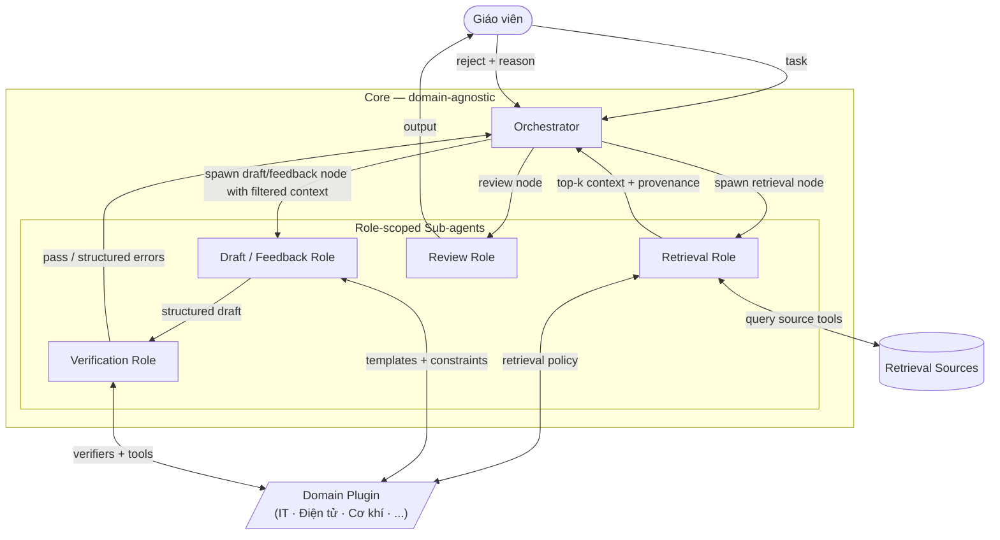

# Thiết kế và triển khai hệ thống — Chương 4

## Kiến trúc tổng quan: Core + Plugin

Hệ thống **không coupling** với một chuyên ngành cụ thể. Thiết kế theo mô hình **domain-agnostic core + domain-specific plugin** để giáo viên Lập trình, Điện tử, Cơ khí, ... đều sử dụng được.

Lưu ý về định vị đóng góp: các thành phần như LangGraph, typed schema, verifier, retry/repair, HITL và domain plugin không được trình bày như phát minh mới độc lập. Chương này tập trung vào cách tích hợp các kỹ thuật đó thành một workflow sư phạm có kiểm chứng, phù hợp với local small LLM và dữ liệu giáo viên nội bộ.

### Core (domain-agnostic)

- **LLM local**: Gemma 4 E2B / E4B (edge-optimized, chạy máy thường). Serve qua **llama.cpp** (nhúng trực tiếp, không cần cài riêng — phù hợp đóng gói Electron).
- **Embedding**: `bge-m3` (đa ngôn ngữ VN+EN) hoặc `nomic-embed-text-v2`.
- **Vector DB**: Qdrant local (embedded mode — không cần server riêng, bundle trong app).
- **Orchestration**: LangGraph — biểu diễn typed task graph có schema, verifier, retry policy và stop condition rõ ràng.
- **Multi-Agent System (MAS)**: supervisor điều phối các role-scoped sub-agent invocation theo từng task; không đóng cứng 4 agent luôn chạy (xem 4.4).
- **Desktop app**: Electron — main process quản lý child processes; MAS Python chạy trong child process; IPC bridge giữa Electron ↔ MAS ↔ llama.cpp.

### Domain Plugin (domain-specific)

Mỗi plugin đóng gói: metadata schema · task schemas · pedagogical constraints · prompt templates · retrieval policy · verifier/repair policy · tool set · corpus ingestion pipeline.

Plugin CNTT (lập trình) là plugin đầu tiên — validate kiến trúc core. Các plugin khác là hướng mở rộng.

### IPC Architecture

```
Electron Main Process
  ├── Renderer (UI)
  └── Child Process: MAS (Python/llama.cpp bindings)
        ├── Supervisor Orchestrator (LangGraph typed task graph)
        ├── Role-scoped Sub-agents (Planner / Generator / Verifier / Reviewer / ...)
        ├── Retriever (Qdrant embedded + bge-m3)
        └── LLM Backend (llama.cpp — Gemma 4 E2B/E4B)
```

---

## 4.1 Nguyên tắc HITL (Human-In-The-Loop)

HITL không phải tính năng tuỳ chọn — đây là **ràng buộc thiết kế cứng** của hệ thống, xuất phát từ bản chất của domain sư phạm:

> _Giáo viên là người chịu trách nhiệm pháp lý và đạo đức với học viên. Hệ thống chỉ là công cụ hỗ trợ soạn thảo — không bao giờ được tự động phát hành output đến học viên mà không qua tay giáo viên._

**Lý do HITL là "sống còn":**

- LLM hallucinate → kiến thức sai → học viên học sai → thiệt hại khó đảo ngược.
- Test case tự sinh có thể thiếu edge case → chấm code sai → điểm số không công bằng.
- Feedback không phù hợp có thể gây demotivation hoặc ảnh hưởng tâm lý học viên.
- Giáo viên biết ngữ cảnh lớp học (em này học chậm, lớp đang ôn thi, …) — LLM không biết.
- Bloom calibration sai → dạy sai trình tự kiến thức.

**Ba mức HITL trong hệ thống:**

| Mức | Tên                     | Mô tả                                                                           | Khi nào                      |
| --- | ----------------------- | ------------------------------------------------------------------------------- | ---------------------------- |
| L1  | **Hard gate**           | Output bị giữ lại, không thể đến học viên nếu chưa được duyệt                   | Grading feedback — luôn luôn |
| L2  | **Soft review**         | Hiển thị confidence score + cảnh báo; giáo viên có thể approve nhanh hoặc edit  | Lesson plan, exercise draft  |
| L3  | **Override & feedback** | Giáo viên reject + ghi lý do → lý do được inject lại vào agent prompt khi retry | Mọi output bị reject         |

**HITL checkpoint trong typed task graph:**

```
DraftLessonPlan        →  [L2: Soft Review]  →  approved / edited
DraftExercise          →  [L2: Soft Review]  →  approved / edited
DraftFeedback          →  [L1: Hard Gate]    →  sent to student
CheckPedagogicalOutput →  [L3: teacher override nếu reject]
```

**Thiết kế UI cho HITL:**

- **Review Queue**: panel chứa tất cả output đang chờ duyệt, sorted by task type.
- **Diff view**: highlight phần AI tạo vs phần giáo viên đã edit (audit trail).
- **Confidence badge**: mỗi output kèm mức độ tin cậy từ verifier/constraint checks (citation coverage + pedagogical score).
- **Reject with reason**: textarea ghi lý do → prepend vào prompt retry dưới dạng constraint.
- **Audit log**: lưu mọi action (approve/edit/reject) với timestamp.

**HITL trong corpus labeling**: Bloom label + metadata do LLM gợi ý → export CSV → giáo viên/domain expert review → import lại. Không index chunk chưa được xác nhận.

**Implication cho nghiên cứu**: edit rate + reject rate là metric thực tiễn — bổ sung vào 4.9 nếu thu thập được, hoặc ghi nhận là hướng đánh giá tương lai.

---

## 4.2 Tổng quan kiến trúc core + plugin



> Retrieval được tách thành node/sub-agent riêng để tránh nhồi toàn bộ retrieval capability vào mọi role. Các role sinh nội dung chỉ nhận context đã lọc kèm provenance, giúp giảm prompt size và tool surface cho local small LLM. Core không chứa logic domain-specific nào; plugin là điểm mở rộng duy nhất.

---

## 4.3 Cơ sở thiết kế kiến trúc Core + Plugin

Đề tài hướng đến hỗ trợ giáo viên **các ngành kỹ thuật nói chung** (IT, Điện tử, Cơ khí, Xây dựng...). Để kiến trúc có thể mở rộng sang các ngành khác mà không phải viết lại hệ thống, cần xác định rõ: tác vụ nào là bất biến (_core_), tác vụ nào đòi hỏi tri thức và công cụ chuyên biệt (_plugin_).

### Đặc thù chung của domain kỹ thuật

Các ngành kỹ thuật chia sẻ một số đặc điểm sư phạm chung, phân biệt với các lĩnh vực hàn lâm thuần tuý:

| Đặc thù                    | Biểu hiện                                                                                     | Ý nghĩa với hệ thống                                        |
| -------------------------- | --------------------------------------------------------------------------------------------- | ----------------------------------------------------------- |
| **Thực hành với công cụ**  | Lab, project, simulation — học qua làm                                                        | Bài tập luôn có exercise_type + tool context                |
| **Verify được bằng máy**   | Chạy code, chạy mạch điện, kiểm tra tính toán — đáp án có tính khách quan                     | verify() là hook bắt buộc trong plugin interface            |
| **Tiêu chuẩn kỹ thuật**    | PEP8 (IT), IEEE (Điện tử), TCVN/ISO (Cơ khí) — "đúng" phải tuân theo chuẩn                    | domain_quality_checks() cần biết chuẩn của từng ngành       |
| **Error taxonomy đặc thù** | Off-by-one (IT), ngắn mạch (Điện tử), safety factor sai (Cơ khí) — lỗi mang tính chuyên ngành | error_taxonomy và feedback_template không thể dùng chung    |
| **Bloom áp dụng được**     | Mọi ngành đều có Remember → Apply → Evaluate trên nội dung kỹ thuật                           | Bloom metadata và corpus indexing là chung, domain-agnostic |

### Điểm riêng buộc phải thành plugin

Bảng dưới minh họa sự khác biệt không thể share qua ba domain kỹ thuật cụ thể — IT, Điện tử và Cơ khí:

| Thành phần plugin       | IT (Lập trình)                                    | Điện tử _(minh họa)_                                   | Cơ khí _(minh họa)_                                      |
| ----------------------- | ------------------------------------------------- | ------------------------------------------------------ | -------------------------------------------------------- |
| `exercise_types`        | Implementation / Debug / Trace / Design           | Circuit Design / Simulation / Analysis / Fault Finding | Stress Analysis / Mechanism Design / Manufacturing / CAD |
| `verify_solution()`     | `PytestRunner` — chạy test case, pass/fail        | `SPICERunner` — chạy simulation, check waveform        | `FEMChecker` — check stress/strain, safety factor        |
| `error_taxonomy`        | off-by-one, mutate-while-iterate, wrong-base-case | wrong-polarity, short-circuit, impedance-mismatch      | unit-mismatch, safety-factor-violation, tolerance-error  |
| `feedback_template`     | Code block + inline comment + fix suggestion      | Circuit diagram annotation + formula derivation        | Engineering drawing markup + calculation correction      |
| `domain_quality_checks` | Compile check + code style (PEP8)                 | Unit consistency + component rating (IEEE std)         | Dimensional consistency + material standard (TCVN/ISO)   |
| `corpus_pipeline`       | Chunk code + docstring, tag by language/framework | Chunk datasheet + schematic, tag by component/topology | Chunk drawing + spec sheet, tag by material/process      |

**Kết luận phân tách:**

- **Core** = _workflow logic_: lesson planning flow, exercise design flow, grading flow, quality review flow — bất biến giữa mọi domain kỹ thuật.
- **Plugin** = _domain knowledge + tools_: toàn bộ các thành phần trong bảng trên — thay đổi hoàn toàn theo từng ngành.

**Plugin IT** trong luận văn đóng vai trò _proof-of-concept_: validate rằng interface plugin đủ biểu đạt cho một domain kỹ thuật phức tạp, đồng thời mở đường để thêm plugin mới mà không thay đổi core.

---

## 4.4 Typed Task Graph Orchestration

Typed task graph trong hệ thống là một lựa chọn thiết kế để kiểm soát agentic workflow, không phải claim thuật toán mới. Core không định nghĩa một tập 4 agent cố định. Thay vào đó, hệ thống dùng **Supervisor Orchestrator** để phân tích yêu cầu giáo viên, chọn graph template phù hợp và thực thi các node theo thứ tự có kiểm soát. Mỗi node có thể gọi một role-scoped sub-agent invocation của cùng local LLM, với prompt, tool access, retrieval policy và output schema riêng.

**Task node contract**:

```python
class TaskNodeSpec(BaseModel):
    node_id: str
    role: str
    input_schema: type[BaseModel]
    output_schema: type[BaseModel]
    allowed_tools: list[str]
    retrieval_policy: RetrievalPolicy
    verifier: VerifierSpec | None
    retry_policy: RetryPolicy
    stop_condition: StopCondition
```

**Message protocol**:

```python
{
    "task_id": str,
    "node_id": str,
    "role": str,
    "plugin_id": str,
    "input": dict,
    "context_chunks": list[Chunk],
    "output": dict,
    "citations": list[Citation],
    "verification": VerificationResult | None,
    "repair_history": list[RepairAction],
}
```

### Graph template theo task

**Lesson planning**:

```
NormalizeRequest
  → RetrieveConcepts
  → DraftLessonPlan
  → CheckBloomAlignment
  → CheckConstructiveAlignment
  → CheckCitationCoverage
  → HITLGate
```

**Exercise generation**:

```
NormalizeRequest
  → RetrieveExamples
  → DraftExercise
  → GenerateReferenceSolution
  → GenerateTests
  → RunDomainVerifier
  → CheckPedagogicalConstraints
  → HITLGate
```

**Code grading / feedback**:

```
NormalizeSubmission
  → RunDomainVerifier
  → ClassifyErrors
  → RetrieveExplanations
  → DraftFeedback
  → CheckFeedbackPolicy
  → HITLGate
```

### Role-scoped sub-agents

Sub-agent trong luận văn được định nghĩa thực dụng: **một lần gọi LLM có role, prompt, tool scope và state riêng**, không nhất thiết là process/model riêng. Supervisor chỉ spawn role khi graph cần node tương ứng.

| Role | Khi được gọi | Tool/retrieval scope |
| --- | --- | --- |
| `RetrievalRole` | Cần theory/example/explanation chunk | VectorSearch, KnowledgeGraph, DiskReader tùy task |
| `LessonDraftRole` | Soạn giáo án | Corpus theory, activity templates, Bloom metadata |
| `ExerciseDraftRole` | Sinh đề/lời giải/test | Example chunks, generation templates, verifier schema |
| `VerificationRole` | Kiểm tra code/test/citation/Bloom | PytestRunner, linter, citation checker, constraint checker |
| `FeedbackRole` | Sinh feedback chấm bài | Error taxonomy, misconception mapping, feedback template |
| `ReviewRole` | Kiểm tra output cuối | Pedagogical constraints, citation coverage, HITL policy |

### Verification-guided repair loop

Verification-guided repair kế thừa ý tưởng kiểm chứng và tự sửa lỗi trong các hệ thống agent/code generation, nhưng được giới hạn vào các component sư phạm-kỹ thuật cụ thể. Retry không dùng prompt chung kiểu "try again". Mỗi verifier trả lỗi có cấu trúc để Supervisor quyết định sửa thành phần nào:

```python
class VerificationError(BaseModel):
    error_type: str                 # compile_error, edge_case_failure, off_bloom, unsupported_claim, ...
    failed_component: str           # exercise, solution, tests, citation, feedback, ...
    evidence: dict                  # traceback, failed test, unsupported claim, violated rubric item
    repair_action: str              # regenerate_solution, add_edge_tests, replace_citation, revise_feedback
```

Ví dụ: nếu `RunDomainVerifier` phát hiện lời giải mẫu fail ở edge case, Supervisor chỉ gọi lại node `GenerateReferenceSolution` với ràng buộc sửa edge case đó; không regenerate đề bài và test đã pass. Nếu `CheckCitationCoverage` phát hiện citation không hỗ trợ claim, Supervisor chỉ gọi lại retrieval/citation repair.

### Core constraints

Các constraint bất biến giữa domain:

- **Bloom alignment**: output phải khớp cấp độ nhận thức yêu cầu.
- **Constructive alignment**: mục tiêu học tập, hoạt động học và đánh giá không mâu thuẫn.
- **Citation coverage**: claim quan trọng phải có source chunk hỗ trợ.
- **Rubric consistency**: đề, lời giải, test case và thang điểm phải nhất quán.
- **Feedback policy**: feedback phải giải thích lỗi và gợi ý sửa, không chỉ báo đúng/sai.
- **HITL gate**: output không được phát hành đến học viên nếu chưa được giáo viên duyệt.

---

## 4.5 Plugin System

**Plugin Interface** (contract mọi plugin phải implement):

```python
class DomainPlugin(ABC):
    plugin_id: str

    # Corpus
    metadata_schema: dict
    corpus_pipeline: CorpusPipeline
    retrieval_policies: dict[str, RetrievalPolicy]

    # Typed task graph
    task_schemas: dict[str, TaskSchema]
    graph_templates: dict[str, TaskGraphSpec]

    # Pedagogical constraints
    bloom_mapping_rules: dict
    learning_objective_templates: dict[str, Template]
    rubric_schema: dict
    misconception_taxonomy: dict[str, str]
    feedback_policy: dict
    citation_policy: dict
    hitl_policy: dict

    # Lesson planning
    activity_types: list[str]
    section_format: dict[str, Template]
    prerequisite_graph: TopicGraph | None

    # Exercise design
    exercise_types: list[str]
    generation_template: dict[str, Template]
    def verify_solution(self, solution: str) -> bool: ...

    # Grading
    def verify(self, submission: str) -> VerificationResult: ...
    feedback_template: Template

    # Verification + repair
    def domain_quality_checks(self, output: str) -> list[CheckResult]: ...
    def map_verification_error(self, error: VerificationError) -> RepairAction: ...
```

**Plugin CNTT (Lập trình)** — implementation:

_Metadata schema_: `bloom_level` · `topic` (CS topic slug) · `difficulty` · `language` (`python/java/any`) · `content_type` (`theory/example/exercise/solution`).

_activity_types_: `[theory_block, live_code_demo, guided_practice, independent_exercise]`.

_exercise_types_: `[Implementation, Debug, Trace, Design]` — mỗi type có generation prompt riêng.

_verify_solution_: `PytestRunner` chạy generated test suite → `True` nếu pass ≥ 90%.

_verify(submission)_: `PytestRunner` (pass rate) + `Linter` (ruff violations) → `VerificationResult{pass_rate, lint_issues[], runtime_errors[]}`.

_error_taxonomy_: `off-by-one` · `mutate-while-iterate` · `variable-shadow` · `wrong-base-case` · `missing-return` · `type-confusion`.

_feedback_template_: code block highlight lỗi + inline comment + citation textbook section.

_domain_quality_checks_: `CodeSyntaxValidator` (compile check) + language consistency.

_Tool set Plugin CNTT_:

- `CodeSyntaxValidator`: parse AST Python/Java, phát hiện syntax error.
- `PytestRunner`: subprocess isolated, timeout 10s, `resource.setrlimit` (no network, no fs write).
- `Linter`: `ruff check` → violation list + severity.
- `ASTAnalyzer`: cyclomatic complexity, unused var, naming → map sang misconception.
- `TopicDependencyGraph`: đồ thị CS topic tĩnh (arrays → sorting → searching → graph…).

_Corpus ingestion_: PDF/HTML giáo trình (Python Crash Course, CLRS, giáo trình nội bộ) + slide + bài tập có đáp án. Chunk tại heading/code-block boundary (chunk_size=512, overlap=64). LLM gợi ý bloom+content_type → export CSV review → import Qdrant.

---

## 4.6 Retrieval Sub-agent

_(Cơ sở lý thuyết: §3.3 — Agentic RAG Survey \[`AgenticRAGSurvey2025`\], A-RAG \[`ARAG2025`\], GraphRAG \[`Edge2024GraphRAG`\])_

`RetrievalRole` là một **sub-agent/node riêng trong typed task graph**, không phải base capability nhúng vào mọi agent. Supervisor gọi retrieval node trước các node sinh nội dung, truyền vào `{task_type, topic, bloom_target, plugin_id, retrieval_policy}` và chỉ chuyển tiếp `top-k` context đã rerank kèm provenance cho các role downstream.

Lý do tách retrieval thành sub-agent:

- Giảm context size cho các role sinh nội dung; chúng không cần biết toàn bộ source/tool plan.
- Giảm tool surface, tránh local small LLM phải chọn giữa quá nhiều retrieval tool trong cùng prompt.
- Dễ ablation retrieval policy và đo riêng retrieval quality.
- Cho phép cache kết quả retrieval theo task/node và tái sử dụng giữa draft, verification và citation repair.

### Kiến trúc nội bộ

```
RetrievalRole  (graph node do Supervisor gọi khi cần)
├── QueryPlanner          — LLM call nhỏ (≤ 128 token): phân tích query + bloom_target → tool_plan
├── Source Tools (parallel)
│   ├── VectorSearchTool  — Qdrant (bge-m3) + payload filter (bloom, topic, language)
│   ├── DiskReaderTool    — đọc trực tiếp file trên disk (PDF/DOCX/slide chưa index)
│   ├── WebSearchTool     — tìm kiếm web (opt-in, teacher-controlled; tắt mặc định)
│   ├── ConnectorTool[]   — plugin-specific: Google Drive, Google Classroom (OAuth)
│   └── KnowledgeGraphTool— topic dependency graph (plugin-provided) + concept graph từ corpus
├── ResultAggregator      — merge kết quả, gắn provenance metadata
└── CrossSourceReranker   — bge-reranker-v2-m3 + source trust weighting
```

### QueryPlanner

Nhận `{task_type, bloom_target, topic, plugin_id}` → quyết định tool nào kích hoạt:

| Task                   | Tools ưu tiên                                                                |
| ---------------------- | ---------------------------------------------------------------------------- |
| Lesson planning        | VectorSearch (theory) + KnowledgeGraph (prerequisite chain)                  |
| Exercise design        | VectorSearch (example) + KnowledgeGraph (topic scope) + Connector (syllabus) |
| Grading                | VectorSearch (explanation) + DiskReader (rubric file)                        |
| Web-augmented (opt-in) | + WebSearch nếu topic mới / chưa có trong corpus                             |

QueryPlanner là LLM call nhỏ (Gemma E2B, ≤ 128 token output) nằm trong `RetrievalRole`; kết quả là `tool_plan: list[ToolCall]`. Các role khác không thấy tool plan này, chỉ nhận retrieved context đã lọc.

### Source Tools

**VectorSearchTool**: embed query bằng `bge-m3` → hybrid search Qdrant (vector + payload filter `bloom_level`, `topic`, `language`) → top-20 candidates.

**DiskReaderTool**: đọc file chưa index (giáo viên drop vào session folder) theo chunk tạm thời; không persist vào Qdrant. Hữu ích cho tài liệu one-off (đề thi cũ, rubric cụ thể).

**WebSearchTool**: disabled mặc định; giáo viên bật per-session từ UI. Kết quả gắn flag `source=web` + warning trong Review Queue (tài liệu web chưa kiểm chứng).

**ConnectorTool**: plugin-specific — Plugin CNTT có thể cung cấp `GoogleClassroomConnector` (fetch assignment, submission) và `GoogleDriveConnector` (fetch tài liệu giảng dạy). Yêu cầu OAuth; token lưu local, không sync cloud.

**KnowledgeGraphTool**: hai lớp — (1) static topic graph do plugin cung cấp (`TopicDependencyGraph`); (2) dynamic concept graph tự xây từ corpus bằng entity extraction (optional, heavy). Dùng để expand query theo prerequisite chain và tránh recommend nội dung học viên chưa có nền tảng.

### ResultAggregator & CrossSourceReranker

Mọi kết quả được gắn provenance: `{source_type, source_id, chunk_text, bloom_level, confidence, freshness}`.

CrossSourceReranker dùng `bge-reranker-v2-m3` với source trust weighting:

| Source                                    | Trust weight mặc định |
| ----------------------------------------- | --------------------- |
| VectorSearch (indexed + HITL-verified)    | 1.0                   |
| DiskReader (chưa verify)                  | 0.8                   |
| Connector (corpus giáo viên, có cấu trúc) | 0.9                   |
| WebSearch (nguồn ngoài)                   | 0.6                   |

Top-5 final chunks được trả về kèm provenance → Supervisor truyền vào các node downstream dưới dạng `context_pack`. Nếu verifier phát hiện citation không hỗ trợ claim, Supervisor gọi lại `RetrievalRole` ở chế độ citation repair thay vì yêu cầu draft role tự retrieve.

### Privacy & opt-in

- WebSearch tắt mặc định — tài liệu nội bộ không leak.
- ConnectorTool chỉ active khi giáo viên authorize OAuth session.
- DiskReader chỉ đọc trong session folder được giáo viên chỉ định.
- Mọi external source fetch được log trong Audit log (xem §4.1 HITL).

---

## 4.7 llama.cpp Integration

- Nhúng `llama-cpp-python` trong Python child process — không cần server riêng.
- Model load một lần khi khởi động app; giữ context window tối đa của Gemma 4 E2B/E4B.
- Prompt caching: tái dùng KV cache cho system prompt + retrieved chunks ở đầu mỗi agent call.
- Fallback VRAM (theo thứ tự thử): (1) giảm quantization xuống Q2_K; (2) bật CPU offload một phần (`n_gpu_layers` giảm dần); (3) giảm `n_ctx` (context window) xuống 4 096; (4) nếu vẫn không đủ, thông báo lỗi rõ ràng cho người dùng.

---

## 4.8 Guardrails

_(Cơ sở lý thuyết: §3.7 — AGrail \[`Luo2025AGrail`\], ToolSafe \[`Zhang2025ToolSafe`\], prompt injection \[`Perez2022`\])_

Ba tầng độc lập, không thay thế HITL:

- **Input**: topic relevance (zero-shot Gemma), prompt injection detect, PII scrub, length/budget check.
- **Output**: citation coverage ≥ 0.6, code safety blocklist (`os.system`, network call), Bloom mismatch flag (lệch > 1 bậc).
- **Tool sandbox**: `PytestRunner` dùng `resource.setrlimit` (CPU 10 s, RAM 256 MB, no network, no fs write) — theo ToolSafe step-level principle. Mọi tool có timeout cứng; timeout → `VerificationResult{pass_rate=0, error="timeout"}`.

Calibration: false positive gây friction cho giáo viên → threshold dễ hơn so với guardrail an toàn dữ liệu thông thường; false negative (output sai) vẫn bắt được qua HITL.

---

## 4.9 Context Management

_(Cơ sở lý thuyết: §3.6 — ACON \[`Kang2025ACON`\], Lost in the Middle \[`Liu2023LostInMiddle`\], Context Engineering \[`ContextEngineering2025`\])_

**Budget cố định** (tổng ≤ 8 192 token — context window Gemma 4 E2B):

| Slot             | Giới hạn |
| ---------------- | -------- |
| System prompt    | ≤ 512    |
| Retrieved chunks | ≤ 2 048  |
| History summary  | ≤ 512    |
| Task instruction | ≤ 256    |
| Output reserve   | ≥ 1 024  |

Nếu vượt budget → cắt `history_summary` trước, rồi giảm retrieved chunks.

**Conversation compaction**: sau mỗi task hoàn thành (hoặc khi history > 1 500 token), LLM call riêng compress history thành ≤ 200 token — ý tưởng từ ACON, đơn giản hoá vì single local LLM.

**Chain depth limit**: max 3 retry per task; sau 3 lần fail → đẩy draft lên Review Queue với flag `⚠ needs_human_revision`.

**Agent federation**: mọi LLM call qua Orchestrator (single backend); agent chỉ build prompt + parse output — Orchestrator kiểm soát KV cache và budget tập trung.

---

## 4.10 Memory Architecture

_(Cơ sở lý thuyết: §3.5 — Sumers taxonomy \[`Sumers2024`\], MemGPT \[`Packer2023`\], episodic memory \[`Vo2025Episodic`\])_

4 tầng ánh xạ lên taxonomy Sumers (2024):

| Tầng           | Tên                                  | Storage                          | Vòng đời            |
| -------------- | ------------------------------------ | -------------------------------- | ------------------- |
| M1 — Working   | State task hiện tại                  | LangGraph state dict (RAM)       | Trong 1 task        |
| M2 — Episodic  | Conversation history + corrections   | SQLite `session.db`              | Đến khi xóa session |
| M3 — Long-term | Teacher profile + correction pattern | SQLite `profile.db` (persistent) | Vĩnh viễn           |
| M4 — Semantic  | Corpus giáo trình nội bộ             | Qdrant embedded                  | Update khi import   |

**Luồng ghi từ L3 Override**: reject reason → M2 (immediate) → M3 nếu pattern lặp ≥ 3 lần → inject vào system prompt retry.

**Luồng đọc khi bắt đầu task**: Orchestrator prepend teacher preferences (M3) + N correction gần nhất (M2) vào system prompt slot ≤ 512 token trước khi gọi LLM.

**Privacy**: M2 + M3 local only, không sync cloud; giáo viên xóa từng session hoặc toàn bộ profile từ UI.

---

## 4.11 Electron Desktop App

- **Main process** (Node.js): quản lý lifecycle, spawn child process Python MAS, expose IPC channel.
- **Renderer** (React/Vue): UI giáo viên — workspace chọn plugin, soạn yêu cầu, xem output + citation highlight, Review Queue (HITL).
- **IPC bridge**: `ipcMain`/`ipcRenderer` ↔ child process qua `child_process.spawn` + JSON-line protocol.
- **Child process** (Python): toàn bộ MAS + llama.cpp + Qdrant embedded. Nhận lệnh từ main, stream response về.
- Packaging: `electron-builder` → `.dmg` / `.exe` / `.AppImage`. Bundle model GGUF riêng (download lần đầu qua UI).

---
