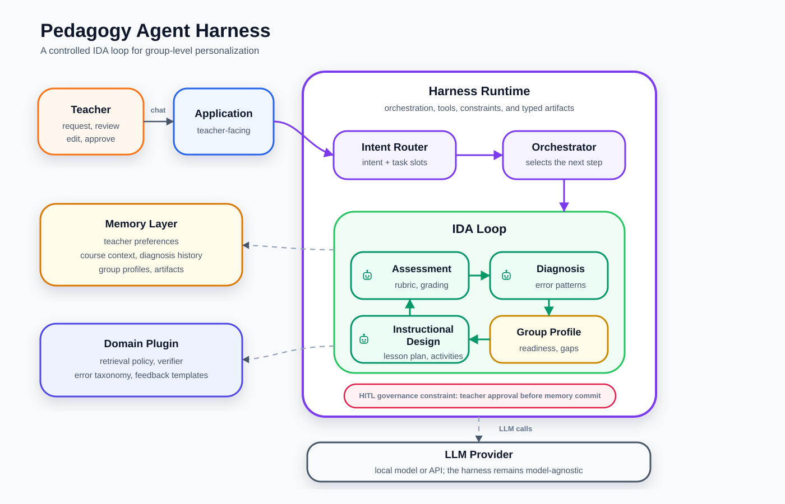

# Chương 3 — Proposed Method: Pedagogy Agent Harness

## 3.1 Định vị thiết kế

Luận văn đề xuất **Pedagogy Agent Harness**: một execution environment kết hợp với LLM để tạo thành Pedagogy Agent theo công thức:

```
Pedagogy Agent = LLM + Pedagogy Agent Harness
```

Trong đó, LLM cung cấp năng lực ngôn ngữ, reasoning và generation; còn harness cung cấp những thành phần mà một chatbot tổng quát không có: memory theo phạm vi sư phạm, orchestration có kiểm soát, tool execution, domain plugin, schema validation, verifier, context injection và teacher-in-the-loop governance.

Thiết kế của harness bám theo bốn lớp đã nêu ở Chương 1:

1. **Memory layer**: quản lý ngữ cảnh theo ba phạm vi `GlobalMemory`, `WorkspaceMemory` và `SessionMemory`.
2. **Orchestration mechanism**: vận hành IDA Loop bằng typed workflow graph với bốn role/sub-agent: `Orchestrator`, `Diagnosis Agent`, `Instructional Design Agent` và `Assessment Agent`.
3. **Tools & sandbox**: cung cấp retriever, profile synthesizer, schema validator, verifier và domain plugin chạy trong môi trường kiểm soát.
4. **Hooks & HITL governance**: đặt checkpoint tất định tại các điểm sinh artifact, cập nhật profile, retry và commit memory.

Đóng góp của chương này không nằm ở việc đề xuất một thuật toán LLM mới, mà ở cách cấu hình và tích hợp các thành phần trên thành một harness phù hợp với bối cảnh sư phạm: giáo viên thiết kế dạy học, đánh giá, chẩn đoán nhóm học sinh, điều chỉnh kế hoạch, rồi tiếp tục đánh giá ở vòng sau.

## 3.2 Kiến trúc tổng thể

Luồng vận hành chính của hệ thống là **IDA Loop** (Instructional Design–Assessment Loop):

```
Assessment
  -> Diagnosis
  -> StudentGroupProfile
  -> Instructional Design
  -> Teaching
  -> Assessment
  -> ...
```

Trong phạm vi prototype, giáo viên tương tác với hệ thống qua giao diện chat. Mọi input từ giáo viên đi qua `IntentRouter`, sau đó được `Orchestrator` chuyển thành một graph execution tương ứng. Graph execution có thể tạo kế hoạch bài dạy, sinh đề, tạo rubric, chấm bài, tổng hợp diagnosis, đề xuất cập nhật profile hoặc trả lời truy vấn về memory.

Sơ đồ logic:

```
[Chat UI]
    <-> IPC
[Main Process / Harness Runtime]
    -> IntentRouter
    -> Orchestrator
    -> Typed Workflow Graph
         -> ContextInjection
         -> Retrieval / Tool Use
         -> Role-specific Agent Node
         -> SchemaValidation
         -> PedagogicalVerifier
         -> DomainVerifier?
         -> HITLGate
         -> MemoryCommit
    <-> Memory Store
    <-> LLM Provider
    <-> Domain Plugin?
```

Về triển khai, harness có thể được hiện thực bằng LangGraph.js hoặc một state machine tương đương trong Electron main process. UI không gọi LLM trực tiếp; UI chỉ gửi request qua IPC và nhận streaming token, status update, artifact draft và HITL prompt từ harness runtime.

### Figure 3.1 — Tổng quan phương pháp Pedagogy Agent Harness

Hình 3.1 là figure chính của phương pháp đề xuất. Thay vì trình bày toàn bộ node kỹ thuật, hình này nhấn mạnh trực giác thiết kế: giáo viên làm việc với một harness sư phạm; `Orchestrator` điều phối IDA Loop; assessment tạo diagnosis; diagnosis cập nhật `StudentGroupProfile`; profile quay lại dẫn dắt thiết kế dạy học và đánh giá ở vòng sau. Memory, domain plugin, verifier và HITL là các lớp kiểm soát bao quanh vòng lặp này.



**Diễn giải hình**: vòng xanh lá là IDA Loop, nơi assessment tạo diagnosis, diagnosis cập nhật profile nhóm, và profile dẫn dắt instructional design ở vòng sau. Khối vàng là memory duy trì continuity; khối tím là orchestration; khối xanh lam là domain plugin; dải đỏ là HITL governance như một ràng buộc xuyên suốt, bảo đảm giáo viên giữ quyền quyết định cuối cùng trước khi commit vào memory.

## 3.3 Orchestration mechanism

### 3.3.1 Nguyên tắc thiết kế

Orchestration mechanism không để một ReAct agent tự do quyết định toàn bộ quá trình bằng prompt. Thay vào đó, harness dùng một **typed workflow graph**: mỗi node có input schema, output schema, tool quyền hạn, checkpoint và transition rule rõ ràng.

Thiết kế này có bốn mục tiêu:

1. **Kiểm soát trách nhiệm**: mỗi role/sub-agent chỉ xử lý một loại quyết định sư phạm.
2. **Giảm error propagation**: output quan trọng phải qua schema validation, verifier và HITL trước khi trở thành input cho vòng sau.
3. **Duy trì IDA Loop**: assessment không kết thúc ở feedback, mà sinh diagnosis và cập nhật `StudentGroupProfile`.
4. **Đánh giá được**: trajectory của graph có thể log lại để đo tool-call correctness, retry count, verifier pass rate, latency và failure mode.

### 3.3.2 Bốn role/sub-agent

Harness triển khai bốn role chính. Các role này có thể dùng cùng một LLM backend, nhưng khác nhau ở system prompt, tool access, input/output schema và checkpoint.

| Role | Trách nhiệm | Input chính | Output chính | Tool quyền hạn |
| --- | --- | --- | --- | --- |
| `Orchestrator` | Điều phối graph, định tuyến intent, chọn node kế tiếp, quản lý HITL và commit | Teacher input, graph state, validation/verifier result | Next node, HITL request, commit decision | Memory read/write có kiểm soát, router, validators |
| `Diagnosis Agent` | Chuyển kết quả đánh giá thành chẩn đoán nhóm học sinh | Grading result, rubric, submissions, old profiles | `GroupDiagnosis`, misconception labels, profile update proposal | Error taxonomy, profile synthesizer |
| `Instructional Design Agent` | Sinh kế hoạch bài dạy và hoạt động phân hoá | Topic, Bloom target, course context, student profiles | Lesson plan, differentiated activities | Retriever, pedagogical templates |
| `Assessment Agent` | Sinh rubric, đề, bài tập, chấm bài và feedback | Topic, difficulty, submissions, profiles | Assessment artifact, grading result, feedback | Retriever, rubric templates, domain verifier nếu có |

Điểm quan trọng là `Orchestrator` không phải agent sinh nội dung sư phạm chính. Nó là controller của graph: nhận trạng thái hiện tại, kiểm tra output từ các node, quyết định transition, mở HITL checkpoint, retry node lỗi hoặc commit artifact đã được duyệt.

### 3.3.3 Graph state

Mỗi lần xử lý một request của giáo viên, harness tạo một `WorkflowState`. State này là nguồn dữ liệu duy nhất cho các transition trong graph.

```typescript
interface WorkflowState {
  workflow_id: string
  workspace_id: string
  session_id: string
  teacher_id: string

  intent: Intent
  intent_confidence: number
  status: "running" | "need_clarification" | "waiting_hitl" | "completed" | "failed"

  input: TeacherRequest
  context_pack?: ContextPack

  active_node?: WorkflowNode
  draft_artifacts: ArtifactDraft[]
  validation_results: ValidationResult[]
  verifier_results: VerifierResult[]
  hitl_decisions: HITLDecision[]

  diagnosis_output?: GroupDiagnosis[]
  profile_update_proposal?: StudentGroupProfilePatch[]

  retry_count_by_node: Record<string, number>
  trace: WorkflowTraceEvent[]
}
```

Các artifact được sinh ra trong graph ở trạng thái `draft`. Chúng chỉ được ghi vào `WorkspaceMemory.ArtifactLog` sau khi qua HITL Gate. Tương tự, `StudentGroupProfile` chỉ được cập nhật sau khi giáo viên approve hoặc edit proposal.

### 3.3.4 Node và transition

Graph được mô tả ở mức logic như sau:

```text
TeacherInput
  -> IntentRouter
  -> Orchestrator
       -> NEED_CLARIFICATION
       -> QUERY_MEMORY
       -> UPDATE_PROFILE
       -> UC_ID_GRAPH
       -> UC_AS_GRAPH
       -> FEEDBACK_REVISION

UC_ID_GRAPH
  -> ContextInjection
  -> Retrieval
  -> InstructionalDesignAgent
  -> SchemaValidation
  -> PedagogicalVerifier
  -> HITLGate
  -> MemoryCommit

UC_AS_GRAPH
  -> ContextInjection
  -> AssessmentAgent
  -> SchemaValidation
  -> DomainVerifier?
  -> PedagogicalVerifier
  -> DiagnosisAgent
  -> ProfileSynthesis
  -> HITLGate
  -> MemoryCommit
```

Transition rule chính:

| Điều kiện | Transition |
| --- | --- |
| `intent_confidence < threshold` hoặc intent mơ hồ | `NEED_CLARIFICATION` |
| Schema invalid | Retry node sinh output với validation error làm constraint |
| Domain verifier fail | Retry `AssessmentAgent` hoặc yêu cầu giáo viên xác nhận nếu vượt retry limit |
| Pedagogical verifier fail | Retry node sinh output với violation reason |
| Giáo viên approve | Commit artifact/profile patch |
| Giáo viên edit | Merge edit, validate lại phần bị sửa, sau đó commit |
| Giáo viên reject có lý do | Targeted repair node liên quan, không chạy lại toàn bộ graph |
| Timeout HITL | Giữ artifact ở `draft`, không dùng làm input cho IDA Loop kế tiếp |

Nhờ vậy, orchestration mechanism có tính tất định ở phần điều phối, trong khi LLM chỉ tham gia ở các node cần sinh hoặc diễn giải nội dung.

## 3.4 Intent Router

`IntentRouter` là node đầu tiên xử lý mọi chat input. Router phân loại input thành một trong sáu intent:

| Intent | Ví dụ trigger | Graph kích hoạt |
| --- | --- | --- |
| `UC_ID` | "Soạn kế hoạch bài dạy chủ đề stack" | `UC_ID_GRAPH` |
| `UC_AS` | "Tạo đề kiểm tra", "Chấm bài này", "Tạo rubric" | `UC_AS_GRAPH` |
| `UPDATE_PROFILE` | "Nhóm B hay nhầm push/pop" | Profile patch proposal |
| `QUERY` | "Tuần trước dạy đến đâu?", "Nhóm C đang thế nào?" | Memory read |
| `FEEDBACK` | "Chỉnh lại hoạt động 2" | Artifact revision |
| `NEED_CLARIFICATION` | Input thiếu mục tiêu hoặc lẫn nhiều tác vụ | Clarifying question |

Router dùng LLM classifier nhẹ kết hợp keyword heuristic fallback. Output của router gồm `{intent, confidence, extracted_slots, missing_slots}`. Nếu confidence thấp hoặc thiếu slot quan trọng, `Orchestrator` không chạy pipeline ngay mà hỏi lại một câu ngắn.

Ví dụ:

```json
{
  "intent": "UC_ID",
  "confidence": 0.82,
  "extracted_slots": {
    "topic": "stack",
    "bloom_target": "apply",
    "duration": "2 sessions"
  },
  "missing_slots": []
}
```

## 3.5 UC-ID graph — Thiết kế dạy học

UC-ID graph phục vụ các tác vụ soạn kế hoạch bài dạy, thiết kế hoạt động học tập, điều chỉnh kế hoạch theo nhóm học sinh và tạo hoạt động phân hoá.

Input chính:

```typescript
interface UCIDInput {
  topic: string
  bloom_target?: BloomLevel
  duration?: string
  learning_objectives?: string[]
  student_group_profile?: StudentGroupProfile[]
}
```

Luồng xử lý:

```text
ContextInjection
  -> Retrieval
  -> InstructionalDesignAgent
  -> SchemaValidation
  -> PedagogicalVerifier
  -> HITLGate
  -> MemoryCommit
```

`ContextInjection` lấy `CourseContext`, `StudentGroupProfiles`, `DiagnosisHistory` gần nhất và preference của giáo viên. `Retrieval` truy vấn corpus theo topic, Bloom target và readiness/misconception của nhóm học sinh. `InstructionalDesignAgent` sinh artifact có cấu trúc:

```typescript
interface LessonPlanArtifact {
  topic: string
  learning_objectives: LearningObjective[]
  prerequisite_diagnosis?: string
  teaching_sequence: TeachingActivity[]
  differentiated_activities: GroupActivity[]
  assessment_alignment: AssessmentAlignment[]
  citations: Citation[]
}
```

`PedagogicalVerifier` kiểm tra các lỗi như:

- mục tiêu học tập không khớp Bloom target;
- hoạt động học tập không liên kết với mục tiêu;
- assessment không đo được mục tiêu đã nêu;
- phân hoá nhóm chỉ mang tính hình thức;
- thiếu căn cứ từ retrieved context khi artifact yêu cầu citation.

Nếu giáo viên reject một phần cụ thể, ví dụ "hoạt động nhóm yếu vẫn quá khó", `Orchestrator` chỉ retry node `InstructionalDesignAgent` với constraint mới, giữ nguyên context pack và các phần artifact không bị phản đối.

## 3.6 UC-AS graph — Kiểm tra, đánh giá

UC-AS graph phục vụ ba nhóm tác vụ: sinh bài tập/đề kiểm tra, xây dựng rubric/ma trận đề và chấm bài kèm feedback.

| Sub-task | Input | Output |
| --- | --- | --- |
| Sinh đề/bài tập | `{topic, difficulty, exercise_type}` + optional profile | Bài tập, đáp án, rubric, test cases nếu có |
| Xây dựng công cụ đánh giá | `{topic, assessment_type, bloom_target}` | Rubric, ma trận đề, tiêu chí phân mức |
| Chấm bài + feedback | Submission + rubric + optional profile | Grade, feedback, misconception labels, diagnosis |

Luồng xử lý:

```text
ContextInjection
  -> AssessmentAgent
  -> SchemaValidation
  -> DomainVerifier?
  -> PedagogicalVerifier
  -> DiagnosisAgent
  -> ProfileSynthesis
  -> HITLGate
  -> MemoryCommit
```

`AssessmentAgent` sinh hoặc chấm artifact theo sub-task. Với case study CNTT/lập trình, domain plugin có thể cung cấp verifier chạy test case trong sandbox để phát hiện compile error, runtime error, sai output hoặc test case không hợp lệ.

Output chấm bài được chuẩn hoá:

```typescript
interface GradingArtifact {
  submission_id: string
  rubric_scores: RubricScore[]
  correctness_summary: string
  feedback: FeedbackItem[]
  misconception_labels: string[]
  verifier_result?: VerifierResult
  citations?: Citation[]
}
```

Sau khi có grading artifact, `DiagnosisAgent` tổng hợp pattern lỗi theo nhóm:

```typescript
interface GroupDiagnosis {
  group_id: string
  strengths: string[]
  error_patterns: ErrorPattern[]
  misconceptions: string[]
  recommended_interventions: string[]
  confidence: number
}
```

Diagnosis không tự động ghi đè profile. Nó được chuyển sang `ProfileSynthesis` để tạo proposal, sau đó trình giáo viên qua HITL.

## 3.7 Profile Synthesis Pipeline

`ProfileSynthesis` là cầu nối giữa assessment và personalization. Nó thực hiện cơ chế **episodic → semantic consolidation**: chuyển các sự kiện đánh giá cụ thể trong `DiagnosisHistory` thành tri thức ổn định hơn trong `StudentGroupProfiles`.

Pipeline gồm ba bước:

1. **Parse**: chuẩn hoá output của `DiagnosisAgent` thành `GroupDiagnosis`.
2. **Merge**: so sánh diagnosis mới với profile hiện tại; thêm misconception mới, cập nhật readiness level nếu đủ confidence, ghi nhận strength hoặc intervention đề xuất.
3. **Propose**: tạo `StudentGroupProfilePatch` và trình giáo viên approve/edit/reject.

Ví dụ patch:

```typescript
interface StudentGroupProfilePatch {
  group_id: string
  operations: ProfilePatchOperation[]
  evidence: {
    diagnosis_id: string
    artifact_id: string
    confidence: number
  }
  summary_for_teacher: string
}
```

Quy tắc commit:

- patch chỉ được áp dụng sau khi giáo viên approve hoặc edit;
- patch bị reject không được dùng cho context injection vòng sau;
- mọi thay đổi profile lưu kèm evidence và timestamp để phục vụ audit.

## 3.8 Memory Architecture

Harness quản lý memory theo ba tầng scope lồng nhau. Mục tiêu là tránh việc toàn bộ lịch sử hội thoại bị nhồi tuyến tính vào prompt, đồng thời giữ được continuity của IDA Loop trong phạm vi khoá học.

### Global scope — cá nhân hoá giáo viên

Duy trì xuyên suốt nhiều workspace và nhiều phiên làm việc.

```text
GlobalMemory
├── teacher_id
├── preferences
│   ├── feedback_tone
│   ├── default_bloom_target
│   ├── difficulty_calibration_style
│   └── preferred_language_register
└── teaching_style_notes[]
```

Global memory được inject nhẹ vào system context, chủ yếu để điều chỉnh tone, style và preference dài hạn. Nó không chứa dữ liệu nhạy cảm cấp submission nếu không cần thiết.

### Workspace scope — ngữ cảnh khoá học

Một workspace tương ứng với một môn học/khoá học cụ thể.

```text
WorkspaceMemory
├── workspace_id, teacher_id
├── CourseContext
│   ├── subject
│   ├── syllabus
│   ├── learning_outcomes
│   └── domain
│
├── StudentGroupProfiles[]
│   ├── group_id, group_name, size
│   ├── readiness_level
│   ├── known_misconceptions[]
│   ├── strengths[]
│   └── last_updated
│
├── DiagnosisHistory[]
│   ├── diagnosis_id, round_id, timestamp
│   ├── source_artifact_id
│   └── group_diagnoses[]
│
└── ArtifactLog[]
    ├── artifact_id, type
    ├── session_id
    ├── status
    ├── hitl_notes
    └── citations
```

Workspace memory là lõi của IDA Loop. `StudentGroupProfiles` và `DiagnosisHistory` được dùng lại ở các vòng UC-ID/UC-AS sau để tạo group-level personalization.

### Session scope — working memory

Session memory tồn tại trong một phiên làm việc.

```text
SessionMemory
├── session_id, workspace_id, teacher_id
├── conversation_history[]
├── active_workflow_state
└── pending_artifacts[]
```

Các artifact chưa được approve nằm trong `pending_artifacts`. Khi session kết thúc, chỉ artifact/profile patch đã qua HITL mới được commit vào `WorkspaceMemory`; phần còn lại giữ ở trạng thái draft hoặc bị loại theo quyết định của giáo viên.

## 3.9 Context Injection

`ContextInjection` chạy trước mỗi node sinh nội dung chính. Nó tạo `ContextPack` có giới hạn token thay vì truyền toàn bộ memory vào prompt.

Thứ tự ưu tiên:

1. `SessionMemory.active_workflow_state`
2. `WorkspaceMemory.StudentGroupProfiles`
3. `WorkspaceMemory.DiagnosisHistory` trong N vòng gần nhất, mặc định N = 3
4. `WorkspaceMemory.CourseContext`
5. `GlobalMemory.preferences`
6. Retrieved chunks từ corpus

Context pack có hai kênh sử dụng:

- **Retrieval policy**: profile nhóm ảnh hưởng đến query expansion, metadata filter và reranking.
- **Generation prompt**: profile, diagnosis, course context và preference được đưa vào prompt theo slot cố định.

Nếu context vượt budget, harness ưu tiên giữ profile hiện tại, diagnosis gần nhất và course objective; diagnosis cũ được nén thành summary. Việc này giúp giảm rủi ro mất thông tin quan trọng do context dài và tránh biến conversation history thành nguồn ngữ cảnh duy nhất.

## 3.10 Tools, verifier và sandbox

Harness cung cấp một tập tool lõi:

| Tool | Chức năng | Dùng trong graph |
| --- | --- | --- |
| `Retriever` | Tìm chunk từ corpus theo topic, Bloom, difficulty, misconception | UC-ID, UC-AS |
| `SchemaValidator` | Kiểm tra artifact theo JSON Schema | Tất cả artifact |
| `PedagogicalVerifier` | Kiểm tra Bloom, constructive alignment, rubric consistency, feedback policy | UC-ID, UC-AS |
| `ProfileSynthesizer` | Merge diagnosis thành profile patch | UC-AS |
| `ArtifactStore` | Lưu draft/approved artifact và trace | HITL, commit |
| `DomainVerifier` | Kiểm tra đặc thù domain nếu plugin cung cấp | Optional |

Tool có thể được gọi bởi agent node nhưng quyền hạn được giới hạn theo role. Ví dụ `InstructionalDesignAgent` được dùng retriever và pedagogical templates, nhưng không được commit trực tiếp vào memory. `AssessmentAgent` có thể gọi domain verifier, nhưng verifier result phải quay về graph để `Orchestrator` quyết định retry hoặc HITL.

Với case study CNTT/lập trình, verifier chạy trong sandbox để giảm rủi ro khi xử lý code submission. Verifier chỉ nhận input đã được chuẩn hoá và trả về result có cấu trúc, không được ghi trực tiếp vào memory.

## 3.11 Domain Plugin Interface

Domain plugin là lớp mở rộng optional. Core harness vẫn hoạt động nếu không có plugin, nhưng plugin giúp thêm kiến thức, verifier và taxonomy đặc thù lĩnh vực.

```typescript
interface DomainPlugin {
  domain: string
  metadataSchema: JSONSchema
  taskSchemas: Record<string, JSONSchema>
  retrievalPolicy: RetrievalPolicy
  verifier?: Verifier
  errorTaxonomy: ErrorTaxonomy
  feedbackTemplates: FeedbackTemplates
  corpusIngestionPipeline: IngestionPipeline
}
```

Khi plugin được load:

- `metadataSchema` kiểm soát metadata của corpus chunk;
- `retrievalPolicy` điều chỉnh cách truy vấn và rerank;
- `taskSchemas` bổ sung schema cho artifact đặc thù domain;
- `verifier` được chèn vào UC-AS graph;
- `errorTaxonomy` hỗ trợ `DiagnosisAgent` gán misconception label;
- `feedbackTemplates` giúp feedback nhất quán với domain.

Khi không có plugin, graph bỏ qua `DomainVerifier` nhưng vẫn chạy `SchemaValidation`, `PedagogicalVerifier`, HITL và memory commit. Điều này bảo đảm core harness không phụ thuộc cứng vào một domain cụ thể.

## 3.12 HITL Governance

Teacher-in-the-loop là cơ chế governance bắt buộc, không phải tính năng UI phụ. Mọi artifact có ảnh hưởng đến dạy học, đánh giá hoặc profile học sinh đều phải qua HITL trước khi commit.

Các quyết định HITL:

| Quyết định | Hành động của harness |
| --- | --- |
| `Approve` | Commit artifact/profile patch vào `WorkspaceMemory` |
| `Edit` | Merge chỉnh sửa, validate lại phần liên quan, sau đó commit |
| `Reject` | Ghi rejection reason, targeted repair node liên quan |
| `Skip/Timeout` | Giữ artifact ở `draft`, không dùng cho vòng IDA kế tiếp |

HITL xuất hiện ở ba điểm chính:

1. Sau khi sinh lesson plan, assessment, rubric hoặc feedback.
2. Sau khi `ProfileSynthesis` đề xuất cập nhật `StudentGroupProfile`.
3. Khi verifier hoặc schema validation thất bại quá số retry và cần giáo viên quyết định tiếp tục.

Nhờ HITL, giáo viên giữ quyền chuyên môn cuối cùng. Harness chỉ đề xuất, kiểm tra, ghi nhớ và hỗ trợ retry có mục tiêu.

## 3.13 Logging và trace phục vụ đánh giá

Mỗi graph execution ghi lại `WorkflowTrace`:

```typescript
interface WorkflowTraceEvent {
  timestamp: string
  node: string
  input_summary: string
  output_summary: string
  tool_calls: ToolCallTrace[]
  validation_result?: ValidationResult
  verifier_result?: VerifierResult
  hitl_decision?: HITLDecision
  latency_ms: number
  token_usage?: TokenUsage
}
```

Trace này phục vụ Chương 4 ở các metric:

- schema validity;
- verifier pass rate;
- số retry;
- tool-call correctness;
- latency end-to-end;
- token usage;
- failure mode taxonomy;
- personalization delta qua các vòng IDA.

Do đó, orchestration mechanism không chỉ là thiết kế runtime, mà còn là bề mặt đo lường để đánh giá liệu harness có tạo khác biệt so với LLM-only, Naive RAG, Generic ReAct ARAG và Fixed MA-ARAG hay không.

## 3.14 Tóm tắt

Chương này mô tả Pedagogy Agent Harness như một kiến trúc có bốn lớp: memory, orchestration, tools/plugin và HITL. Điểm lõi của phương pháp là typed workflow graph vận hành IDA Loop với bốn role/sub-agent. `AssessmentAgent` tạo hoặc chấm assessment; `DiagnosisAgent` chuyển kết quả đánh giá thành diagnosis; `ProfileSynthesis` đề xuất cập nhật `StudentGroupProfile`; `InstructionalDesignAgent` dùng profile đó để sinh kế hoạch bài dạy phân hoá; `Orchestrator` kiểm soát transition, validation, verifier, HITL và commit memory.

Cách thiết kế này biến cá nhân hoá theo nhóm học sinh từ một prompt đơn lẻ thành một vòng lặp có trạng thái, có kiểm soát và có thể đánh giá được.
