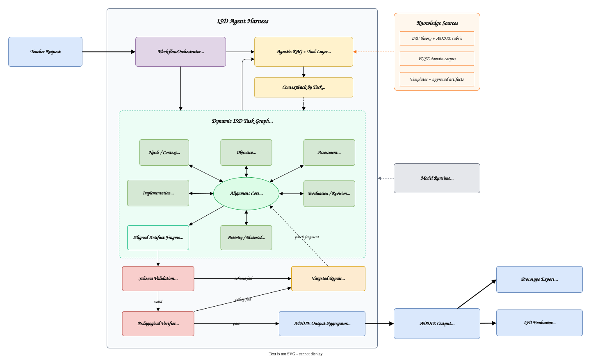

# Chương 3 — Proposed Method: Adaptive Instructional Design Agent Harness

## 3.1 Định vị thiết kế

Luận văn đề xuất **Adaptive Instructional Design Agent Harness**: một harness điều phối agent cho thiết kế dạy học thích ứng. Harness kết hợp với LLM để tạo thành Adaptive Instructional Design Agent theo công thức:

```
Adaptive Instructional Design Agent = LLM + Adaptive Instructional Design Agent Harness
```

Trong đó, LLM cung cấp năng lực ngôn ngữ và reasoning; còn harness cung cấp những thành phần mà một chatbot hoặc agent tổng quát không có: learner-state-aware memory, orchestration policy, workflow graph, tool execution, domain plugin, schema validation, verifier, context injection và teacher-in-the-loop governance. Trọng tâm thiết kế không phải là "AI sinh lesson plan/feedback", mà là **learner-state-aware instructional design orchestration**.

Thiết kế của harness bám theo bốn lớp đã nêu ở Chương 1:

1. **Memory layer**: quản lý ngữ cảnh theo bốn phạm vi `GlobalMemory`, `ProgramMemory`, `ClassMemory` và `SessionMemory`.
2. **Orchestration mechanism**: vận hành closed-loop learning bằng graph-based workflow với bốn role/sub-agent: `Plan-and-Execute Orchestrator`, `Instructional Design Agent`, `Feedback Agent` và `Profile Agent`.
3. **Tools & sandbox**: cung cấp retriever, profile synthesizer, schema validator, verifier và domain plugin chạy trong môi trường kiểm soát.
4. **Hooks & HITL governance**: đặt checkpoint tất định tại các điểm sinh artifact, cập nhật profile, retry và commit memory.

Đóng góp của chương này không nằm ở việc đề xuất một thuật toán LLM mới, mà ở cách cấu hình và tích hợp các thành phần trên thành **Adaptive Instructional Design Agent Harness**: assessment tạo adaptive signal, diagnosis cập nhật learner state, intervention được điều chỉnh theo state đó, và reassessment khép vòng refinement ở các phiên sau.

## 3.2 Kiến trúc tổng thể

Luồng vận hành chính của hệ thống là **AID Loop** (Adaptive Instructional Design Loop), hiện thực hoá closed-loop learning:

```
Assessment
  -> Diagnosis
  -> Learner State Update
  -> Intervention
  -> Reassessment
  -> ...
```

Trong phạm vi prototype, giáo viên tương tác với hệ thống qua giao diện chat. Mọi input từ giáo viên đi vào `Plan-and-Execute Orchestrator` — Orchestrator tích hợp module `IntentRouter` để phân loại intent trước khi dispatch graph execution tương ứng. Graph execution có thể tạo intervention plan, sinh assessment/rubric trong luồng instructional design, chấm bài, tạo feedback/adaptive signal, tổng hợp diagnosis, đề xuất cập nhật `ClassLearningProfile` hoặc trả lời truy vấn về memory.

Sơ đồ logic:

```
[Chat UI]
    <-> IPC
[Main Process / Harness Runtime]
    -> Plan-and-Execute Orchestrator
         [IntentRouter module → graph dispatch]
    -> Graph-based Workflow
         -> Retrieval Agents   (context injection + retrieval)
         -> Role-specific Agent Node
         -> SchemaValidation
         -> PedagogicalVerifier
         -> DomainVerifier?
         -> HITLGate
         -> MemoryCommit
    <-> Memory Store
    <-> LLM Provider
    <-> Domain Plugin?
```

Về triển khai, harness có thể được hiện thực bằng LangGraph.js hoặc một state machine tương đương trong Electron main process. UI không gọi LLM trực tiếp; UI chỉ gửi request qua IPC và nhận streaming token, status update, artifact draft và HITL prompt từ harness runtime.

### Figure 3.1 — Tổng quan phương pháp Adaptive Instructional Design Agent Harness

Hình 3.1 là figure chính của phương pháp đề xuất. Thay vì trình bày toàn bộ node kỹ thuật, hình này nhấn mạnh trực giác thiết kế: giáo viên làm việc với một instructional design harness; `Orchestrator` điều phối AID Loop; assessment tạo diagnosis; diagnosis cập nhật learner state trong `ClassLearningProfile`; learner state quay lại dẫn dắt intervention và assessment ở vòng sau. Memory, domain plugin, verifier và HITL là các lớp kiểm soát bao quanh vòng lặp này.



**Diễn giải hình**: vòng xanh lá là AID Loop, nơi assessment tạo diagnosis, diagnosis cập nhật learner state của lớp, và learner state dẫn dắt orchestration policy cho intervention/reassessment ở vòng sau. Khối vàng là memory duy trì continuity; khối tím là orchestration; khối xanh lam là domain plugin; dải đỏ là HITL governance như một ràng buộc xuyên suốt, bảo đảm giáo viên giữ quyền quyết định cuối cùng trước khi commit vào memory.

### 3.2.1 Standalone deployment model

Để benchmark có thể chạy độc lập so với ứng dụng (xem Chương 4), harness core được thiết kế theo **Headless Core + Transport Adapter pattern**. Toàn bộ logic orchestration, memory, tool và graph nằm trong một module TypeScript thuần, không phụ thuộc Electron hay UI. Giao tiếp ra ngoài đi qua một interface mỏng duy nhất:

```typescript
interface HarnessTransport {
  send(event: HarnessEvent, payload: unknown): void
  onRequest(handler: (req: TeacherRequest) => void): void
}
```

`HarnessRuntime` nhận một `HarnessTransport` khi khởi tạo. Ứng dụng Electron cài `ElectronAdapter` — bridge IPC sang interface này. Benchmark runner cài `BenchmarkAdapter` — đọc fixture từ file, ghi raw output và `WorkflowTrace` ra JSON sau mỗi sample, không cần UI hay event loop của Electron.

```
src/
  harness/                  ← Harness Core (không import electron)
    orchestrator.ts
    nodes/
    memory/
    tools/
    workflow-state.ts
    trace-logger.ts
  adapters/
    electron-adapter.ts     ← IPC ↔ HarnessTransport
    benchmark-adapter.ts    ← file/stdin ↔ HarnessTransport
  benchmark/
    runner.ts               ← entry point độc lập
    fixtures/               ← benchmark adapter fixtures (Chương 4)
    scorer.ts
```

Điều kiện bắt buộc để pattern này hoạt động là harness core không chứa bất kỳ import nào từ `electron`, `ipcMain` hay UI layer. Mọi side effect ra ngoài — streaming token, status update, HITL prompt — đều đi qua `transport.send()`; mọi input vào — teacher request, fixture payload — đều đi qua `transport.onRequest()`. Nhờ đó, benchmark runner có thể khởi tạo harness bằng lệnh `npx ts-node benchmark/runner.ts` không cần khởi động Electron, không mock IPC, không bị ảnh hưởng bởi UI state.

Biên giới giữa core và adapter cũng là biên giới đo lường: `WorkflowTrace` được emit bởi core, thu thập bởi adapter, và dùng để tính toàn bộ metric ở Chương 4 mà không cần can thiệp thủ công.

### 3.2.2 Session lifecycle trong AID Loop

Mỗi **phiên làm việc** (session) là một iteration — hoặc một phần iteration — của AID Loop. Phiên không tự khép kín: nó bắt đầu bằng cách đọc checkpoint từ `ClassMemory` của phiên trước và kết thúc bằng cách commit kết quả trở lại `ClassMemory` để phiên sau kế thừa.

```
ClassMemory (checkpoint N)
    ↓
Session N
    ↓  Orchestrator [IntentRouter → graph dispatch]
    ├── UC_ID_GRAPH   (nếu intent = thiết kế dạy học)
    ├── UC_FB_GRAPH   (nếu intent = chấm bài / tạo feedback)
    └── ... (các intent khác: QUERY, UPDATE_PROFILE, ...)
    ↓  HITL → commit
ClassMemory (checkpoint N+1)
    ↓
Session N+1 ...
```

Một phiên có thể trigger **một hoặc nhiều** graph execution tùy theo intent trong teacher input. Điều quan trọng là dù phiên chạy graph nào, **ClassMemory luôn là nguồn checkpoint đầu vào và điểm commit đầu ra**. Nhờ vậy, continuity của AID Loop được duy trì qua nhiều phiên mà không phụ thuộc vào conversation history.

Trong một phiên điển hình:

| Bước | Thành phần | Mô tả |
| --- | --- | --- |
| 1 | `Orchestrator` [IntentRouter] | Phân loại teacher input thành intent và slot; dispatch graph tương ứng |
| 2 | `Retrieval Agents` | Load context từ memory (profiles, diagnosis, curriculum spec) và truy vấn corpus; tạo `ContextPack` cho agent node |
| 3 | Graph execution | Chạy `UC_ID_GRAPH` hoặc `UC_FB_GRAPH` (hoặc cả hai nếu có nhiều intent) |
| 4 | HITL Gate | Giáo viên approve / edit / reject artifact và profile patch |
| 5 | Memory commit | Artifact và profile patch đã duyệt được ghi vào `ClassMemory`; `SessionMemory` bị giải phóng |

Artifact hoặc profile patch chưa qua HITL không được commit và không trở thành checkpoint cho phiên sau. Điều này bảo đảm AID Loop chỉ tích lũy thông tin đã được giáo viên xác nhận.

### 3.2.3 Class lifecycle — trước, trong và sau AID Loop

Nếu session lifecycle mô tả một iteration đơn lẻ, thì **class lifecycle** mô tả toàn bộ vòng đời của một lớp học từ khi mở đến khi đóng. Class lifecycle gồm ba giai đoạn:

```
[Khởi tạo class]
    ↓
[Vận hành AID Loop — nhiều phiên]
    ↓
[Kết thúc class — end-of-class synthesis]
```

**Giai đoạn 1 — Khởi tạo class (trước AID Loop)**

Khi giáo viên mở một lớp mới, harness tạo `ClassMemory` với trạng thái ban đầu:

- `ClassMemory` được liên kết với `program_id` để biết lớp này đang theo chương trình nào; `CurriculumSpec` của từng môn sẽ được tra cứu từ `ProgramMemory.syllabi` theo `course_id` của mỗi phiên.
- `ClassLearningProfile` được khởi tạo thủ công bởi giáo viên hoặc tổng hợp từ `CrossClassInsights` của các lớp trước (nếu có). Đây là prior knowledge về lớp trước khi có bất kỳ assessment nào.
- `DiagnosisHistory` và `ArtifactLog` bắt đầu rỗng.

Giai đoạn này không có graph execution; đây là bước cấu hình để AID Loop có đủ ngữ cảnh ban đầu để vận hành.

**Giai đoạn 2 — Vận hành AID Loop (trong)**

Đây là giai đoạn chính, gồm nhiều phiên làm việc liên tiếp, mỗi phiên theo session lifecycle ở mục 3.2.2. Qua từng phiên, `ClassMemory` tích lũy dần:

- `ArtifactLog` lưu lesson plan, đề, rubric, grading result đã được HITL approve.
- `DiagnosisHistory` lưu các lần chẩn đoán learner state của lớp.
- `ClassLearningProfile` được cập nhật qua `ProfileAgent` sau mỗi vòng assessment.

AID Loop không có điểm kết thúc tự động — nó tiếp tục cho đến khi giáo viên kết thúc lớp học.

**Giai đoạn 3 — Kết thúc class (sau AID Loop)**

Khi lớp học kết thúc, harness thực hiện **end-of-class synthesis**: tổng hợp những gì đã tích lũy trong `ClassMemory` để cải thiện `ProgramMemory` cho các lớp sau.

| Nguồn (`ClassMemory`) | Đích (`ProgramMemory`) | Điều kiện |
| --- | --- | --- |
| Artifact đã approve trong `ArtifactLog` | `MaterialLibrary` | Giáo viên chọn promote qua HITL |
| Pattern lỗi phổ biến trong `DiagnosisHistory` | `CrossClassInsights.common_misconceptions` | Tự động đề xuất, giáo viên xác nhận |
| Chiến lược hiệu quả trong `ArtifactLog` | `CrossClassInsights.effective_strategies` | Tự động đề xuất, giáo viên xác nhận |

Sau bước này, `ClassMemory` được đóng (archive) và không còn là checkpoint cho phiên mới. Các lớp mở sau đó sẽ tạo `ClassMemory` mới, nhưng hưởng lợi từ `ProgramMemory` đã được làm giàu qua end-of-class synthesis.

Nhờ cơ chế này, AID Loop không chỉ điều chỉnh instruction trong một lớp mà còn tạo ra vòng lặp cải thiện dài hạn theo chiều: `SessionMemory → ClassMemory → ProgramMemory → GlobalMemory`.

## 3.3 Orchestration mechanism

### 3.3.1 Nguyên tắc thiết kế

Orchestration mechanism không để một ReAct agent tự do quyết định toàn bộ quá trình bằng prompt. Thay vào đó, harness dùng một **graph-based workflow** kiểu Plan-and-Execute: mỗi node có input schema, output schema, tool quyền hạn, checkpoint và transition rule rõ ràng.

Thiết kế này có bốn mục tiêu:

1. **Kiểm soát trách nhiệm**: mỗi role/sub-agent chỉ xử lý một loại quyết định sư phạm.
2. **Giảm error propagation**: output quan trọng phải qua schema validation, verifier và HITL trước khi trở thành input cho vòng sau.
3. **Duy trì closed-loop orchestration**: evaluation evidence không kết thúc ở feedback tức thời, mà sinh diagnosis và cập nhật `ClassLearningProfile` cho intervention/reassessment vòng sau.
4. **Đánh giá được**: trajectory của graph có thể log lại để đo tool-call correctness, retry count, verifier pass rate, latency và failure mode.

### 3.3.2 Bốn role/sub-agent

Harness triển khai bốn role chính. Các role này có thể dùng cùng một LLM backend, nhưng khác nhau ở system prompt, tool access, input/output schema và checkpoint.

| Role | Trách nhiệm | Input chính | Output chính | Tool quyền hạn |
| --- | --- | --- | --- | --- |
| `Plan-and-Execute Orchestrator` | Điều phối graph, định tuyến intent, chọn node kế tiếp, quản lý HITL và commit | Teacher input, graph state, validation/verifier result | Next node, HITL request, commit decision | Memory read/write có kiểm soát, router, validators |
| `Instructional Design Agent` | Đề xuất lesson/intervention plan, hoạt động phân hoá và assessment/rubric như một phần của instructional design | Topic, Bloom target, program context, class learning profile | Lesson plan/intervention plan, differentiated activities, assessment/rubric artifacts | Retrieval Agents, Writing Tools |
| `Feedback Agent` | Đánh giá bài nộp hoặc assessment evidence, điều phối domain evaluators nếu có, sinh feedback và adaptive signal | Submission/evidence, rubric, class learning profile, domain evaluator result | Grading/evaluation artifact, feedback/adaptive signal, misconception labels | Retrieval Agents, Writing Tools, domain evaluator/verifier nếu có |
| `Profile Agent` | Chuyển grading result thành class diagnosis và đề xuất profile patch | Grading result, rubric, current profile, error taxonomy | `ClassDiagnosis`, `ClassLearningProfilePatch` | Context Compactor, error taxonomy từ domain plugin |

Điểm quan trọng là `Plan-and-Execute Orchestrator` không phải agent sinh nội dung sư phạm chính. Nó là controller của graph: nhận learner state và workflow state hiện tại, kiểm tra output từ các node, quyết định transition, mở HITL checkpoint, retry node lỗi hoặc commit artifact đã được duyệt.

### 3.3.3 Graph state

Mỗi lần xử lý một request của giáo viên, harness tạo một `WorkflowState`. State này là nguồn dữ liệu duy nhất cho các transition trong graph.

```typescript
interface WorkflowState {
  workflow_id: string
  class_id: string
  session_id: string
  teacher_id: string

  intent: Intent
  intent_confidence: number
  status: "running" | "need_clarification" | "waiting_hitl" | "completed" | "failed"

  input: TeacherRequest
  context_pack?: ContextPack

  active_node?: WorkflowNode
  draft_artifacts: ArtifactDraft[]
  validation_results: ValidationResult[]
  verifier_results: VerifierResult[]
  hitl_decisions: HITLDecision[]

  diagnosis_output?: ClassDiagnosis
  profile_update_proposal?: ClassLearningProfilePatch

  retry_count_by_node: Record<string, number>
  trace: WorkflowTraceEvent[]
}
```

Các artifact được sinh ra trong graph ở trạng thái `draft`. Chúng chỉ được ghi vào `ClassMemory.ArtifactLog` sau khi qua HITL Gate. Tương tự, `ClassLearningProfile` chỉ được cập nhật sau khi giáo viên approve hoặc edit proposal.

### 3.3.4 Node và transition

Graph được mô tả ở mức logic như sau:

```text
TeacherInput
  -> Orchestrator [IntentRouter module]
       -> NEED_CLARIFICATION
       -> QUERY_MEMORY
       -> UPDATE_PROFILE
       -> UC_ID_GRAPH
       -> UC_FB_GRAPH
       -> FEEDBACK_REVISION

UC_ID_GRAPH
  -> RetrievalAgents   (load context + query corpus)
  -> InstructionalDesignAgent
  -> SchemaValidation
  -> PedagogicalVerifier
  -> HITLGate
  -> MemoryCommit

UC_FB_GRAPH
  -> RetrievalAgents   (load context + query corpus)
  -> FeedbackAgent
  -> SchemaValidation
  -> DomainVerifier?
  -> PedagogicalVerifier
  -> ProfileAgent
  -> HITLGate
  -> MemoryCommit
```

Trong graph, `PedagogicalVerifier` là node tường minh — không phải tool được gọi ngầm. Nếu verifier fail, `Orchestrator` retry node sinh output trước đó với violation reason làm constraint, chứ không bỏ qua.

Transition rule chính:

| Điều kiện | Transition |
| --- | --- |
| `intent_confidence < threshold` hoặc intent mơ hồ | `NEED_CLARIFICATION` |
| Schema invalid | Retry node sinh output với validation error làm constraint |
| Domain verifier fail | Retry `FeedbackAgent` hoặc yêu cầu giáo viên xác nhận nếu vượt retry limit |
| Pedagogical verifier fail | Retry node sinh output với violation reason |
| Giáo viên approve | Commit artifact/profile patch |
| Giáo viên edit | Merge edit, validate lại phần bị sửa, sau đó commit |
| Giáo viên reject có lý do | Targeted repair node liên quan, không chạy lại toàn bộ graph |
| Timeout HITL | Giữ artifact ở `draft`, không dùng làm input cho AID Loop kế tiếp |

Nhờ vậy, orchestration mechanism có tính tất định ở phần điều phối, trong khi LLM chỉ tham gia ở các node cần sinh hoặc diễn giải nội dung.

## 3.4 Intent Router

`IntentRouter` là module bên trong `Plan-and-Execute Orchestrator`, không phải node độc lập trong graph. Mỗi khi nhận teacher input, Orchestrator chạy IntentRouter trước để phân loại intent và trích xuất slot, rồi mới dispatch graph tương ứng.

Router nhận diện sáu intent:

| Intent | Ví dụ trigger | Graph kích hoạt |
| --- | --- | --- |
| `UC_ID` | "Soạn kế hoạch bài dạy chủ đề stack", "Tạo rubric", "Thiết kế bài tập" | `UC_ID_GRAPH` |
| `UC_FB` | "Chấm bài này", "Nhận xét submission này", "Tổng hợp lỗi từ bài làm" | `UC_FB_GRAPH` |
| `UPDATE_PROFILE` | "Nhóm B hay nhầm push/pop" | Profile patch proposal |
| `QUERY` | "Tuần trước dạy đến đâu?", "Nhóm C đang thế nào?" | Memory read |
| `FEEDBACK` | "Chỉnh lại hoạt động 2" | Artifact revision |
| `NEED_CLARIFICATION` | Input thiếu mục tiêu hoặc lẫn nhiều tác vụ | Clarifying question |

Router dùng LLM classifier nhẹ kết hợp keyword heuristic fallback. Output của router gồm `{intent, confidence, extracted_slots, missing_slots}`. Nếu confidence thấp hoặc thiếu slot quan trọng, Orchestrator không dispatch graph mà hỏi lại một câu ngắn trước.

Ví dụ:

```json
{
  "intent": "UC_ID",
  "confidence": 0.82,
  "extracted_slots": {
    "topic": "stack",
    "bloom_target": "apply",
    "duration": "2 sessions"
  },
  "missing_slots": []
}
```

## 3.5 UC-ID graph — Instructional intervention design

UC-ID graph phục vụ các tác vụ biểu diễn và điều chỉnh instructional workflow: soạn kế hoạch bài dạy, thiết kế hoạt động học tập, thiết kế assessment/rubric như một phần của constructive alignment, điều chỉnh orchestration policy theo learner state của lớp và tạo hoạt động phân hoá.

Input chính:

```typescript
interface UCIDInput {
  topic: string
  bloom_target?: BloomLevel
  duration?: string
  learning_objectives?: string[]
  class_learning_profile?: ClassLearningProfile
}
```

Luồng xử lý:

```text
RetrievalAgents
  -> InstructionalDesignAgent
  -> SchemaValidation
  -> PedagogicalVerifier
  -> HITLGate
  -> MemoryCommit
```

`RetrievalAgents` đảm nhận hai việc: load context từ memory (`CurriculumSpec` của môn từ `ProgramMemory.syllabi`, `ClassLearningProfile` và `DiagnosisHistory` gần nhất từ `ClassMemory`, preference từ `GlobalMemory`) và truy vấn corpus theo topic, Bloom target, readiness/misconception của lớp. Kết quả được đóng gói thành `ContextPack` truyền cho `InstructionalDesignAgent`. `InstructionalDesignAgent` đề xuất artifact có cấu trúc:

```typescript
interface LessonPlanArtifact {
  topic: string
  learning_objectives: LearningObjective[]
  prerequisite_diagnosis?: string
  teaching_sequence: TeachingActivity[]
  differentiated_activities: GroupActivity[]
  assessment_alignment: AssessmentAlignment[]
  assessment_artifacts?: AssessmentArtifact[]
  citations: Citation[]
}
```

`PedagogicalVerifier` kiểm tra các lỗi như:

- mục tiêu học tập không khớp Bloom target;
- hoạt động học tập không liên kết với mục tiêu;
- assessment không đo được mục tiêu đã nêu;
- phân hoá nhóm chỉ mang tính hình thức;
- thiếu căn cứ từ retrieved context khi artifact yêu cầu citation.

Nếu giáo viên reject một phần cụ thể, ví dụ "hoạt động nhóm yếu vẫn quá khó", `Orchestrator` chỉ retry node `InstructionalDesignAgent` với constraint mới, giữ nguyên context pack và các phần artifact không bị phản đối.

## 3.6 UC-FB graph — Feedback and adaptive signal

UC-FB graph phục vụ các tác vụ đánh giá bài nộp hoặc assessment evidence đã có, rồi tạo feedback/adaptive signal cho người học và giáo viên. Việc thiết kế assessment, rubric hoặc bài tập thuộc trách nhiệm của `InstructionalDesignAgent`; `FeedbackAgent` chỉ dùng các artifact đó làm tiêu chí đánh giá và làm căn cứ phản hồi.

| Sub-task | Input | Output |
| --- | --- | --- |
| Chấm bài theo rubric | Submission + rubric + optional profile | Grade/evaluation artifact, rubric scores, evidence |
| Đánh giá domain-specific evidence | Submission/evidence + domain plugin config | Domain evaluator result, verifier result, error labels |
| Tạo feedback + adaptive signal | Evaluation artifact + optional profile | Feedback/adaptive signal, misconception labels, evidence summary |

Luồng xử lý:

```text
RetrievalAgents
  -> FeedbackAgent
  -> SchemaValidation
  -> DomainVerifier?
  -> PedagogicalVerifier
  -> ProfileAgent
  -> HITLGate
  -> MemoryCommit
```

`FeedbackAgent` đánh giá submission hoặc assessment evidence theo rubric đã có. Nếu domain plugin cung cấp tool/sub-agent đánh giá chuyên môn, ví dụ code verifier, essay rubric checker hoặc math solution checker, `FeedbackAgent` chịu trách nhiệm điều phối các evaluator đó, chuẩn hoá kết quả và chuyển thành feedback/adaptive signal. Với case study Computer Science, domain plugin có thể cung cấp verifier chạy test case trong sandbox để phát hiện compile error, runtime error, sai output hoặc test case không hợp lệ.

Output chấm bài được chuẩn hoá:

```typescript
interface GradingArtifact {
  submission_id: string
  rubric_scores: RubricScore[]
  correctness_summary: string
  feedback: FeedbackItem[]
  misconception_labels: string[]
  verifier_result?: VerifierResult
  citations?: Citation[]
}
```

Sau khi có grading artifact, `ProfileAgent` nhận vào và thực hiện hai bước liên tiếp trong cùng một node.

## 3.7 Profile Agent

`ProfileAgent` là cầu nối giữa assessment và adaptive orchestration. Nó thực hiện cơ chế **episodic → semantic consolidation** trong một node duy nhất: chuyển grading result thành class diagnosis, rồi ngay lập tức đề xuất profile patch để trình giáo viên qua HITL.

Ba bước bên trong agent:

1. **Diagnose**: tổng hợp pattern lỗi từ grading artifact thành `ClassDiagnosis` ở mức lớp, kèm segment notes nếu trong lớp có nhóm lỗi khác biệt rõ.
2. **Merge**: so sánh diagnosis mới với profile hiện tại; thêm misconception mới, cập nhật readiness level nếu đủ confidence, ghi nhận strength và intervention đề xuất.
3. **Propose**: tạo `ClassLearningProfilePatch` và trình giáo viên approve/edit/reject qua HITL Gate.

Output của bước Diagnose:

```typescript
interface ClassDiagnosis {
  class_id: string
  strengths: string[]
  error_patterns: ErrorPattern[]
  misconceptions: string[]
  recommended_interventions: string[]
  segment_notes?: LearnerSegmentNote[]
  confidence: number
}
```

Output của bước Propose:

```typescript
interface ClassLearningProfilePatch {
  class_id: string
  operations: ProfilePatchOperation[]
  evidence: {
    diagnosis_id: string
    artifact_id: string
    confidence: number
  }
  summary_for_teacher: string
}
```

Quy tắc commit:

- patch chỉ được áp dụng sau khi giáo viên approve hoặc edit;
- patch bị reject không được dùng cho context injection vòng sau;
- mọi thay đổi profile lưu kèm evidence và timestamp để phục vụ audit.

## 3.8 Memory Architecture

Harness quản lý memory theo bốn tầng scope lồng nhau, ánh xạ với cognitive taxonomy của Sumers et al. (2024). Mục tiêu là tránh việc toàn bộ lịch sử hội thoại bị nhồi tuyến tính vào prompt, đồng thời duy trì continuity của AID Loop trong phạm vi một lớp học và tích lũy cải thiện học liệu qua nhiều lớp.

| Scope | Cognitive type | Vai trò |
| --- | --- | --- |
| Global | Procedural | Hành vi và phong cách dạy tích lũy xuyên suốt nhiều chương trình |
| Program | Semantic | Curriculum và học liệu ổn định cho cả chương trình, cải thiện qua nhiều lớp |
| Class | Episodic | Sự kiện và learner-state profile gắn với một lớp học cụ thể |
| Session | Working | Ngữ cảnh tức thời đang xử lý |

Consolidation diễn ra theo chiều từ dưới lên:

```
Session  →(HITL commit)→           ClassMemory
Class    →(end-of-class synthesis)→ ProgramMemory
Program  →(implicit, qua thời gian)→ GlobalMemory
```

### Global scope — Procedural memory

Duy trì xuyên suốt nhiều khoá học và nhiều phiên làm việc.

```text
GlobalMemory
├── teacher_id
├── preferences
│   ├── feedback_tone
│   ├── default_bloom_target
│   ├── difficulty_calibration_style
│   └── preferred_language_register
└── teaching_style_notes[]
```

Global memory được inject nhẹ vào system context, chủ yếu để điều chỉnh tone, style và preference dài hạn. Nó không chứa dữ liệu nhạy cảm cấp submission nếu không cần thiết.

### Program scope — Semantic memory

Một `ProgramMemory` gắn với một chương trình đào tạo cụ thể và tồn tại qua nhiều lớp, nhiều môn học trong chương trình đó. Đây là nơi tích lũy curriculum gốc cho toàn bộ chương trình và học liệu đã được tinh chỉnh qua thực tế giảng dạy.

```text
ProgramMemory
├── program_id, teacher_id
├── syllabi[]
│   ├── course_id
│   ├── subject
│   ├── learning_outcomes
│   └── domain
├── MaterialLibrary[]
│   ├── material_id, course_id, type
│   ├── version
│   └── effectiveness_notes
└── CrossClassInsights[]
    ├── course_id
    ├── common_misconceptions[]
    ├── effective_strategies[]
    └── last_updated
```

`syllabi` chứa `CurriculumSpec` của từng môn học trong chương trình; khi khởi tạo lớp hoặc inject context, harness tra cứu syllabus theo `course_id` tương ứng. `MaterialLibrary` chứa artifact tái sử dụng được (rubric, lesson plan template, assessment) đã qua HITL và được giáo viên chọn promote từ các lớp trước. `CrossClassInsights` tích lũy pattern chẩn đoán phổ biến theo từng môn, phục vụ retrieval và verifier ở các lớp sau.

### Class scope — Episodic memory

Một `ClassMemory` tương ứng với một lớp học sinh xuyên suốt toàn bộ chương trình đào tạo — lớp này học nhiều môn theo thứ tự của `ProgramMemory.syllabi`. Đây là lõi learner-state của AID Loop.

```text
ClassMemory
├── class_id, program_id, teacher_id
│
├── ClassLearningProfile
│   ├── class_id, class_name, size
│   ├── readiness_level
│   ├── known_misconceptions[]
│   ├── strengths[]
│   ├── learner_segments[]
│   └── last_updated
│
├── DiagnosisHistory[]
│   ├── diagnosis_id, course_id, round_id, timestamp
│   ├── source_artifact_id
│   └── class_diagnoses[]
│
└── ArtifactLog[]
    ├── artifact_id, course_id, type
    ├── session_id
    ├── status
    ├── hitl_notes
    └── citations
```

`DiagnosisHistory` và `ArtifactLog` là episodic thuần — sự kiện cụ thể gắn với thời điểm, môn học và lớp học. Mỗi entry mang `course_id` để phân biệt lịch sử theo từng môn trong chương trình. `ClassLearningProfile` là kết quả consolidation từ episodic: sau khi qua `ProfileAgent` và HITL, nó trở thành tri thức semantic ổn định hơn trong phạm vi lớp này.

Class memory là lõi learner-state của AID Loop. `ClassLearningProfile` và `DiagnosisHistory` (lọc theo `course_id` hiện tại) được dùng lại ở các vòng UC-ID/UC-FB sau để điều chỉnh orchestration policy ở mức lớp.

### Session scope — Working memory

Session memory tồn tại trong một phiên làm việc.

```text
SessionMemory
├── session_id, class_id, teacher_id
├── conversation_history[]
├── active_workflow_state
└── pending_artifacts[]
```

Các artifact chưa được approve nằm trong `pending_artifacts`. Khi session kết thúc, chỉ artifact/profile patch đã qua HITL mới được commit vào `ClassMemory`; phần còn lại giữ ở trạng thái draft hoặc bị loại theo quyết định của giáo viên.

## 3.9 Retrieval Agents — Context & Retrieval

`Retrieval Agents` là node đầu tiên trong mỗi UC graph. Thay vì truyền toàn bộ memory vào prompt, Retrieval Agents tổng hợp `ContextPack` có giới hạn token gồm hai phần: context từ memory và chunks từ corpus.

**Phần 1 — Load context từ memory** (thứ tự ưu tiên):

1. `SessionMemory.active_workflow_state`
2. `ClassMemory.ClassLearningProfile`
3. `ClassMemory.DiagnosisHistory` trong N vòng gần nhất, mặc định N = 3
4. `ProgramMemory.syllabi[course_id]` (CurriculumSpec của môn học trong phiên hiện tại)
5. `GlobalMemory.preferences`

**Phần 2 — Retrieval từ corpus**:

- Query được expand dựa trên topic, Bloom target và misconception của lớp từ profile.
- Metadata filter và reranking áp dụng theo `RetrievalPolicy` của domain plugin (nếu có).
- Retrieved chunks bao gồm cả `ProgramMemory.MaterialLibrary`.

`ContextPack` có hai kênh sử dụng:

- **Retrieval policy**: profile của lớp ảnh hưởng đến query expansion, metadata filter và reranking.
- **Generation prompt**: profile, diagnosis, curriculum spec và preference được đưa vào prompt theo slot cố định.

Nếu context vượt budget, Retrieval Agents ưu tiên giữ profile hiện tại, diagnosis gần nhất và learning outcomes từ `CurriculumSpec`; diagnosis cũ được nén qua `Context Compactor`. Việc này tránh biến conversation history thành nguồn ngữ cảnh duy nhất.

## 3.10 Tools / Sub-agents

Harness cung cấp bốn nhóm tool/sub-agent dùng chung cho các agent node trong graph:

| Nhóm | Chức năng | Agent sử dụng |
| --- | --- | --- |
| `Retrieval Agents` | Tìm chunk từ corpus theo topic, Bloom, difficulty, misconception; hỗ trợ query expansion và reranking | UC-ID, UC-FB |
| `Writing Tools` | Hỗ trợ tạo và chỉnh sửa artifact có cấu trúc (lesson plan, rubric, feedback/adaptive signal) | ID Agent, Feedback Agent |
| `Context Compactor` | Nén conversation history và diagnosis cũ thành summary khi context vượt budget | Tất cả agent node |
| `MCP Client` | Giao tiếp với external tool server qua Model Context Protocol | Tất cả agent node |

Tool có thể được gọi bởi agent node nhưng quyền hạn được giới hạn theo role. `InstructionalDesignAgent` và `FeedbackAgent` có quyền dùng Retrieval Agents và Writing Tools, nhưng không được commit trực tiếp vào memory. Schema validation và artifact commit là trách nhiệm của graph (node `SchemaValidation` và `MemoryCommit`), không phải của tool.

Với case study Computer Science, domain verifier từ plugin chạy trong sandbox để giảm rủi ro khi xử lý code submission. Verifier chỉ nhận input đã được chuẩn hoá và trả về result có cấu trúc; `Orchestrator` quyết định retry hay chuyển HITL dựa trên result đó.

## 3.11 Domain Plugin Interface

Domain plugin là lớp mở rộng optional. Core harness vẫn hoạt động nếu không có plugin, nhưng plugin giúp thêm kiến thức, verifier và taxonomy đặc thù lĩnh vực.

```typescript
interface DomainPlugin {
  domain: string
  agents?: AgentDefinition[]       // sub-agent bổ sung đặc thù domain
  tools?: ToolDefinition[]         // tool bổ sung, có thể chạy trong sandbox
  sandbox?: SandboxConfig          // cấu hình sandbox cho verifier/code execution
  policies?: PolicyDefinition[]    // ràng buộc domain-specific cho Orchestrator
  corpus?: CorpusConfig            // cấu hình ingestion và metadata cho corpus domain
  metadata?: MetadataSchema        // schema metadata của chunk trong corpus domain
}
```

Khi plugin được load:

- `agents` và `tools` được inject vào harness — agent node trong graph có thể gọi;
- `sandbox` cấu hình môi trường thực thi cho verifier (ví dụ: chạy test case code submission);
- `policies` bổ sung ràng buộc domain-specific mà `Orchestrator` kiểm tra khi transition;
- `corpus` và `metadata` điều chỉnh pipeline ingestion và cách Retrieval Agents truy vấn corpus domain.

Khi không có plugin, graph bỏ qua `DomainVerifier` nhưng vẫn chạy `SchemaValidation`, `PedagogicalVerifier`, HITL và memory commit. Điều này bảo đảm core harness không phụ thuộc cứng vào một domain cụ thể.

## 3.12 HITL Governance

Teacher-in-the-loop là cơ chế governance bắt buộc, không phải tính năng UI phụ. Mọi artifact có ảnh hưởng đến dạy học, đánh giá hoặc profile học sinh đều phải qua HITL trước khi commit.

Các quyết định HITL:

| Quyết định | Hành động của harness |
| --- | --- |
| `Approve` | Commit artifact/profile patch vào `ClassMemory` |
| `Edit` | Merge chỉnh sửa, validate lại phần liên quan, sau đó commit |
| `Reject` | Ghi rejection reason, targeted repair node liên quan |
| `Skip/Timeout` | Giữ artifact ở `draft`, không dùng cho vòng APO kế tiếp |

HITL xuất hiện ở bốn điểm chính:

1. Sau khi tạo lesson plan/intervention plan, assessment, rubric hoặc feedback/adaptive signal.
2. Sau khi `ProfileAgent` đề xuất cập nhật `ClassLearningProfile`.
3. Khi verifier hoặc schema validation thất bại quá số retry và cần giáo viên quyết định tiếp tục.
4. Cuối khoá học (end-of-class synthesis): giáo viên chọn artifact nào từ `ClassMemory.ArtifactLog` được promote lên `ProgramMemory.MaterialLibrary` và insight nào được tích lũy vào `CrossClassInsights`.

Nhờ HITL, giáo viên giữ quyền chuyên môn cuối cùng. Harness chỉ đề xuất, kiểm tra, ghi nhớ và hỗ trợ retry có mục tiêu.

## 3.13 Logging và trace phục vụ đánh giá

Mỗi graph execution ghi lại `WorkflowTrace`:

```typescript
interface WorkflowTraceEvent {
  timestamp: string
  node: string
  input_summary: string
  output_summary: string
  tool_calls: ToolCallTrace[]
  validation_result?: ValidationResult
  verifier_result?: VerifierResult
  hitl_decision?: HITLDecision
  latency_ms: number
  token_usage?: TokenUsage
}
```

Trace này phục vụ Chương 4 ở các metric:

- schema validity;
- verifier pass rate;
- số retry;
- tool-call correctness;
- latency end-to-end;
- token usage;
- failure mode taxonomy;
- learner-state adaptation delta qua các vòng APO.

Do đó, orchestration mechanism không chỉ là thiết kế runtime, mà còn là bề mặt đo lường để đánh giá liệu harness có tạo khác biệt so với LLM-only, Naive RAG, ReAct/Agentic RAG baseline và Teacher-facing SOTA pipeline hay không.

## 3.14 Tóm tắt

Chương này mô tả Adaptive Instructional Design Agent Harness như một kiến trúc có bốn lớp: memory, orchestration, tools/sub-agents và HITL. Điểm lõi của phương pháp là graph-based AID Loop với bốn role/sub-agent. `InstructionalDesignAgent` thiết kế lesson/intervention và assessment artifacts; `FeedbackAgent` đánh giá submission/evidence, điều phối domain evaluators và sinh feedback/adaptive signal; `PedagogicalVerifier` kiểm tra constraint là một node tường minh trong graph; `ProfileAgent` chuyển grading result thành diagnosis và đề xuất profile patch trong một bước duy nhất; `Plan-and-Execute Orchestrator` kiểm soát transition, HITL và commit memory. Tool layer gồm bốn nhóm dùng chung: Retrieval Agents, Writing Tools, Context Compactor và MCP Client. Domain plugin mở rộng domain-specific qua sáu thành phần: Agents, Tools, Sandbox, Policies, Corpus, Metadata. Memory được tổ chức theo bốn scope ánh xạ cognitive taxonomy: `GlobalMemory` (procedural), `ProgramMemory` (semantic), `ClassMemory` (episodic) và `SessionMemory` (working) — consolidation diễn ra từ dưới lên, đảm bảo insight từ mỗi lớp học được tích lũy cải thiện curriculum cho toàn bộ chương trình đào tạo.

Cách thiết kế này biến adaptive orchestration ở mức lớp từ một prompt đơn lẻ thành một vòng lặp có trạng thái, có kiểm soát và có thể đánh giá được.
