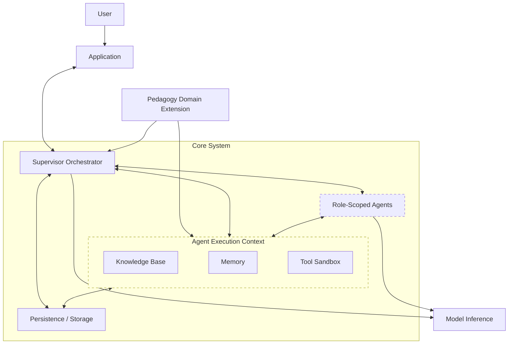
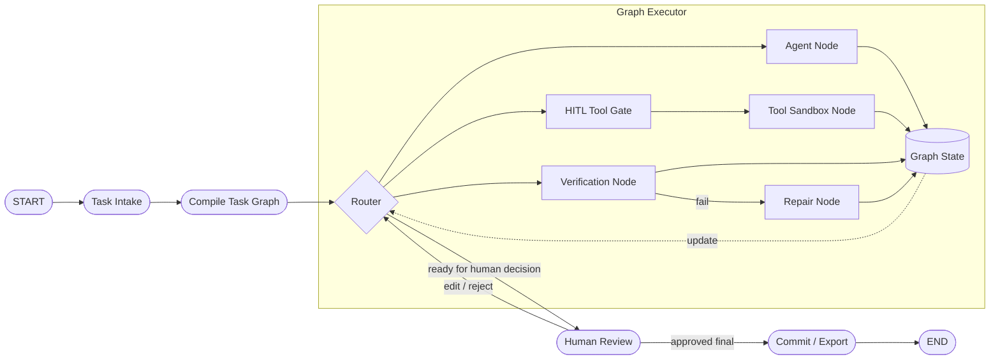
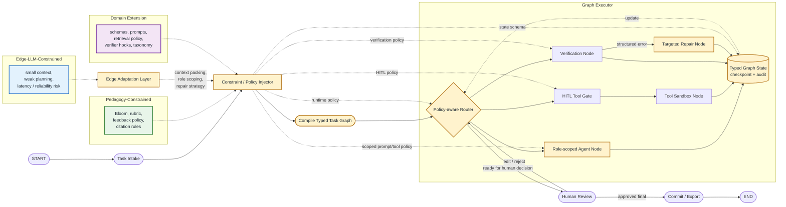
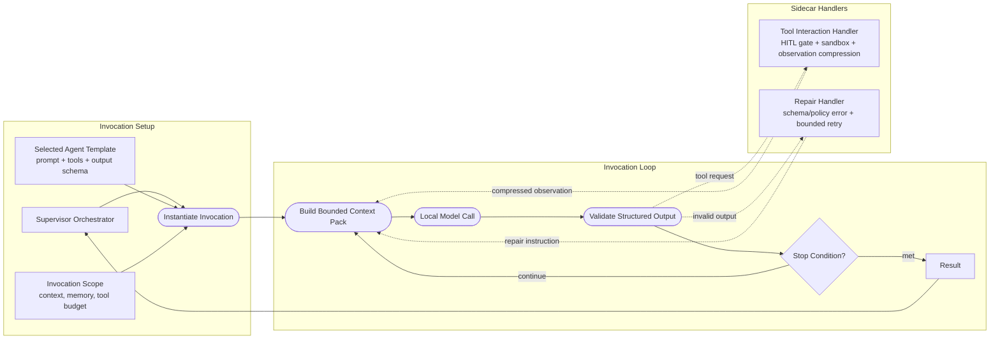
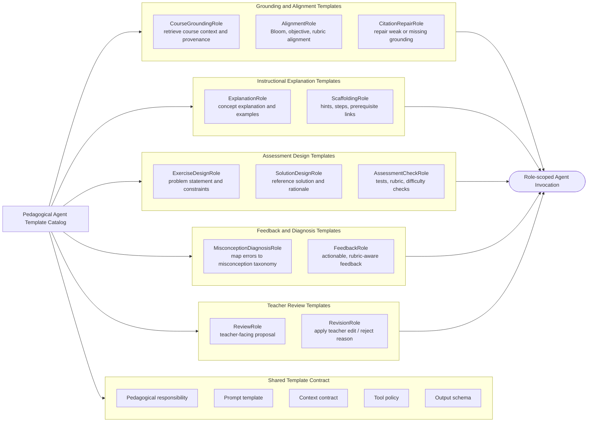
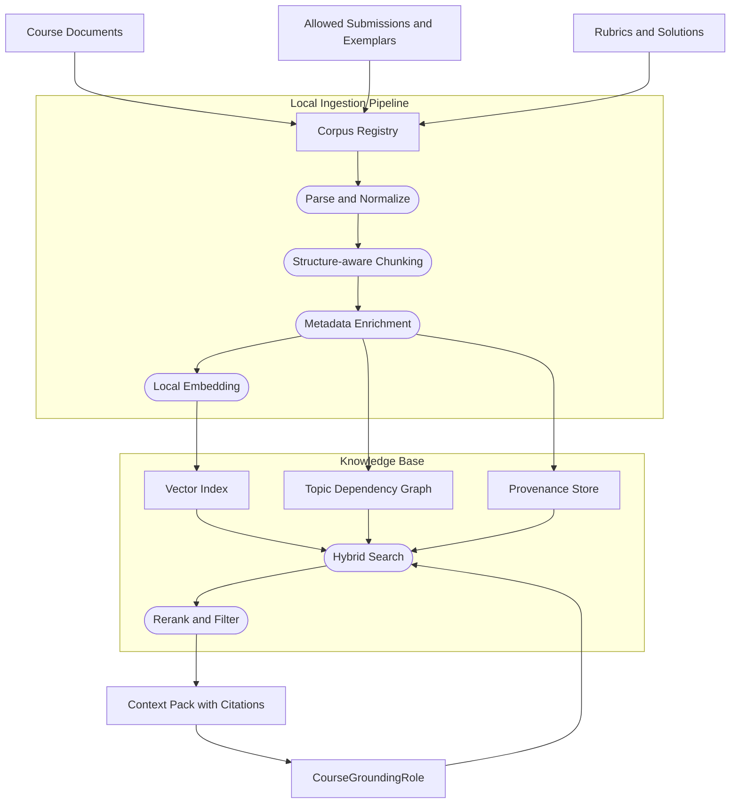
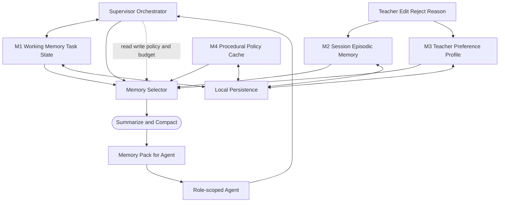

# Thiết kế và triển khai hệ thống -- Chương 4

## 4.1 Mục tiêu thiết kế và phạm vi hệ thống

- Thiết kế hệ thống hỗ trợ giáo viên kỹ thuật bằng kiến trúc Multi-Agent Agentic RAG.
- Tập trung vào các tác vụ sư phạm-kỹ thuật có thể kiểm chứng:
  - hỏi đáp/giải thích dựa trên tài liệu học phần;
  - sinh bài tập lập trình;
  - sinh feedback cho bài nộp lập trình.
- Local-first deployment là ràng buộc cứng để bảo vệ dữ liệu giáo viên và học viên.
- Prototype hiện thực và đánh giá trong miền CNTT/lập trình.
- Các miền kỹ thuật khác chỉ được phân tích ở mức khả năng mở rộng của interface.
- Hệ thống không nhằm thay thế giáo viên, LMS, hay quy trình đánh giá học tập dài hạn.

## 4.2 Yêu cầu thiết kế chính

- **Local-first và privacy-aware**
  - local-first deployment là ràng buộc bắt buộc của hệ thống;
  - dữ liệu học phần, bài nộp và feedback được xử lý cục bộ;
  - hạn chế phụ thuộc API thương mại;
  - corpus và session data lưu local.

- **Human-in-the-loop**
  - giáo viên kiểm soát việc hệ thống có được thay đổi dữ liệu/trạng thái hay không;
  - giáo viên quyết định thay đổi cụ thể nào được áp dụng, chỉnh sửa, lưu, xuất hoặc hủy;
  - reject/edit reason được dùng làm tín hiệu sửa output và audit trail.

- **Pedagogy-constrained**
  - output cần bám mục tiêu học tập, Bloom level, rubric và constructive alignment;
  - feedback cần giải thích lỗi và gợi ý cải thiện;
  - citation/provenance cần rõ khi dùng tài liệu học phần.

- **Technical-verification-aware**
  - bài tập/lời giải/test cần có khả năng kiểm chứng bằng công cụ;
  - feedback chấm code cần dựa trên kết quả verifier khi có thể;
  - lỗi kỹ thuật được ánh xạ sang error taxonomy của miền.

- **Edge-LLM-constrained**
  - local/edge small LLM là ràng buộc bắt buộc của hệ thống;
  - mọi workflow phải được thiết kế theo giới hạn context, memory, latency và compute của edge LLM;
  - quản lý context, memory, tool scope, retry và số lần gọi model như constraint của orchestration;
  - không giả định frontier/cloud LLM, context rất dài hoặc agent có khả năng tool planning mạnh.

- **Extensible-by-design**
  - core không hard-code logic CNTT/lập trình;
  - domain knowledge, tool, verifier và prompt policy nằm trong Pedagogy Domain Extension;
  - extension CNTT/lập trình là bản hiện thực đầu tiên.

## 4.3 Kiến trúc tổng quan

- Kiến trúc được tổ chức quanh ba trụ cột:
  - **Pedagogy-Constrained Orchestration** — hiện thực qua Orchestrator, Role-scoped Agents, Guardrails và HITL;
  - **Edge-LLM-Constrained Orchestration** — hiện thực qua Orchestrator và Memory (context/memory budget control);
  - **Pedagogy Domain Extension** — hiện thực qua Extension và Knowledge Base.

- **Core System**
  - bao gồm Supervisor Orchestrator, Role-scoped Agents, Knowledge Base, Memory, Persistence/Storage và Tool Sandbox;
  - không bao gồm User, Application, Pedagogy Domain Extension và Model Inference;
  - giữ workflow/runtime logic có thể tái sử dụng giữa các domain extension.

- **Agent Execution Context**
  - gom Knowledge Base, Memory và Tool Sandbox;
  - là môi trường thực thi được cấp theo scope cho role-scoped agent invocations;
  - giúp agents truy cập context, memory và tools mà không mở toàn bộ hệ thống;
  - scope cụ thể vẫn do Supervisor Orchestrator kiểm soát.

- **Supervisor Orchestrator**
  - điều phối workflow sư phạm-kỹ thuật;
  - quản lý task graph, pedagogical agent template catalog, retrieval, verification, repair và HITL;
  - instantiate/điều phối role-scoped agent invocations theo từng task thay vì chạy pipeline cố định;
  - giữ vai trò routing/coordination trung tâm; agents không tự handoff trực tiếp cho nhau;
  - nạp agent template, retrieval policy và feedback policy từ Extension khi khởi tạo agent invocation;
  - enforce guardrails và HITL checkpoints như middleware nội bộ trong task graph;
  - áp dụng đồng thời Pedagogy-Constrained Orchestration và Edge-LLM-Constrained Orchestration;
  - độc lập với từng miền kỹ thuật cụ thể.

- **Role-scoped agent templates and invocations**
  - gồm một agent template catalog theo trách nhiệm sư phạm như grounding/alignment, explanation/scaffolding, assessment design, feedback/diagnosis và teacher review;
  - mỗi template về bản chất là cấu hình prompt, context contract, tool policy và output schema, không phải agent runtime riêng;
  - mỗi template được Orchestrator instantiate thành ephemeral agent invocation khi cần;
  - giúp cô lập context của từng bước và chỉ trả kết quả có cấu trúc về orchestrator;
  - mỗi invocation có template, context scope, memory scope và tool scope riêng;
  - orchestrator quyết định template nào được instantiate, thứ tự gọi và điều kiện dừng/retry;
  - agent invocation dùng chung model inference backend nhưng không nhất thiết là process/model riêng.

- **Pedagogy Domain Extension**
  - khai báo metadata schema, task schema, prompt templates;
  - cung cấp retrieval policy, verifier, error taxonomy, feedback policy;
  - đóng gói corpus ingestion pipeline và domain tools;
  - được orchestrator nạp khi khởi tạo; agents không truy cập Extension trực tiếp.

- **Knowledge Base**
  - corpus học phần đã index;
  - vector search/reranking;
  - provenance/citation metadata;
  - nhận tài liệu từ workspace/storage qua ingestion/indexing pipeline;
  - metadata và retrieval behavior được cấu hình bởi Pedagogy Domain Extension;
  - topic dependency graph ở mức prototype nếu cần.

- **Memory**
  - working memory cho state của task hiện tại;
  - short-term/session memory cho history và teacher corrections;
  - long-term memory cho teacher preferences/profile nếu được triển khai;
  - orchestrator kiểm soát lượng memory được inject vào agent context (prompt budget);
  - agents đọc/ghi memory trong phạm vi context scope được orchestrator cấp.

- **Persistence / Storage**
  - lưu workspace, configs, session metadata và audit log;
  - lưu chat history/correction history ở dạng persistable;
  - lưu checkpoint/state snapshot để hỗ trợ resume sau HITL hoặc lỗi runtime;
  - lưu corpus registry, index metadata và trạng thái ingestion;
  - là tầng lưu trữ cục bộ phục vụ Application, Knowledge Base và Memory.

- **Tool Sandbox**
  - chạy verifier, test runner, linter, syntax checker và các domain tools;
  - áp dụng timeout, resource limit và isolation cho tool execution;
  - nhận tool definitions/verifier hooks từ Pedagogy Domain Extension thông qua Orchestrator;
  - trả kết quả có cấu trúc cho Orchestrator để repair, retry hoặc chuyển HITL.

- **Model inference**
  - local/edge small LLM inference backend;
  - local embedding/reranking model services;
  - model lifecycle và resource control;
  - không phụ thuộc frontier/cloud LLM cho workflow chính.

- **Application**
  - desktop UI cho giáo viên;
  - review queue, approve/edit/reject;
  - hiển thị draft/proposed changes để giáo viên quyết định trước khi áp dụng;
  - giao tiếp hai chiều với orchestration backend qua IPC (gửi task, nhận stream trạng thái và output).

### 4.3.1 Detail design: Supervisor Orchestrator

- Thiết kế Supervisor Orchestrator dựa trên nền tảng lit-review về LLM-based MAS và Agentic AI ở §3.2, §3.6: agent không tự trao đổi ngang hàng tùy ý, mà được điều phối qua một supervisor để giảm coordination overhead, context fragmentation và error propagation.
- HITL/control gate kế thừa lập luận human-agent collaboration ở §3.4; guardrail/tool gate liên hệ §3.9; context và retry budget liên hệ §3.8 và §3.10 về giới hạn Edge SLM.

Hình trên mô tả kiến trúc Orchestrator tổng quát theo kiểu LangGraph/state-machine: task được compile thành graph, executor chạy các node qua router/state, tool execution luôn đi qua HITL gate và sandbox, verification lỗi thì repair, còn quyết định cuối vẫn đi qua human review.

- Diagram thứ hai giữ cùng skeleton với diagram tổng quát; phần tô vàng là các node được specialize so với diagram 1, còn `Constraint / Policy Injector` là component nội bộ của Orchestrator nhận ba control surfaces rồi inject policy vào compiler/router/executor/state.
- Với **Pedagogy-Constrained Orchestration**, `Pedagogy Constraints` inject Bloom target, rubric, feedback policy và citation requirement vào graph compiler/node executor; verification trả lỗi có cấu trúc để repair đúng thành phần thay vì regenerate toàn bộ.
- Với **Edge-LLM-Constrained Orchestration**, `Edge Adaptation Layer` chuyển các giới hạn của small/local LLM thành cơ chế vận hành: context packing, role scoping, output schema bắt buộc, verifier-guided repair, retry/tool-call budget và HITL fallback.
- Với **Pedagogy Domain Extension**, `Domain Extension` cung cấp schema, prompt template, retrieval policy, verifier hook và error taxonomy để graph không hard-code miền CNTT/lập trình.
- Tool invocation tách khỏi agent invocation là invariant của cả hai diagram: mọi tool node bắt buộc đi qua `HITL Tool Gate` trước khi chạy trong sandbox; diagram thứ hai chỉ bổ sung policy/scoping cụ thể cho gate này.
- `Typed Graph State` đồng thời là checkpoint/audit surface, phục vụ đánh giá trajectory/tool-use ở §3.11 và resume sau HITL hoặc lỗi runtime.

### 4.3.2 Detail design: Role-scoped agent templates and invocation

- Role-scoped agent bắt đầu từ một pedagogical agent template trong catalog, sau đó được Orchestrator instantiate thành invocation tạm thời với hợp đồng input/output cụ thể.
- Template về bản chất là cấu hình prompt + context contract + tool policy + output schema; invocation là một lần gọi model/tool-loop được bind với cấu hình đó dưới context/memory/tool budget của task node.
- Cách này tận dụng role assignment của LLM-based MAS (§3.6) nhưng giới hạn autonomy để phù hợp với HITL, safety và edge deployment (§3.4, §3.9, §3.10).

- Pedagogical agent templates được phân hoá theo trách nhiệm sư phạm: grounding/alignment, explanation/scaffolding, assessment design, feedback/diagnosis và teacher review.
- `CourseGroundingRole` và `AlignmentRole` chuẩn bị grounding, provenance, Bloom/objective/rubric alignment; `ExplanationRole` và `ScaffoldingRole` sinh giải thích, ví dụ và gợi ý từng bước; `ExerciseDesignRole`, `SolutionDesignRole` và `AssessmentCheckRole` hỗ trợ thiết kế bài tập, lời giải tham chiếu, rubric/test/difficulty checks; `MisconceptionDiagnosisRole` và `FeedbackRole` tạo feedback dựa trên lỗi, rubric và misconception taxonomy; `ReviewRole` và `RevisionRole` chuẩn hoá output cho giáo viên và áp dụng edit/reject reason.
- Invocation không tự ghi persistence chính và không tự gọi agent khác; mọi state mutation đi qua Orchestrator và HITL.
- Tool loop là mediated loop: invocation chỉ phát structured tool request; Orchestrator kiểm tra HITL policy, chạy tool trong sandbox, rồi nén/lọc observation trước khi đưa quay lại bounded context pack.
- Khi tool output vượt context window được cấp, observation compressor giữ phần liên quan theo schema của template: lỗi chính, stdout/stderr rút gọn, test summary, citation/provenance hoặc artifact pointer thay vì toàn bộ log.
- Thiết kế này giảm tool surface trong prompt, phù hợp với các khuyến nghị context management ở §3.8 và rủi ro tool-use ở §3.9.
- Dưới ràng buộc Edge SLM, invocation không nhận toàn bộ history/corpus/tool list; bounded context pack chỉ gồm task slice, retrieved context, selected memory và allowed action schema theo budget.
- Invocation luôn trả structured output để Orchestrator có thể validate, kiểm tra stop condition, repair theo lỗi cụ thể hoặc chuyển HITL khi vượt retry/tool budget.
- Stop condition của invocation gồm: final output hợp lệ theo schema/policy, tool request đã hoàn tất, retry/tool budget đã cạn, hoặc cần chuyển sang HITL.

- Diagram trên là agent template catalog theo trách nhiệm sư phạm; Orchestrator chọn template phù hợp rồi instantiate thành role-scoped invocation cho từng task node.
- Mỗi template có cùng contract tối thiểu: pedagogical responsibility, prompt template, context contract, tool policy và output schema; các template có thể dùng cùng local model backend nhưng khác prompt, context pack, tool permission và output schema.
- Tool request, tool observation compression và schema validation là capability/cross-cutting mechanism của invocation, không phải nhóm role sư phạm riêng.

### 4.3.3 Detail design: Knowledge Base và ingestion mechanism

- Knowledge Base hiện thực lớp semantic memory/corpus grounding cho RAG, kế thừa RAG/Agentic RAG ở §3.5. Ingestion được đóng gói trong Pedagogy Domain Extension để metadata, chunking và retrieval policy có thể thay đổi theo miền kỹ thuật.
- Thiết kế có thể mở rộng sang topic dependency graph, lấy cảm hứng từ GraphRAG và graph-based agent memory trong §3.5, nhưng prototype giới hạn ở graph tĩnh/metadata graph để không vượt khả năng Edge SLM.

- Ingestion chạy local: tài liệu được đăng ký vào corpus registry, parse/normalize, chunk theo cấu trúc, gắn metadata như topic, Bloom level, difficulty, content type, source và quyền sử dụng.
- Retrieval trả về context pack ngắn gồm chunk, metadata, citation/provenance và lý do chọn; downstream agents không đọc trực tiếp toàn corpus.
- Khi citation thiếu hoặc sai, Orchestrator gọi `CitationRepairRole` thay vì để role sinh nội dung tự bịa nguồn, liên hệ trực tiếp với mục tiêu giảm hallucination của RAG ở §3.5.

### 4.3.4 Detail design: Memory

- Memory được thiết kế theo taxonomy trong lit-review §3.7: working memory, episodic memory, semantic memory và procedural/preference-like memory. Cơ chế đọc/ghi có kiểm soát lấy cảm hứng từ MemGPT và các survey memory agent, nhưng được đơn giản hóa cho local Edge SLM.
- Context injection và compaction liên hệ §3.8: memory không phải nơi nhồi toàn bộ lịch sử vào prompt, mà là external store được Orchestrator chọn lọc theo budget.

- M1 working memory giữ state task hiện tại và intermediate artifacts.
- M2 episodic memory giữ lịch sử session, quyết định HITL, correction và reject reason.
- Semantic memory của hệ thống là Knowledge Base ở §4.3.3; Memory chỉ inject phần tri thức đã được retrieval/selector chọn vào agent context.
- M3 teacher preference profile lưu preference dài hạn nếu giáo viên cho phép, ví dụ tone feedback, mức độ gợi ý, format bài tập.
- M4 procedural policy cache lưu cấu hình/policy thường dùng như prompt template version, verifier preference và retrieval defaults; đây là cache vận hành, không thay thế Extension.
- Mọi ghi dài hạn cần được gắn provenance/audit và có thể bị tắt để đáp ứng local-first, privacy-aware design ở §3.14.

## 4.4 Các luồng nghiệp vụ chính

- **Luồng hỏi đáp/giải thích tài liệu học phần**
  - giáo viên nhập câu hỏi/chủ đề;
  - hệ thống chuẩn hóa intent và truy xuất tài liệu liên quan;
  - agent sinh câu trả lời có citation;
  - verifier kiểm tra citation coverage và ràng buộc sư phạm;
  - giáo viên quyết định câu trả lời có được lưu/xuất hay cần chỉnh sửa/hủy.

- **Luồng sinh bài tập lập trình**
  - giáo viên nhập topic, độ khó, Bloom target và exercise type;
  - hệ thống retrieve ví dụ/tài liệu/rubric liên quan;
  - agent sinh đề bài, lời giải tham chiếu và test cơ bản;
  - verifier chạy kiểm tra kỹ thuật;
  - nếu lỗi, supervisor repair đúng thành phần lỗi;
  - output được đưa vào HITL review.

- **Luồng sinh feedback cho bài nộp**
  - hệ thống nhận bài nộp và yêu cầu chấm/feedback;
  - domain verifier chạy test/lint/syntax checks;
  - lỗi được phân loại theo error taxonomy;
  - retrieval lấy giải thích liên quan từ corpus;
  - feedback agent sinh nhận xét có tính sư phạm;
  - giáo viên quyết định feedback có được lưu/xuất/gửi hay cần chỉnh sửa/hủy.

## 4.5 Pedagogy-Constrained Orchestration

- Mục tiêu:
  - đưa ràng buộc sư phạm vào workflow thay vì chỉ hậu kiểm cuối cùng;
  - giúp output phù hợp với mục tiêu học tập, rubric và ngữ cảnh lớp học.

- Supervisor Orchestrator:
  - nhận yêu cầu từ giáo viên;
  - chọn graph template theo task;
  - chọn pedagogical agent template phù hợp cho từng node;
  - instantiate role-scoped agent invocation khi cần;
  - điều phối grounding, explanation, assessment design, feedback, verification, repair và HITL.

- Typed task graph:
  - mỗi node có input/output schema;
  - mỗi node khai báo agent template, tool scope và verifier riêng;
  - stop condition và retry policy được khai báo rõ.

- Pedagogical agent templates:
  - `CourseGroundingRole`, `AlignmentRole`, `CitationRepairRole`: chuẩn bị grounding, provenance và alignment theo Bloom/objective/rubric;
  - `ExplanationRole`, `ScaffoldingRole`: sinh giải thích, ví dụ, hint và prerequisite links;
  - `ExerciseDesignRole`, `SolutionDesignRole`, `AssessmentCheckRole`: thiết kế bài tập, lời giải tham chiếu, rubric/test và kiểm tra độ khó;
  - `MisconceptionDiagnosisRole`, `FeedbackRole`: ánh xạ lỗi sang misconception taxonomy và sinh feedback có tính sư phạm;
  - `ReviewRole`, `RevisionRole`: chuẩn bị output cho HITL và áp dụng edit/reject reason của giáo viên.

- Pedagogical constraints:
  - Bloom alignment;
  - constructive alignment;
  - rubric consistency;
  - citation coverage;
  - misconception mapping;
  - feedback policy;
  - HITL gate.

- Verification-guided repair:
  - verifier trả lỗi có cấu trúc;
  - supervisor xác định thành phần cần sửa;
  - chỉ repair component lỗi thay vì regenerate toàn bộ;
  - nếu quá số lần retry thì chuyển sang human review.

## 4.6 Edge-LLM-Constrained Orchestration

- Mục tiêu:
  - thiết kế agentic workflow dưới ràng buộc bắt buộc của local/edge small LLM;
  - biến giới hạn context, memory, latency và compute thành constraint của orchestration;
  - giảm tải reasoning, context và tool planning cho model;
  - kiểm soát chi phí tính toán, latency và lỗi tool/schema;
  - đảm bảo hệ thống không phụ thuộc vào frontier/cloud LLM để hoàn thành workflow chính.

- Ràng buộc cứng của edge LLM:
  - context window hạn chế;
  - RAM/VRAM hạn chế;
  - reasoning và tool planning yếu hơn frontier model;
  - dễ lỗi khi prompt quá dài hoặc tool surface quá rộng;
  - nhiều LLM calls làm tăng latency;
  - retry không kiểm soát dễ tốn tài nguyên;
  - không thể đẩy toàn bộ history, corpus, tool list và multi-agent state vào một prompt.

- Context management:
  - context budget là quota bắt buộc theo từng node;
  - giới hạn retrieved chunks truyền vào mỗi node;
  - downstream agent chỉ nhận context đã lọc theo role;
  - history được tóm tắt trước khi đưa lại vào prompt;
  - provenance được giữ ngắn và có cấu trúc.

- Memory management:
  - working memory cho state của task hiện tại;
  - episodic memory cho session history và teacher corrections;
  - semantic memory cho corpus đã index;
  - long-term teacher profile là optional/future;
  - memory injection bị giới hạn bởi prompt budget;
  - memory không được dùng như nơi nhồi toàn bộ lịch sử vào LLM.

- Task decomposition:
  - tách task lớn thành các node nhỏ;
  - mỗi node giải quyết một mục tiêu hẹp;
  - tránh yêu cầu một prompt vừa retrieve, vừa generate, vừa verify, vừa format;
  - node output được chuẩn hóa để node sau dùng lại.

- Agent coordination:
  - agent là role-scoped invocation, không nhất thiết là process/model riêng;
  - supervisor quyết định role nào cần gọi theo từng task;
  - không chạy fixed multi-agent pipeline nếu task không cần;
  - trạng thái chung được quản lý ở orchestrator.

- Tool-use control:
  - tool access được cấp theo node;
  - retrieval tool chỉ mở cho retrieval node;
  - code verifier/linter chỉ mở cho verification node;
  - tool call có schema, timeout và sandbox;
  - số tool call và retry được giới hạn như tài nguyên hệ thống.

- Retrieval compression:
  - retrieval node có thể lấy nhiều candidates hơn;
  - reranker chọn context nhỏ cho downstream node;
  - context pack gồm chunk ngắn, metadata và provenance;
  - citation repair gọi lại retrieval node thay vì để draft agent tự tìm nguồn.

- Retry and repair policy:
  - retry dựa trên lỗi có cấu trúc;
  - ưu tiên targeted repair;
  - giới hạn retry depth;
  - nếu không chắc chắn thì chuyển sang HITL;
  - tránh vòng lặp agent tự sửa không dừng.

- Runtime scheduling:
  - giới hạn số LLM calls cho mỗi task;
  - cache retrieval result khi dùng lại;
  - tái sử dụng prompt/context cố định nếu runtime hỗ trợ;
  - fallback khi thiếu tài nguyên bằng cách giảm top-k, giảm context hoặc giảm retry.

## 4.7 Pedagogy Domain Extension

- Mục tiêu:
  - tách core workflow khỏi tri thức và công cụ của từng miền;
  - cho phép thêm miền kỹ thuật mới mà không thay đổi core;
  - giữ claim mở rộng ở mức thiết kế/interface.

- Core giữ:
  - orchestration logic;
  - task graph execution;
  - HITL workflow;
  - context/memory/tool scheduling;
  - generic verification/repair loop.

- Extension giữ:
  - metadata schema;
  - domain task schema;
  - retrieval policy;
  - prompt templates;
  - verifier/tool interface;
  - error taxonomy;
  - feedback policy;
  - corpus ingestion pipeline.

- Extension CNTT/lập trình:
  - exercise types: implementation, debug, trace, design;
  - metadata: topic, Bloom level, difficulty, language, content type;
  - verifier: syntax check, unit test, lint check;
  - error taxonomy: off-by-one, wrong-base-case, missing-return, type-confusion;
  - feedback template: chỉ ra lỗi, giải thích nguyên nhân, gợi ý sửa.

- Các extension khác:
  - Điện tử/Cơ khí/Xây dựng chỉ dùng làm ví dụ interface;
  - không đưa vào đánh giá thực nghiệm chính;
  - trình bày như hướng mở rộng cần kiểm chứng thêm.

## 4.8 Retrieval và quản lý tri thức

- Mục tiêu:
  - cung cấp grounding từ tài liệu học phần;
  - giảm hallucination;
  - hỗ trợ citation/provenance;
  - chọn context phù hợp với task và Bloom target.

- Corpus:
  - slide bài giảng;
  - giáo trình/tài liệu nội bộ;
  - đề bài, rubric, lời giải mẫu;
  - bài nộp/lỗi mẫu nếu được phép sử dụng.

- Metadata:
  - topic;
  - Bloom level;
  - difficulty;
  - content type;
  - language/framework;
  - source/provenance.

- Retrieval pipeline:
  - chunking theo cấu trúc tài liệu;
  - embedding và index local;
  - filter theo metadata;
  - rerank;
  - trả về context pack ngắn cho downstream agents.

- Grounding and citation roles:
  - lập truy vấn theo task;
  - chọn nguồn truy xuất phù hợp;
  - gom và lọc kết quả;
  - trả context có provenance;
  - hỗ trợ citation repair khi cần qua `CitationRepairRole`.

- Privacy:
  - corpus nội bộ không gửi ra ngoài mặc định;
  - nguồn external/web là optional/future;
  - mọi nguồn chưa xác minh cần được đánh dấu trong review.

## 4.9 Verification, Guardrails và HITL

- Verification:
  - kiểm tra output schema;
  - kiểm tra citation coverage;
  - kiểm tra Bloom/rubric/feedback policy;
  - kiểm tra kỹ thuật bằng domain verifier;
  - trả lỗi có cấu trúc cho repair loop.

- Guardrails:
  - input relevance check;
  - prompt injection detection;
  - PII/data leakage checks;
  - unsafe code/tool-use checks;
  - output quality and safety flags.

- Tool sandbox:
  - tool chạy trong phạm vi giới hạn;
  - timeout cứng;
  - không cho network/filesystem access nếu không cần;
  - lỗi tool được chuẩn hóa thành verification result.

- HITL levels:
  - hard gate cho các thao tác thay đổi dữ liệu/trạng thái;
  - soft review cho draft chưa ghi vào dữ liệu chính;
  - approve/edit/reject trước khi lưu, xuất hoặc cập nhật;
  - reject/edit reason cho repair;
  - audit log cho mọi thao tác được áp dụng.

- Vai trò của giáo viên:
  - cho phép hoặc từ chối data mutation;
  - xác định phần thay đổi cụ thể được áp dụng;
  - chỉnh sửa nội dung trước khi lưu/xuất/cập nhật;
  - phản hồi lý do reject;
  - xác nhận metadata/corpus label khi cần.

## 4.10 Kiến trúc ứng dụng desktop và local runtime

- Desktop application:
  - giao diện nhập yêu cầu;
  - quản lý workspace/corpus;
  - hiển thị câu trả lời, citation và verifier result;
  - review queue cho HITL.

- Runtime architecture:
  - desktop UI (Tauri — webview shell nhẹ, không bundle browser engine);
  - orchestration backend chạy như HTTP server cục bộ (LangGraph dev server trên localhost);
  - local LLM backend;
  - local vector database;
  - local session/profile storage.

- Giao tiếp UI — backend (HTTP + SSE):
  - UI gửi task tới backend qua HTTP REST (`POST /threads`, `POST /threads/{id}/runs`);
  - backend stream trạng thái và output về UI qua SSE (`GET /threads/{id}/runs/{runId}/stream`);
  - HITL interrupt: backend pause tại breakpoint, lưu checkpoint; UI gửi decision qua HTTP POST để resume;
  - tool/verifier chạy hoàn toàn phía backend, kết quả trả về có cấu trúc qua stream;
  - lỗi runtime được serialize và gửi qua stream event.

- Local storage:
  - indexed corpus;
  - task/session history (checkpoint của LangGraph);
  - teacher corrections;
  - audit log;
  - optional teacher profile.

- Deployment scope:
  - prototype chạy local để demo và đánh giá;
  - UI và backend khởi động cùng nhau trên máy giáo viên;
  - packaging hoàn chỉnh là mục tiêu sản phẩm/future work nếu chưa hoàn thiện.

## 4.11 Tổng kết thiết kế

- Chương này trình bày kiến trúc hệ thống ở mức system design.
- Đóng góp không nằm ở từng kỹ thuật riêng lẻ.
- Giá trị chính là cách tích hợp:
  - Multi-Agent Agentic RAG;
  - ràng buộc sư phạm;
  - điều phối dưới ràng buộc edge LLM;
  - cơ chế extension cho miền kỹ thuật;
  - verification, guardrails và HITL.

- Phạm vi hiện thực:
  - core orchestration;
  - extension CNTT/lập trình;
  - retrieval local từ corpus học phần;
  - verifier kỹ thuật cơ bản;
  - teacher-controlled data mutation/review flow.

- Chương tiếp theo đánh giá hệ thống qua:
  - baseline comparison;
  - ablation study;
  - quality metrics theo từng task;
  - latency/resource metrics cho local small LLM.
