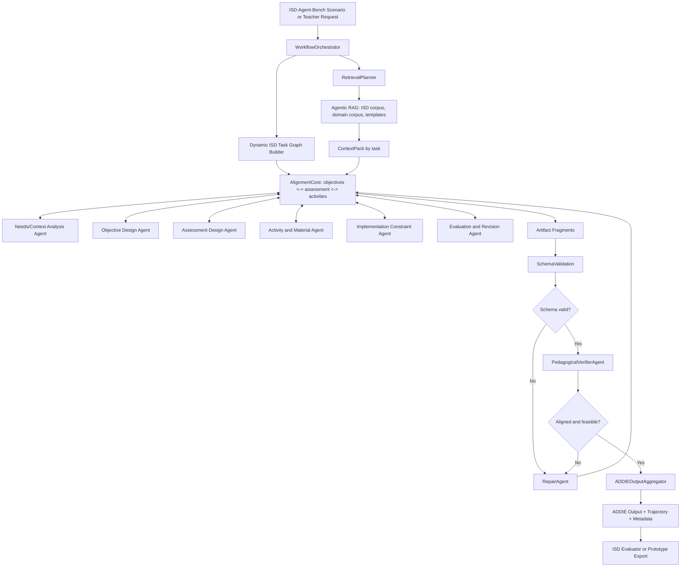

# Proposal: ISD Agent Harness for Continuous Instructional Design

## 1. Introduction

### 1.1 Problem Statement

Trong bối cảnh đào tạo nội bộ tại doanh nghiệp phần mềm, việc xây dựng một khoá học không kết thúc ở thời điểm có giáo án, slide, bài tập và rubric đầu tiên. Với các chương trình đào tạo nhân viên mới, fresher hoặc kỹ sư chuyển vai trò, nội dung thường phải được cập nhật liên tục theo thay đổi của công nghệ, yêu cầu dự án, năng lực đầu vào của học viên và phản hồi sau mỗi lần triển khai. Một khoá học về Java, lập trình hướng đối tượng, cấu trúc dữ liệu, kiểm thử phần mềm hoặc quy trình phát triển phần mềm có thể cần được điều chỉnh sau từng batch học viên: mục tiêu học tập cần rõ hơn, bài tập cần sát thực tế hơn, rubric cần nhất quán hơn, phần hướng dẫn cần dễ triển khai hơn, và hoạt động học tập cần phù hợp với thời lượng, môi trường học, nguồn lực và yêu cầu đánh giá.

Trong thực tế của tác giả khi tham gia xây dựng và cải tiến các khoá học nội bộ cho nhân viên và fresher, khối lượng công việc của instructional design không nằm ở một tác vụ đơn lẻ. Người thiết kế phải phân tích bối cảnh đào tạo, xác định mục tiêu học tập, xây dựng chuỗi hoạt động, tạo tài liệu, thiết kế bài tập, viết rubric, chuẩn bị kế hoạch triển khai, thu thập phản hồi và sửa đổi chương trình. Các công cụ LLM hiện nay có thể hỗ trợ từng việc riêng như sinh lesson plan, viết quiz, tạo rubric hoặc gợi ý feedback. Tuy nhiên, khi dùng như chatbot độc lập, các công cụ này thường thiếu một cơ chế điều phối theo lifecycle của Instructional Systems Design (ISD): output có thể không theo một schema ổn định, các pha Analysis, Design, Development, Implementation và Evaluation có thể bị lệch nhau, quá trình reasoning/tool-use khó truy vết, và lỗi ở một pha không được phát hiện rồi sửa có mục tiêu trước khi chuyển sang pha tiếp theo.

Các ISD agents hiện có trong ISD-Agent-Bench cho thấy nhiều hướng triển khai có giá trị: single-prompt baseline sinh toàn bộ ADDIE output trong một lần; ReAct-ISD dùng tool-use theo mẫu ReAct; ADDIE-Agent ép tuần tự năm pha ADDIE; Dick-Carey-Agent và RPISD-Agent mô phỏng các mô hình ISD cụ thể; EduPlanner dùng nhiều agent để tạo, đánh giá và tối ưu hoá artifact. Tuy vậy, các agent này chủ yếu đại diện cho từng chiến lược agent riêng lẻ. Luận văn này đặt vấn đề ở tầng harness: làm thế nào xây dựng một môi trường thực thi cho ISD agents có khả năng điều phối multi-agent workflow, truy xuất tri thức bằng agentic RAG, ràng buộc output bằng schema, kiểm tra chất lượng sư phạm bằng verifier, tự sửa lỗi có mục tiêu và ghi lại trajectory để đánh giá được bằng benchmark chuẩn.

### 1.2 Contributions

Luận văn đề xuất một đóng góp chính: **ISD Agent Harness**, một harness cho Instructional Systems Design agents. Harness này đặt LLM trong một execution framework chuyên cho ISD, gồm multi-agent orchestration, agentic RAG, schema-constrained generation, pedagogical verification, targeted repair và workflow trace. Thay vì chỉ sinh một artifact cuối, harness tổ chức quá trình thiết kế dạy học thành các pha và node có input/output rõ ràng, cho phép kiểm soát chất lượng, tái chạy phần lỗi và thu thập dữ liệu đánh giá quá trình.

Đóng góp thứ hai là một **prototype sản phẩm** cho case study trong miền IT/Software Engineering. Prototype minh hoạ cách harness được dùng trong một workflow thực tế: nhận yêu cầu thiết kế hoặc cải tiến một module đào tạo, truy xuất tài liệu miền phần mềm, tạo ADDIE-compatible artifact, kiểm tra alignment giữa mục tiêu-hoạt động-đánh giá, sinh rubric/bài tập, ghi trajectory và xuất kết quả theo format có thể đưa vào pipeline đánh giá. Case study không nhằm chứng minh hiệu quả học tập dài hạn, mà nhằm cho thấy harness có thể trở thành một công cụ hỗ trợ instructional designer/giảng viên nội bộ trong bối cảnh đào tạo phần mềm.

### 1.3 Research Questions

**RQ1.** Trên ISD-Agent-Bench, ISD Agent Harness cải thiện chất lượng artifact instructional design như thế nào so với các agent baseline và ISD agents hiện có?

**RQ2.** Các thành phần harness như multi-agent orchestration, agentic RAG, schema validation, pedagogical verifier và targeted repair ảnh hưởng như thế nào đến trajectory quality, schema validity, failure rate, latency và token/tool cost?

## 2. Method

### 2.1 Overview

Luận văn đề xuất **ISD Agent Harness** theo công thức:

```text
ISD Agent = ISD Agent Harness + Model
```

Trong đó, harness cung cấp môi trường thực thi chuyên cho ISD; model cung cấp năng lực ngôn ngữ, reasoning và generation bên trong môi trường đó. Harness không gắn cứng với một mô hình thiết kế dạy học duy nhất. Thay vào đó, nó biểu diễn ISD workflow như một graph có thể cấu hình, trong đó ADDIE là output contract chung để tương thích với ISD-Agent-Bench, còn các chiến lược như backward design, constructive alignment, Gagne sequencing hoặc rubric-first design được dùng như policy/verifier bên trong.

Kiến trúc tổng thể gồm năm lớp:

```text
Scenario / Teacher Request
  -> Orchestrator
  -> Dynamic ISD Task Graph
  -> Agentic RAG and Tool Layer
  -> Schema Validation + Pedagogical Verification + Targeted Repair
  -> ADDIE Output Aggregator + Trajectory + Prototype UI Artifact
```

### 2.2 Architectural Comparison with ISD-Agent-Bench Agents

Điểm khác biệt chính của harness so với các agent trong ISD-Agent-Bench là harness không chỉ là một agent strategy đơn lẻ. Nó là runtime điều phối nhiều role, nhiều nguồn tri thức, nhiều checkpoint và nhiều cơ chế kiểm tra. Các agent hiện có trong benchmark đại diện cho các chiến lược riêng: single-prompt generation, ReAct tool-use, sequential ADDIE, process-model-specific workflow hoặc generate-evaluate-optimize loop. ISD Agent Harness kết hợp các lợi thế này trong một kiến trúc có thể đo lường: workflow có task/fragment contract, agentic RAG có policy truy xuất, verifier có tiêu chí rõ, repair có target, và trajectory được log thống nhất.

| Agent/Architecture | Kiến trúc lõi | Điểm mạnh | Giới hạn chính | Khác biệt của kiến trúc đề xuất |
| --- | --- | --- | --- | --- |
| `baseline` | Một prompt sinh toàn bộ ADDIE output | Đơn giản, chi phí thấp, dễ chạy | Không có workflow trace giàu thông tin, không có kiểm tra pha, lỗi một phần khó sửa có mục tiêu | Harness chia workflow thành node/phase, validate từng phần và log trajectory |
| `react-isd` | ReAct agent dùng các ISD tools | Linh hoạt, có tool-use, gần agentic pattern phổ biến | Tool choice phụ thuộc mạnh vào model; thứ tự ISD và chất lượng output khó kiểm soát tất định | Harness dùng graph policy để kiểm soát transition, tool permission và phase contract |
| `addie-agent` | StateGraph tuyến tính qua 5 pha ADDIE | Rõ lifecycle, dễ tương thích output schema | Tuyến tính cứng; ít cơ chế repair/verifier và ít linh hoạt với domain/corpus | Harness giữ ADDIE contract nhưng cho phép dynamic orchestration, verifier và targeted repair |
| `dick-carey-agent` | Workflow theo Dick & Carey, có formative-evaluation loop | Mạnh ở systems approach và revision | Bám một process model cụ thể; mapping về ADDIE là lớp chuyển đổi | Harness không gắn cứng với một model ISD, dùng policy/verifier để kết hợp nhiều nguyên tắc |
| `rpisd-agent` | Rapid prototyping loop với feedback nhiều phía | Phù hợp cải tiến prototype và usability feedback | Phức tạp, cần nhiều giả định về feedback; không phải mọi scenario đều cần prototyping | Harness có thể bật/tắt loop repair theo verifier result thay vì ép mọi task vào prototyping |
| `eduplanner` | Multi-agent generate-evaluate-optimize | Có evaluator/optimizer loop, cải thiện artifact qua phản hồi | Tập trung vào tối ưu output, chưa nhấn mạnh agentic RAG, schema contract và trace chuẩn hoá ở mọi node | Harness dùng multi-agent theo role ISD, context pack theo pha, verifier/repair và trace thống nhất |
| **ISD Agent Harness** | Runtime gồm orchestrator, dynamic task graph, role-based agents, agentic RAG, schema/verifier/repair, trace | Kiểm soát được workflow, truy xuất tri thức theo task, sửa lỗi có mục tiêu, đánh giá được cả output và process | Chi phí latency/token cao hơn, cần thiết kế policy và corpus cẩn thận | Dùng ADDIE như output contract, nhưng execution bên trong là non-linear ISD orchestration |

### 2.3 Proposed Workflow

Workflow đề xuất bắt đầu từ scenario của ISD-Agent-Bench hoặc yêu cầu của giảng viên nội bộ. `WorkflowOrchestrator` không chạy cứng chuỗi Analysis -> Design -> Development -> Implementation -> Evaluation. Thay vào đó, nó tạo một **dynamic ISD task graph**, trong đó needs/context analysis, objective design, assessment design, activity/material design, implementation constraints và evaluation/revision planning có thể tương tác lặp quanh một `AlignmentCore`. ADDIE chỉ là output contract ở bước cuối: `ADDIEOutputAggregator` map các artifact fragments đã được kiểm tra vào schema `addie_output` để benchmark có thể đánh giá.



### 2.4 Multi-agent Orchestration

Harness dùng multi-agent workflow gồm các role sau:

| Role | Trách nhiệm | Output chính |
| --- | --- | --- |
| `WorkflowOrchestrator` | Phân tích request/scenario, tạo dynamic task graph, chọn policy, điều phối retry và ghi trace | execution graph, transition decision |
| `NeedsContextAgent` | Phân tích target audience, prior knowledge, context, constraints và task structure | needs/context fragment |
| `ObjectiveDesignAgent` | Thiết kế mục tiêu học tập, Bloom level, measurable criteria và prerequisite assumptions | objective fragment |
| `AssessmentDesignAgent` | Thiết kế evidence, rubric, formative/summative assessment và success criteria | assessment/rubric fragment |
| `ActivityMaterialAgent` | Tạo learning activities, materials, exercises, examples và facilitator notes | activity/material fragment |
| `ImplementationConstraintAgent` | Phân tích duration, resource, delivery mode, risk và deployment constraints; đẩy constraint ngược về design | implementation fragment |
| `EvaluationRevisionAgent` | Thiết kế evaluation plan, feedback loop và revision strategy | evaluation/revision fragment |
| `AlignmentCore` | Đồng bộ objectives, assessment, activities, implementation constraints và evaluation criteria | aligned artifact graph |
| `PedagogicalVerifierAgent` | Kiểm tra Bloom alignment, constructive alignment, coverage, actionability và consistency | verifier report |
| `RepairAgent` | Sửa có mục tiêu artifact fragment vi phạm schema hoặc verifier policy | repaired artifact patch |
| `ADDIEOutputAggregator` | Map artifact graph cuối vào schema `addie_output` của ISD-Agent-Bench | ADDIE-compatible output |

Các role có thể dùng cùng một model backend nhưng khác system prompt, tool permission, context pack và output schema. `WorkflowOrchestrator` không sinh toàn bộ nội dung thay các agent khác; nó giữ vai trò controller. Khác với ADDIE tuyến tính, các agent làm việc trên artifact fragments và tương tác qua `AlignmentCore`. Ví dụ, `AssessmentDesignAgent` có thể buộc `ObjectiveDesignAgent` sửa mục tiêu nếu không có evidence đo được; `ImplementationConstraintAgent` có thể đẩy constraint thời lượng/tài nguyên ngược lại để `ActivityMaterialAgent` điều chỉnh hoạt động. Điều này giúp harness giữ ADDIE-compatible output mà không bị ràng buộc vào execution order của `addie-agent`.

### 2.5 Agentic RAG

Agentic RAG là thành phần bắt buộc của harness. Khác với retrieval tĩnh, trong đó một query duy nhất được tạo từ topic, harness dùng một `RetrievalPlanner` để quyết định cần truy xuất gì cho từng pha ISD.

Nguồn tri thức gồm:

- scenario context từ ISD-Agent-Bench;
- ISD theory notes, ADDIE rubric, Bloom verbs, constructive alignment checklist;
- material/rubric templates của prototype;
- corpus IT/Software Engineering cho case study, ví dụ coding exercise template, rubric chấm bài lập trình, guideline cho code review, testing, OOP, data structures, software process;
- previous approved artifacts trong prototype, nếu người dùng chọn lưu lại như reusable material.

Quy trình agentic RAG:

```text
Request/Scenario
  -> RetrievalPlanner
  -> Query decomposition by ISD task
  -> Retrieval over ISD corpus + domain corpus + templates
  -> Reranking by task need and constraint
  -> ContextPack per agent
  -> Citation/grounding metadata in artifact
```

Ví dụ, khi scenario yêu cầu một khoá học Software Testing kéo dài hai tuần cho fresher, `NeedsContextAgent` cần context về learner background và training constraints; `ObjectiveDesignAgent` cần Bloom/action verbs và learning outcome patterns; `AssessmentDesignAgent` cần rubric mẫu cho test plan, bug report hoặc unit test assignment; `ActivityMaterialAgent` cần exercise templates và test-case design examples. Mỗi agent nhận context pack khác nhau theo task thay vì dùng một context chung quá dài.

### 2.6 Schema Contracts and Verification

Để tương thích với ISD-Agent-Bench, output cuối của harness tuân thủ schema ADDIE:

```text
addie_output.analysis
addie_output.design
addie_output.development
addie_output.implementation
addie_output.evaluation
trajectory
metadata
```

Mỗi pha có schema nội bộ chi tiết hơn schema cuối. Sau khi agent sinh output, harness chạy hai lớp kiểm tra:

1. **Schema validation**: kiểm tra JSON parseability, required fields, type, enum, ID format và field completeness.
2. **Pedagogical verification**: kiểm tra learning objectives có measurable/action verbs, objective-activity-assessment alignment, coverage giữa goals và artifacts, rubric consistency, feasibility theo duration/resources, và actionability cho người dạy.

Nếu lỗi thuộc schema, `RepairAgent` nhận validation error và artifact fragment để sửa cấu trúc. Nếu lỗi thuộc pedagogy, `RepairAgent` nhận verifier report và chỉ sửa phần liên quan. Harness ghi rõ retry count, violation type và repaired fields vào trajectory. Nhờ đó, evaluation không chỉ nhìn output cuối mà còn thấy quá trình hệ thống phát hiện và sửa lỗi.

### 2.7 Prototype for IT/Software Engineering Case Study

Prototype là một sản phẩm teacher-facing cho miền IT/Software Engineering. Giao diện tối thiểu gồm:

- nhập yêu cầu thiết kế/cải tiến module đào tạo;
- chọn subject area như Java/OOP, Data Structures, Software Testing, Git, Agile/Scrum hoặc Software Engineering fundamentals;
- chọn duration, target audience, delivery mode, resource constraints;
- xem artifact ADDIE đã sinh;
- xem verifier warnings và repair history;
- xuất JSON theo schema benchmark và Markdown/PDF lesson package cho người dạy;
- xem workflow trace gồm agent steps, retrieval sources, validation result, verifier result, token/cost/latency.

Prototype phục vụ hai mục tiêu. Thứ nhất, nó chứng minh harness có thể vận hành như một sản phẩm thực tế chứ không chỉ là script benchmark. Thứ hai, nó cung cấp case study để phân tích sâu các artifact trong miền phần mềm, nơi yêu cầu thiết kế thường có nhiều ràng buộc domain-specific như bài tập code, rubric chấm correctness/design/readability, môi trường lab, test case và feedback vòng lặp.

## 3. Evaluation

### 3.1 Evaluation Goals

Evaluation của luận văn tập trung vào hai câu hỏi nghiên cứu: harness có tạo output ISD tốt hơn không, và các thành phần của harness có làm quá trình tạo output đáng tin cậy hơn không. Luận văn không tự xây benchmark mới. Đánh giá định lượng chính dùng ISD-Agent-Bench, vì benchmark này đã có scenario set, input/output schema, nhiều agent baseline và evaluator dựa trên ADDIE rubric cùng trajectory scoring. Bên cạnh đó, prototype IT/Software Engineering được dùng như một case study định tính để minh hoạ harness trong bối cảnh đào tạo nội bộ thực tế.

### 3.2 Quantitative Evaluation on ISD-Agent-Bench

Harness được tích hợp như một agent mới trong pipeline ISD-Agent-Bench. Nó nhận cùng scenario JSON với các agent khác và trả về cùng output schema.

```bash
isd-harness-agent run \
  --input scenario.json \
  --output result.json \
  --trajectory trajectory.json
```

Các biến thể so sánh:

| Variant | Mục đích |
| --- | --- |
| `baseline` | lower bound single-prompt generation |
| `react-isd` | so sánh với ReAct tool-use agent |
| `addie-agent` | so sánh với sequential ADDIE workflow |
| `dick-carey-agent` | so sánh với systems approach có feedback loop |
| `rpisd-agent` | so sánh với rapid prototyping workflow |
| `eduplanner` | so sánh với generate-evaluate-optimize multi-agent strategy |
| `isd-harness-agent` | proposed harness |

Các metric chính:

| Metric | Ý nghĩa |
| --- | --- |
| `total_score` | điểm tổng hợp của evaluator |
| `addie_score` | chất lượng artifact theo ADDIE rubric |
| `trajectory_score` | chất lượng quá trình/tool-use nếu có trajectory |
| `schema_validity` | tỷ lệ output hợp lệ theo schema |
| `phase_coverage` | năm pha ADDIE có đủ nội dung cần thiết không |
| `alignment_score` | mục tiêu, hoạt động, assessment và rubric có nhất quán không |
| `repair_success_rate` | tỷ lệ lỗi schema/verifier được sửa thành công |
| `latency_ms`, `llm_calls`, `tool_calls`, `token_usage` | chi phí vận hành |

Kết quả được báo cáo theo toàn bộ test split hoặc một subset cân bằng nếu giới hạn chi phí. Subset phải được chọn trước khi chạy, stratified theo domain, difficulty, duration, learning environment và class size. Mỗi run cần có manifest ghi rõ model, judge, prompt version, commit hash, sample list, seed, temperature, max tokens và adapter version.

### 3.3 Ablation Study

Để trả lời RQ2, luận văn chạy các ablation:

| Ablation | Thành phần bị tắt | Mục tiêu |
| --- | --- | --- |
| `no_rag` | bỏ agentic RAG, chỉ dùng scenario input | đo tác động của retrieval/context grounding |
| `no_verifier` | bỏ pedagogical verifier | đo lỗi alignment và rubric consistency |
| `no_repair` | phát hiện lỗi nhưng không sửa | đo giá trị của targeted repair |
| `single_agent` | thay multi-agent workflow bằng một agent sinh toàn bộ output | đo giá trị của role decomposition |
| `linear_addie_only` | giữ graph tuyến tính, bỏ dynamic orchestration policy | so sánh harness với ADDIE sequential agent |

Ablation không nhằm tạo thêm nhiều claim rời rạc. Nó giúp giải thích contribution chính: harness tốt hơn vì thành phần nào, trong điều kiện nào, và trade-off chi phí ra sao.

### 3.4 Case Study Evaluation for IT/Software Engineering Prototype

Case study dùng 3-5 tác vụ thiết kế/cải tiến khoá học trong miền IT/Software Engineering, ví dụ:

- thiết kế module OOP Java cho fresher trong 2 tuần;
- cải tiến bài tập Data Structures để tăng độ rõ của rubric;
- tạo lesson package cho Software Testing gồm lab, checklist, rubric và formative quiz;
- thiết kế mini-project Git/Agile cho nhóm mới vào dự án;
- chuyển một workshop Code Review thành blended learning module.

Mỗi case study được phân tích theo các tiêu chí:

| Tiêu chí | Câu hỏi đánh giá |
| --- | --- |
| Domain relevance | Artifact có đúng với thực hành IT/Software Engineering không? |
| Instructional alignment | Objectives, activities, materials và assessment có khớp nhau không? |
| Actionability | Giảng viên có thể dùng hoặc chỉnh ít để triển khai không? |
| Trace usefulness | Trace có giúp hiểu vì sao artifact được tạo/sửa như vậy không? |
| Prototype usability | Workflow có phù hợp với thao tác thiết kế/cải tiến khoá học nội bộ không? |

Phần này có thể dùng expert review nhỏ với 2-3 người có kinh nghiệm đào tạo nội bộ hoặc software engineering education. Nếu chưa đủ điều kiện human evaluation, case study được báo cáo như qualitative analysis, không dùng để claim statistical superiority.

### 3.5 Threats to Validity

**Internal validity.** Prompt, model và judge có thể ảnh hưởng kết quả. Luận văn cần cố định run manifest, chạy cùng model/decoding config cho các variant khi khả thi, randomize order khi dùng LLM-as-judge và báo cáo lỗi connection/schema đầy đủ.

**Construct validity.** ISD-Agent-Bench đánh giá chất lượng artifact và trajectory, không đo trực tiếp learning outcome của học viên. Vì vậy, kết luận chỉ nằm ở chất lượng instructional design output và quá trình agentic workflow.

**External validity.** Prototype IT/Software Engineering chỉ minh hoạ một miền ứng dụng. Harness được thiết kế để mở rộng sang domain khác qua corpus, templates và verifier policy, nhưng luận văn không claim hiệu quả tương đương trên mọi môn học.

**Cost validity.** Multi-agent và agentic RAG có thể tăng latency/token cost. Vì vậy, evaluation cần báo cáo trade-off giữa điểm số, độ ổn định, số lần repair và chi phí vận hành, thay vì chỉ báo cáo chất lượng artifact.
