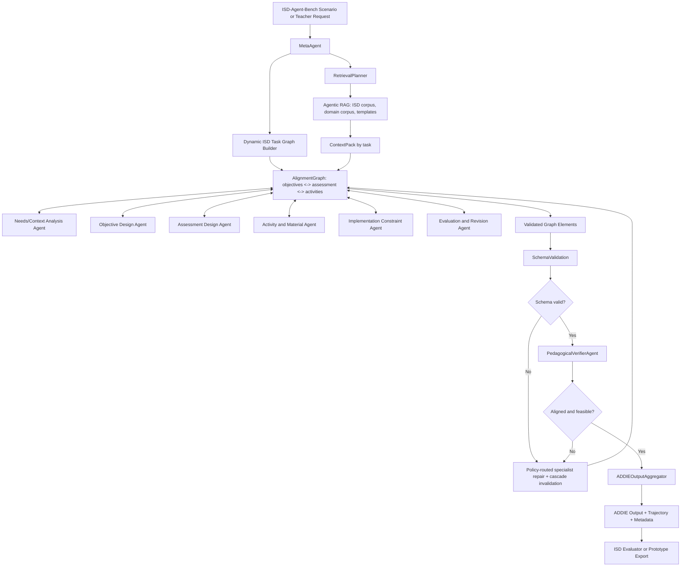

# Proposal: AlignmentGraph-ISD for Continuous Instructional Design

## 1. Introduction

### 1.1 Problem Statement

Trong bối cảnh **corporate training** tại các doanh nghiệp phần mềm, chương trình đào tạo nội bộ hiếm khi là một sản phẩm thiết kế một lần. Các khoá học dành cho nhân viên mới, intern, fresher hoặc kỹ sư chuyển đổi vai trò thường phải được cập nhật liên tục theo thay đổi của công nghệ, yêu cầu dự án, đặc điểm người học và phản hồi sau mỗi đợt triển khai. Trong thực tế, một module về Java, lập trình hướng đối tượng, cấu trúc dữ liệu, kiểm thử phần mềm hoặc quy trình phát triển phần mềm có thể cần được cải tiến nhiều lần về mục tiêu học tập, bài tập, rubric, tài liệu giảng dạy, ràng buộc triển khai và kế hoạch đánh giá.

Vấn đề này xuất phát từ trải nghiệm của tác giả trong quá trình xây dựng và cải tiến các khoá học nội bộ cho nhân viên, intern và fresher. Trong luận văn này, **instructional design** được hiểu là quá trình thiết kế có hệ thống các trải nghiệm học tập: phân tích nhu cầu và người học, xác định mục tiêu, thiết kế đánh giá, phát triển hoạt động/tài liệu, lập kế hoạch triển khai và cải tiến dựa trên phản hồi. Các mô hình ngôn ngữ lớn có thể hỗ trợ từng tác vụ riêng lẻ trong quá trình này, nhưng khi được sử dụng như chatbot độc lập, chúng còn hạn chế trong việc duy trì một lifecycle ISD nhất quán cho toàn bộ khoá học.

Các phương pháp gần đây trong AI for education đã tiếp cận bài toán này từ nhiều hướng. Một nhóm tập trung vào benchmark cho năng lực giáo dục của LLM, như OpenLearnLM, EduBench, MathTutorBench và TutorBench, nhưng chủ yếu đánh giá kiến thức, kỹ năng hoặc tutoring thay vì toàn bộ lifecycle ISD. Một nhóm khác tập trung vào hỗ trợ thiết kế bài học hoặc lập kế hoạch dạy học, như LearnLM, LessonPlanner, EduPlanner và các nghiên cứu về teaching plan generation bằng GPT-4. Gần hơn với ISD, ISD-Agent-Bench đề xuất benchmark dựa trên ADDIE và các agent dựa trên lý thuyết như ReAct-ADDIE, ADDIE-Agent, Dick-Carey-Agent và RPISD-Agent. Các hướng này cho thấy nhiều cách kiểm soát quá trình sinh artifact, từ one-shot prompting, tool-use, workflow tuần tự, multi-agent generation đến các mô hình ISD cổ điển.

Tuy vậy, các kiến trúc hiện có vẫn chủ yếu xem ISD như một quá trình sinh artifact tương thích với ADDIE. Chúng chưa đặt **mức độ khớp nhau giữa các thành phần thiết kế** như một trạng thái trung tâm có thể truy xét, kiểm tra và sửa có mục tiêu. Đây là một giới hạn quan trọng đối với bài toán cải tiến khoá học liên tục, vì chất lượng thiết kế không chỉ phụ thuộc vào việc có đủ mục tiêu, hoạt động, bài tập, rubric và kế hoạch triển khai, mà còn phụ thuộc vào việc các thành phần đó có ăn khớp với nhau hay không. Nói cách khác, cần biết mục tiêu nào được đo bởi bài đánh giá nào, hoạt động nào hỗ trợ mục tiêu nào, rubric nào phản ánh đúng evidence of learning nào, và ràng buộc triển khai nào có thể làm kế hoạch dạy học không khả thi.

Từ khoảng trống này, luận văn đề xuất **AlignmentGraph-ISD**, một alignment-graph harness cho ISD agents. Harness đề xuất biểu diễn các instructional design artifacts và sự ăn khớp giữa chúng như một graph tường minh. Hệ thống được thiết kế để tạo output tương thích với ADDIE, đồng thời duy trì một biểu diễn quá trình đủ chi tiết để có thể đánh giá bằng ISD-Agent-Bench.

### 1.2 Contributions

Luận văn đề xuất một đóng góp chính: **AlignmentGraph-ISD**, một alignment-graph harness cho Instructional Systems Design agents. Harness này đặt model trong một execution framework chuyên cho ISD, gồm dynamic task graph, multi-agent orchestration, agentic RAG, schema-constrained generation, pedagogical verification, targeted repair và workflow trace. Thay vì chỉ sinh một artifact cuối, AlignmentGraph-ISD tổ chức quá trình thiết kế dạy học thành các artifact nodes và alignment edges có quan hệ rõ ràng, cho phép kiểm soát chất lượng, tái chạy phần lỗi và thu thập dữ liệu đánh giá quá trình.

Đóng góp thứ hai là một **prototype sản phẩm** cho case study trong miền IT/Software Engineering. Prototype minh hoạ cách AlignmentGraph-ISD được dùng trong một workflow thực tế: nhận yêu cầu thiết kế hoặc cải tiến một module đào tạo, truy xuất tài liệu miền phần mềm, tạo ADDIE-compatible artifact, kiểm tra alignment giữa mục tiêu-hoạt động-đánh giá, sinh rubric/bài tập, ghi trajectory và xuất kết quả theo format có thể đưa vào pipeline đánh giá. Case study không nhằm chứng minh hiệu quả học tập dài hạn, mà nhằm cho thấy AlignmentGraph-ISD có thể trở thành một công cụ hỗ trợ instructional designer/giảng viên nội bộ trong bối cảnh đào tạo phần mềm.

### 1.3 Research Questions

**RQ1.** Trên ISD-Agent-Bench, AlignmentGraph-ISD cải thiện chất lượng artifact instructional design như thế nào so với các agent baseline và ISD agents hiện có?

**RQ2.** Các thành phần của AlignmentGraph-ISD như dynamic task graph, multi-agent orchestration, agentic RAG, schema validation, pedagogical verifier và targeted repair ảnh hưởng như thế nào đến trajectory quality, schema validity, failure rate, latency và token/tool cost?

## 2. Method

### 2.1 Overview

Luận văn đề xuất **AlignmentGraph-ISD** theo công thức:

```text
AlignmentGraph-ISD Agent = AlignmentGraph-ISD Harness + Model
```

Trong đó, AlignmentGraph-ISD Harness cung cấp môi trường thực thi chuyên cho ISD; model cung cấp năng lực ngôn ngữ, reasoning và generation bên trong môi trường đó. Harness không gắn cứng với một mô hình thiết kế dạy học duy nhất. Thay vào đó, nó biểu diễn ISD workflow như một graph có thể cấu hình, trong đó ADDIE là output contract chung để tương thích với ISD-Agent-Bench, còn các chiến lược như backward design, constructive alignment, Gagne sequencing hoặc rubric-first design được dùng như policy/verifier bên trong.

Kiến trúc tổng thể gồm năm lớp:

```text
Scenario / Teacher Request
  -> Orchestrator
  -> Dynamic ISD Task Graph
  -> Agentic RAG and Tool Layer
  -> Schema Validation + Pedagogical Verification + Targeted Repair
  -> ADDIE Output Aggregator + Trajectory + Prototype UI Artifact
```

### 2.2 Why Alignment Graph?

AlignmentGraph-ISD chọn alignment graph vì chất lượng của một instructional design artifact không chỉ nằm ở việc sinh đủ năm mục ADDIE, mà nằm ở mức độ các thành phần thiết kế dạy học khớp với nhau. Trong một khoá học, learning objectives, assessments, activities, materials, implementation constraints và evaluation plan không độc lập. Một objective có thể được đo bởi nhiều assessment; một assessment có thể bao phủ nhiều objective; một activity có thể hỗ trợ nhiều objective; một constraint về thời lượng, môi trường lab hoặc năng lực đầu vào có thể làm một activity không còn khả thi. Các quan hệ nhiều-nhiều này phù hợp với biểu diễn graph hơn là một workflow tuyến tính.

Trong phương pháp đề xuất, `AlignmentGraph` không chỉ là hình vẽ minh hoạ mà là trạng thái làm việc chung của harness trong suốt quá trình thiết kế:

```text
G_t = (V_t, E_t)

V_t = V_objective union V_assessment union V_activity
      union V_material union V_constraint union V_evaluation

E_t = {measures, supports, requires, constrains,
       evaluates, revises, depends_on}
```

Mỗi node lưu một artifact element có schema riêng, ví dụ objective, rubric item, activity, coding exercise, implementation constraint hoặc evaluation criterion. Mỗi edge lưu quan hệ khớp-nối giữa hai node, gồm relation type, source node, target node, evidence hoặc rationale, verification status và repair history. ADDIE vẫn được giữ như output contract cuối để tương thích với ISD-Agent-Bench, nhưng execution state bên trong là graph.

Cách biểu diễn này tạo ra bốn lợi ích kiến trúc. Thứ nhất, verifier có thể kiểm tra alignment có cấu trúc ở cấp edge, ví dụ assessment có thật sự đo objective hay activity có thật sự hỗ trợ outcome. Thứ hai, repair trở nên có mục tiêu: khi một rubric không đo đúng objective, harness sửa assessment node hoặc `measures` edge liên quan thay vì sinh lại toàn bộ lesson plan. Thứ ba, orchestration trở nên phi tuyến: `MetaAgent` có thể nhìn trạng thái graph, missing edge hoặc failed node để quyết định bước kế tiếp, thay vì chạy cứng Analysis -> Design -> Development -> Implementation -> Evaluation. Thứ tư, trajectory trở nên đánh giá được vì mỗi thao tác thêm, sửa, kiểm tra hoặc repair node/edge đều có thể được log lại cùng agent, retrieval context, verifier result, token/cost và latency.

Vì vậy, alignment graph là cơ sở để nối ba yêu cầu của luận văn: giữ chất lượng sư phạm thông qua alignment, hỗ trợ execution phi tuyến thay vì ADDIE tuyến tính cứng, và tạo trajectory đủ chi tiết để đánh giá bằng ISD-Agent-Bench.

### 2.3 Architectural Comparison with ISD-Agent-Bench Agents

Điểm khác biệt chính của AlignmentGraph-ISD so với các agent trong ISD-Agent-Bench là nó không chỉ là một agent strategy đơn lẻ. Nó là harness điều phối nhiều role, nhiều nguồn tri thức, nhiều checkpoint và nhiều cơ chế kiểm tra. Các agent hiện có trong benchmark đại diện cho các chiến lược riêng: single-prompt generation, ReAct tool-use, sequential ADDIE, process-model-specific workflow hoặc generate-evaluate-optimize loop. AlignmentGraph-ISD kết hợp các lợi thế này trong một kiến trúc có thể đo lường: workflow có graph-element contract, agentic RAG có policy truy xuất, verifier có tiêu chí rõ, repair có target, và trajectory được log thống nhất.

| Agent/Architecture | Kiến trúc lõi | Điểm mạnh | Giới hạn chính | Khác biệt của kiến trúc đề xuất |
| --- | --- | --- | --- | --- |
| `baseline` | Một prompt sinh toàn bộ ADDIE output | Đơn giản, chi phí thấp, dễ chạy | Không có workflow trace giàu thông tin, không có kiểm tra pha, lỗi một phần khó sửa có mục tiêu | AlignmentGraph-ISD chia workflow thành artifact nodes và alignment edges, validate từng phần và log trajectory |
| `react-isd` | ReAct agent dùng các ISD tools | Linh hoạt, có tool-use, gần agentic pattern phổ biến | Tool choice phụ thuộc mạnh vào model; thứ tự ISD và chất lượng output khó kiểm soát tất định | AlignmentGraph-ISD dùng graph policy để kiểm soát transition, tool permission và graph-element contract |
| `addie-agent` | StateGraph tuyến tính qua 5 pha ADDIE | Rõ lifecycle, dễ tương thích output schema | Tuyến tính cứng; ít cơ chế repair/verifier và ít linh hoạt với domain/corpus | AlignmentGraph-ISD giữ ADDIE contract nhưng cho phép dynamic orchestration, verifier và targeted repair |
| `dick-carey-agent` | Workflow theo Dick & Carey, có formative-evaluation loop | Mạnh ở systems approach và revision | Bám một process model cụ thể; mapping về ADDIE là lớp chuyển đổi | AlignmentGraph-ISD không gắn cứng với một model ISD, dùng policy/verifier để kết hợp nhiều nguyên tắc |
| `rpisd-agent` | Rapid prototyping loop với feedback nhiều phía | Phù hợp cải tiến prototype và usability feedback | Phức tạp, cần nhiều giả định về feedback; không phải mọi scenario đều cần prototyping | AlignmentGraph-ISD có thể bật/tắt loop repair theo verifier result thay vì ép mọi task vào prototyping |
| `eduplanner` | Multi-agent generate-evaluate-optimize | Có evaluator/optimizer loop, cải thiện artifact qua phản hồi | Tập trung vào tối ưu output, chưa nhấn mạnh agentic RAG, schema contract và trace chuẩn hoá ở mọi node | AlignmentGraph-ISD dùng multi-agent theo role ISD, context pack theo task, verifier/repair và trace thống nhất |
| **AlignmentGraph-ISD** | Harness gồm orchestrator, dynamic task graph, role-based agents, agentic RAG, schema/verifier/repair, trace | Kiểm soát được workflow, truy xuất tri thức theo task, sửa lỗi có mục tiêu, đánh giá được cả output và process | Chi phí latency/token cao hơn, cần thiết kế policy và corpus cẩn thận | Dùng ADDIE như output contract, nhưng execution bên trong là non-linear ISD orchestration |

### 2.4 Proposed Workflow

Workflow đề xuất bắt đầu từ scenario của ISD-Agent-Bench hoặc yêu cầu của giảng viên nội bộ. `MetaAgent` không chạy cứng chuỗi Analysis -> Design -> Development -> Implementation -> Evaluation. Thay vào đó, nó tạo một **dynamic ISD task graph**, trong đó needs/context analysis, objective design, assessment design, activity/material design, implementation constraints và evaluation/revision planning có thể tương tác lặp quanh một `AlignmentGraph`. ADDIE chỉ là output contract ở bước cuối: `ADDIEOutputAggregator` serialize AlignmentGraph đã được kiểm tra vào schema `addie_output` để benchmark có thể đánh giá.



### 2.5 Multi-agent Orchestration

AlignmentGraph-ISD dùng multi-agent workflow gồm các role sau:

| Role | Trách nhiệm | Output chính |
| --- | --- | --- |
| `MetaAgent` | Phân tích request/scenario, tạo dynamic task graph, chọn policy, điều phối retry và ghi trace | execution graph, transition decision |
| `NeedsContextAgent` | Phân tích target audience, prior knowledge, context, constraints và task structure | need/context nodes and edges |
| `ObjectiveDesignAgent` | Thiết kế mục tiêu học tập, Bloom level, measurable criteria và prerequisite assumptions | objective nodes and prerequisite edges |
| `AssessmentDesignAgent` | Thiết kế evidence, rubric, formative/summative assessment và success criteria | assessment/rubric nodes and `measures` edges |
| `ActivityMaterialAgent` | Tạo learning activities, materials, exercises, examples và facilitator notes | activity/material nodes and `supports` edges |
| `ImplementationConstraintAgent` | Phân tích duration, resource, delivery mode, risk và deployment constraints; đẩy constraint ngược về design | constraint nodes and `constrained_by` edges |
| `EvaluationRevisionAgent` | Thiết kế evaluation plan, feedback loop và revision strategy | evaluation nodes and `evaluated_by` edges |
| `AlignmentGraph` | Đồng bộ objectives, assessment, activities, implementation constraints và evaluation criteria; quản lý stale cascade khi node thay đổi | aligned artifact graph + stale impact state |
| `PedagogicalVerifierAgent` | Kiểm tra Bloom alignment, constructive alignment, coverage, actionability và consistency | verifier report |
| Specialist repair methods | Mỗi role agent tự sửa graph element thuộc chuyên môn của mình khi schema hoặc verifier policy báo lỗi | repaired node/edge patch |
| `ADDIEOutputAggregator` | Map artifact graph cuối vào schema `addie_output` của ISD-Agent-Bench | ADDIE-compatible output |

Các role có thể dùng cùng một model backend nhưng khác system prompt, tool permission, context pack và output schema. `MetaAgent` không sinh toàn bộ nội dung thay các agent khác; nó giữ vai trò controller. Khác với ADDIE tuyến tính, các agent làm việc trên graph elements: thêm, sửa hoặc liên kết artifact nodes và alignment edges trong `AlignmentGraph`. Ví dụ, `AssessmentDesignAgent` có thể buộc `ObjectiveDesignAgent` sửa objective node nếu không có evidence đo được; `ImplementationConstraintAgent` có thể đẩy constraint node ngược lại để `ActivityMaterialAgent` điều chỉnh activity nodes. Điều này giúp AlignmentGraph-ISD giữ ADDIE-compatible output mà không bị ràng buộc vào execution order của `addie-agent`.

### 2.6 Agentic RAG

Agentic RAG là thành phần bắt buộc của AlignmentGraph-ISD. Khác với retrieval tĩnh, trong đó một query duy nhất được tạo từ topic, harness dùng một `RetrievalPlanner` để quyết định cần truy xuất gì cho từng task ISD.

Nguồn tri thức gồm:

- scenario context từ ISD-Agent-Bench;
- ISD theory notes, ADDIE rubric, Bloom verbs, constructive alignment checklist;
- material/rubric templates của prototype;
- corpus IT/Software Engineering cho case study, ví dụ coding exercise template, rubric chấm bài lập trình, guideline cho code review, testing, OOP, data structures, software process;
- previous approved artifacts trong prototype, nếu người dùng chọn lưu lại như reusable material.

Quy trình agentic RAG:

```text
Request/Scenario
  -> RetrievalPlanner
  -> Query decomposition by ISD task
  -> Retrieval over ISD corpus + domain corpus + templates
  -> Reranking by task need and constraint
  -> ContextPack per agent
  -> Citation/grounding metadata in artifact
```

Ví dụ, khi scenario yêu cầu một khoá học Software Testing kéo dài hai tuần cho fresher, `NeedsContextAgent` cần context về learner background và training constraints; `ObjectiveDesignAgent` cần Bloom/action verbs và learning outcome patterns; `AssessmentDesignAgent` cần rubric mẫu cho test plan, bug report hoặc unit test assignment; `ActivityMaterialAgent` cần exercise templates và test-case design examples. Mỗi agent nhận context pack khác nhau theo task thay vì dùng một context chung quá dài.

### 2.7 Schema Contracts and Verification

Để tương thích với ISD-Agent-Bench, output cuối của AlignmentGraph-ISD tuân thủ schema ADDIE:

```text
addie_output.analysis
addie_output.design
addie_output.development
addie_output.implementation
addie_output.evaluation
trajectory
metadata
```

Mỗi graph element có schema nội bộ chi tiết hơn schema cuối. Sau khi agent sinh hoặc cập nhật node/edge, AlignmentGraph-ISD chạy hai lớp kiểm tra:

1. **Schema validation**: kiểm tra JSON parseability, required fields, type, enum, ID format và field completeness.
2. **Pedagogical verification**: kiểm tra learning objectives có measurable/action verbs, objective-activity-assessment alignment, coverage giữa goals và artifacts, rubric consistency, feasibility theo duration/resources, và actionability cho người dạy.

Nếu lỗi thuộc schema, policy route validation error và graph element liên quan về đúng owner agent để sửa cấu trúc. Nếu lỗi thuộc pedagogy, verifier report được route theo loại violation: objective/Bloom về `ObjectiveDesignAgent`, coverage về `AssessmentDesignAgent`, activity support về `ActivityMaterialAgent`, feasibility về `ImplementationConstraintAgent`, evaluation alignment về `EvaluationRevisionAgent`.

Sau mỗi targeted repair, AlignmentGraph chạy cascade invalidation thay vì chỉ sửa cục bộ. Impact matrix hiện tại:

| Node thay đổi | Node downstream cần refresh |
| --- | --- |
| `needs_context` | `objective`, `assessment`, `activity`, `material`, `constraint`, `evaluation` |
| `objective` | `assessment`, `activity`, `material`, `evaluation` |
| `assessment` | `activity`, `material`, `evaluation` |
| `activity` / `material` | peer development node, `assessment`, `constraint`, `evaluation` |
| `constraint` | `objective`, `assessment`, `activity`, `material`, `evaluation` |
| `evaluation` | `assessment` |

Các node/edge bị ảnh hưởng được đánh dấu `stale`; stale edge không được tính là coverage hợp lệ và không được đưa vào alignment evidence cuối. `GraphAuditor` biến stale state thành task mới, rồi `HarnessPolicy` route task đó về specialist agent tương ứng. AlignmentGraph-ISD ghi rõ retry count, violation type, repaired fields và cascade count vào trajectory. Nhờ đó, evaluation không chỉ nhìn output cuối mà còn thấy quá trình hệ thống phát hiện, sửa lỗi và xử lý hiệu ứng downstream.

### 2.8 Prototype for IT/Software Engineering Case Study

Prototype là một sản phẩm teacher-facing cho miền IT/Software Engineering. Giao diện tối thiểu gồm:

- nhập yêu cầu thiết kế/cải tiến module đào tạo;
- chọn subject area như Java/OOP, Data Structures, Software Testing, Git, Agile/Scrum hoặc Software Engineering fundamentals;
- chọn duration, target audience, delivery mode, resource constraints;
- xem artifact ADDIE đã sinh;
- xem verifier warnings và repair history;
- xuất JSON theo schema benchmark và Markdown/PDF lesson package cho người dạy;
- xem workflow trace gồm agent steps, retrieval sources, validation result, verifier result, token/cost/latency.

Prototype phục vụ hai mục tiêu. Thứ nhất, nó chứng minh AlignmentGraph-ISD có thể vận hành như một sản phẩm thực tế chứ không chỉ là script benchmark. Thứ hai, nó cung cấp case study để phân tích sâu các artifact trong miền phần mềm, nơi yêu cầu thiết kế thường có nhiều ràng buộc domain-specific như bài tập code, rubric chấm correctness/design/readability, môi trường lab, test case và feedback vòng lặp.

## 3. Evaluation

### 3.1 Evaluation Goals

Evaluation của luận văn tập trung vào hai câu hỏi nghiên cứu: AlignmentGraph-ISD có tạo output ISD tốt hơn không, và các thành phần của AlignmentGraph-ISD có làm quá trình tạo output đáng tin cậy hơn không. Luận văn không tự xây benchmark mới. Đánh giá định lượng chính dùng ISD-Agent-Bench, vì benchmark này đã có scenario set, input/output schema, nhiều agent baseline và evaluator dựa trên ADDIE rubric cùng trajectory scoring. Bên cạnh đó, prototype IT/Software Engineering được dùng như một case study định tính để minh hoạ AlignmentGraph-ISD trong bối cảnh đào tạo nội bộ thực tế.

### 3.2 Quantitative Evaluation on ISD-Agent-Bench

AlignmentGraph-ISD được tích hợp như một agent mới trong pipeline ISD-Agent-Bench. Nó nhận cùng scenario JSON với các agent khác và trả về cùng output schema.

```bash
alignmentgraph-isd run \
  --input scenario.json \
  --output result.json \
  --trajectory trajectory.json
```

Các biến thể so sánh:

| Variant | Mục đích |
| --- | --- |
| `baseline` | lower bound single-prompt generation |
| `react-isd` | so sánh với ReAct tool-use agent |
| `addie-agent` | so sánh với sequential ADDIE workflow |
| `dick-carey-agent` | so sánh với systems approach có feedback loop |
| `rpisd-agent` | so sánh với rapid prototyping workflow |
| `eduplanner` | so sánh với generate-evaluate-optimize multi-agent strategy |
| `alignmentgraph-isd` | proposed method |

Các metric chính:

| Metric | Ý nghĩa |
| --- | --- |
| `total_score` | điểm tổng hợp của evaluator |
| `addie_score` | chất lượng artifact theo ADDIE rubric |
| `trajectory_score` | chất lượng quá trình/tool-use nếu có trajectory |
| `schema_validity` | tỷ lệ output hợp lệ theo schema |
| `phase_coverage` | năm pha ADDIE có đủ nội dung cần thiết không |
| `alignment_score` | mục tiêu, hoạt động, assessment và rubric có nhất quán không |
| `repair_success_rate` | tỷ lệ lỗi schema/verifier được sửa thành công |
| `latency_ms`, `llm_calls`, `tool_calls`, `token_usage` | chi phí vận hành |

Kết quả được báo cáo theo toàn bộ test split hoặc một subset cân bằng nếu giới hạn chi phí. Subset phải được chọn trước khi chạy, stratified theo domain, difficulty, duration, learning environment và class size. Mỗi run cần có manifest ghi rõ model, judge, prompt version, commit hash, sample list, seed, temperature, max tokens và adapter version.

### 3.3 Ablation Study

Để trả lời RQ2, luận văn chạy các ablation:

| Ablation | Thành phần bị tắt | Mục tiêu |
| --- | --- | --- |
| `no_rag` | bỏ agentic RAG, chỉ dùng scenario input | đo tác động của retrieval/context grounding |
| `no_verifier` | bỏ pedagogical verifier | đo lỗi alignment và rubric consistency |
| `no_repair` | phát hiện lỗi nhưng không sửa | đo giá trị của targeted repair |
| `single_agent` | thay multi-agent workflow bằng một agent sinh toàn bộ output | đo giá trị của role decomposition |
| `linear_addie_only` | giữ graph tuyến tính, bỏ dynamic orchestration policy | so sánh AlignmentGraph-ISD với ADDIE sequential agent |

Ablation không nhằm tạo thêm nhiều claim rời rạc. Nó giúp giải thích contribution chính: AlignmentGraph-ISD tốt hơn vì thành phần nào, trong điều kiện nào, và trade-off chi phí ra sao.

### 3.4 Case Study Evaluation for IT/Software Engineering Prototype

Case study dùng 3-5 tác vụ thiết kế/cải tiến khoá học trong miền IT/Software Engineering, ví dụ:

- thiết kế module OOP Java cho fresher trong 2 tuần;
- cải tiến bài tập Data Structures để tăng độ rõ của rubric;
- tạo lesson package cho Software Testing gồm lab, checklist, rubric và formative quiz;
- thiết kế mini-project Git/Agile cho nhóm mới vào dự án;
- chuyển một workshop Code Review thành blended learning module.

Mỗi case study được phân tích theo các tiêu chí:

| Tiêu chí | Câu hỏi đánh giá |
| --- | --- |
| Domain relevance | Artifact có đúng với thực hành IT/Software Engineering không? |
| Instructional alignment | Objectives, activities, materials và assessment có khớp nhau không? |
| Actionability | Giảng viên có thể dùng hoặc chỉnh ít để triển khai không? |
| Trace usefulness | Trace có giúp hiểu vì sao artifact được tạo/sửa như vậy không? |
| Prototype usability | Workflow có phù hợp với thao tác thiết kế/cải tiến khoá học nội bộ không? |

Phần này có thể dùng expert review nhỏ với 2-3 người có kinh nghiệm đào tạo nội bộ hoặc software engineering education. Nếu chưa đủ điều kiện human evaluation, case study được báo cáo như qualitative analysis, không dùng để claim statistical superiority.

### 3.5 Threats to Validity

**Internal validity.** Prompt, model và judge có thể ảnh hưởng kết quả. Luận văn cần cố định run manifest, chạy cùng model/decoding config cho các variant khi khả thi, randomize order khi dùng LLM-as-judge và báo cáo lỗi connection/schema đầy đủ.

**Construct validity.** ISD-Agent-Bench đánh giá chất lượng artifact và trajectory, không đo trực tiếp learning outcome của học viên. Vì vậy, kết luận chỉ nằm ở chất lượng instructional design output và quá trình agentic workflow.

**External validity.** Prototype IT/Software Engineering chỉ minh hoạ một miền ứng dụng. AlignmentGraph-ISD được thiết kế để mở rộng sang domain khác qua corpus, templates và verifier policy, nhưng luận văn không claim hiệu quả tương đương trên mọi môn học.

**Cost validity.** Multi-agent và agentic RAG có thể tăng latency/token cost. Vì vậy, evaluation cần báo cáo trade-off giữa điểm số, độ ổn định, số lần repair và chi phí vận hành, thay vì chỉ báo cáo chất lượng artifact.
