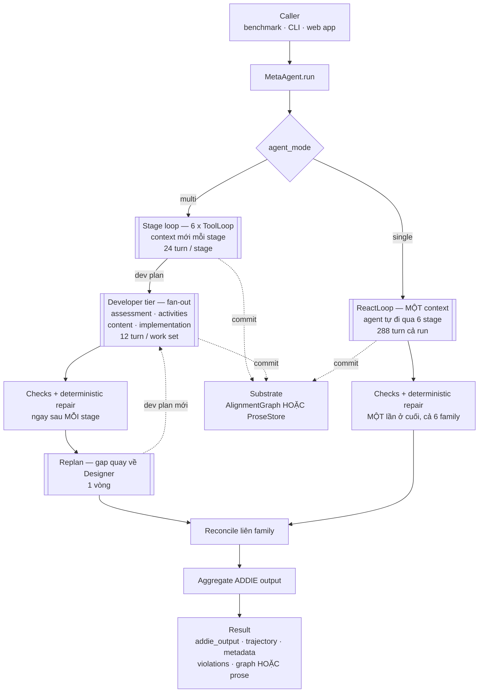
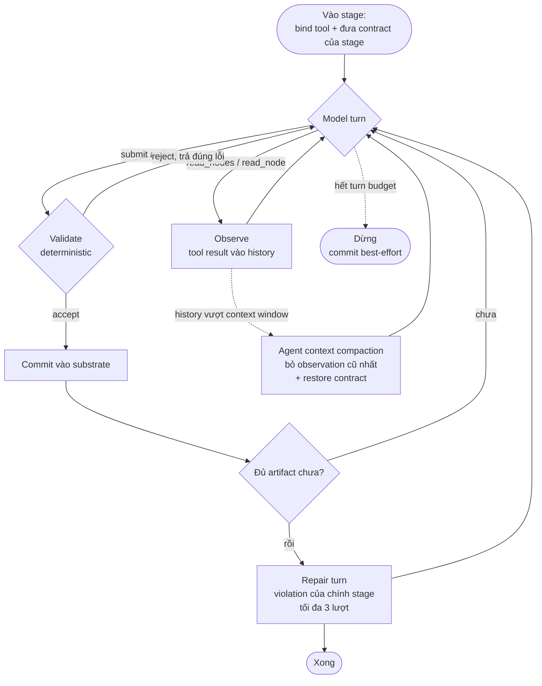
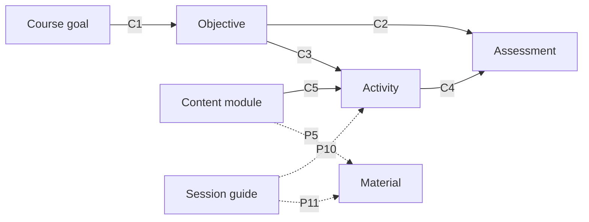

# Báo cáo Sprint 1 — 28/08 đến 08/09/2026

**Đề tài**: AlignmentGraph-ISD — multi-agent system phân rã theo vai trò cho instructional design theo ADDIE, chạy trên
small language model (SLM). **Người thực hiện**: Bùi Việt Phương.

Báo cáo gồm: **(A)** việc đã làm và bằng chứng đo được, **(B)** kiến trúc và tóm tắt bài báo hiện tại, **(C)** tự đánh
giá và các điểm xin ý kiến thầy.

**Thuật ngữ dùng xuyên suốt**

| Thuật ngữ                    | Nghĩa trong báo cáo này                                                                                    |
|:-----------------------------|:-----------------------------------------------------------------------------------------------------------|
| **scenario**                 | Một đề bài thiết kế dạy học (bối cảnh, người học, ràng buộc) — đầu vào của mọi hệ                          |
| **ADDIE output**             | Sản phẩm đầu ra: bản thiết kế 5 pha Analysis · Design · Development · Implementation · Evaluation          |
| **harness**                  | Toàn bộ phần khung bao quanh model: điều phối stage, bind tool, validate, repair, budget. Không phải model |
| **arm**                      | Một cấu hình của hệ đề xuất trong ablation (multi/single × graph/prose). A0 = cấu hình đầy đủ              |
| **baseline**                 | Sáu hệ đối sánh có sẵn trong benchmark; `react-isd` là hệ có điểm judge cao nhất trong sprint              |
| **Designer / Developer**     | Designer là agent của một stage, lập plan; Developer là agent con viết từng phần (work set) theo plan đó   |
| **fan-out / work set**       | Một stage chia việc thành nhiều work set, mỗi work set giao cho một Developer                              |
| **coverage**                 | Với một quan hệ, tỉ lệ phần tử có ít nhất một cạnh của quan hệ đó. 1,00 = không phần tử nào bị bỏ sót      |
| **C1–C5, P1–P11**            | 16 loại cạnh của AlignmentGraph: 5 lõi, 11 phụ (định nghĩa ở mục 2.3)                                      |
| **transport**                | Tầng truyền giữa model và harness: parse tool call, ép kiểu tham số                                        |
| **fallback**                 | Đường dự phòng harness tự sinh output khi model thất bại — **đã gỡ hết** trong sprint                      |
| **gave_up**                  | Một stage dừng vì hết turn budget mà chưa đủ artifact                                                      |
| **agent context compaction** | Khi hội thoại của agent vượt context window, harness bỏ observation cũ nhất                                |
| **trajectory**               | Nhật ký toàn bộ tool call và event của một run — đầu vào của LLM judge                                     |

## Kết luận đặt trước

Sprint này là việc sửa lỗi harness, không phải thực nghiệm. Hệ đã đi từ hỏng từng phần sang chạy được. Ba điều cần nói
ngay:

- **Hai công cụ đo cho hai câu trả lời khác nhau, phải báo cả hai.** LLM judge: hệ đối sánh không đổi một dòng code nào
  mà điểm vẫn dao động 10.8 điểm, nên **không đọc được gì theo cả hai chiều**. Alignment panel (deterministic, không
  dùng LLM, chính là instrument của RQ2): **khoảng cách nới rộng đều đặn qua sprint** — nửa đầu thắng 4–6 trên 6 run,
  nửa cuối thắng **7/7 ở 5 trên 6 tín hiệu**. Đây là tín hiệu thật.
- **Token cost là điểm yếu lớn nhất**: tốn 15–55 lần `react-isd` — hệ đối sánh có điểm judge cao nhất trong sprint —
  vượt xa ngưỡng 3 lần đặt ra ban đầu. Tối ưu cost là **hạng mục của sprint tới** (mục 7.3); nếu không đạt thì khai báo
  thẳng thành **limitation**, kèm lập luận cost là cái giá của auditability.
- **Ladder chưa chạy dòng nào.** Mọi số ở đây đo trên **một scenario duy nhất thuộc `train_30`**, nên không số nào vào
  bài báo — nhưng cũng vì vậy mà `test_90` vẫn nguyên vẹn cho lần chạy báo cáo.

Thứ sprint này mua được là **độ tin cậy của hệ đo**: bốn lỗi làm hỏng chính các core relation đã được tìm ra và vá.
Không có sprint này, ladder sẽ chạy trên một hệ mà C1 coverage = 0 và P10/P11 coverage = 0 — tốn toàn bộ ngân sách API
để đo một đường hỏng.

---

## 0. Khung sprint

| Hạng mục          | Giá trị                                                                                    |
|:------------------|:-------------------------------------------------------------------------------------------|
| Cửa sổ            | 28/08 – 08/09/2026                                                                         |
| Loại việc         | Ổn định kiến trúc trước code freeze. **Không** thực nghiệm chính thức                      |
| Agent model       | `Qwen/Qwen3.5-2B` trên pod RunPod, vLLM, bf16, context 16k, output cap 8192                |
| Judge             | `gpt-4o-mini` + `gemini-2.5-flash-lite`, lấy trung bình                                    |
| Dữ liệu           | **Một scenario duy nhất, lấy từ `train_30`** — đúng tune split, nên `test_90` chưa bị đụng |
| Số run            | 13 run đơn scenario                                                                        |
| Bàn chẩn đoán phụ | Web app demo — ≥ 8 bản vá bắt từ đây                                                       |
| Test              | 367 → **621**                                                                              |

Năm chỉ số theo dõi:

| Chỉ số            | Đầu sprint        | Cuối sprint               | Đọc thế nào                                    |
|:------------------|:------------------|:--------------------------|:-----------------------------------------------|
| Stage `gave_up`   | 4/6               | **1/6** (run cuối 2/6)    | Thật, ngoài nhiễu                              |
| P10/P11 coverage  | 0,00 / 0,00       | **1,00 / 1,00**           | Thật, đo từ graph                              |
| Cost một run      | 300 call / 1298 s | 148–346 call / 574–1157 s | Dao động theo quy mô output, **chưa giảm bền** |
| ADDIE (LLM judge) | 71,3–86,4         | 74,3–82,6                 | **Không đọc được** — dưới sàn nhiễu 10.8       |
| Alignment panel   | thắng 4–6 / 6 run | **7/7 ở 5/6 tín hiệu**    | **Đọc được** — deterministic, không nhiễu đo   |

Ba dòng đầu là kết quả kỹ thuật. Hai dòng cuối là **hai công cụ đo khác nhau** — LLM judge và alignment panel, định
nghĩa ở mục 3.3 — cho hai câu trả lời khác nhau; mục 4 giải thích vì sao chúng không mâu thuẫn.

---

## 1. Việc đã làm

### 1.1 Cách làm việc

Vòng lặp lặp đi lặp lại, mỗi vòng vài ngày:

> chạy 1 scenario trên pod → đọc trajectory và graph dump → tìm nguyên nhân → vá → chạy lại

Mỗi bản vá xuất phát từ **một triệu chứng đo được trên một run cụ thể**, không từ phỏng đoán, và đều kèm test tái hiện
đúng lỗi. Hai bản vá quan trọng nhất còn được xác nhận bằng cách tắt bản vá để xem test hỏng.

### 1.2 Vì sao phải đọc trajectory, không chỉ đọc điểm

Hai lần trong sprint, **safety net che mất lỗi thật**:

- Một run có toàn bộ 28 stage rơi xuống fallback vì lỗi transport, nhưng ADDIE output vẫn đầy đủ và không báo validation
  error nào. Nhìn từ file kết quả thì run đó bình thường.
- Một lần khác, fan-out trả về 0 item, nhưng repair net tự sinh 15 assessment item, khiến kết quả *trông như* có output.

### 1.3 Tiến triển qua năm vòng

| Vòng | Thời gian | Trọng tâm                                                    | Kết quả cuối vòng                                                              |
|:-----|:----------|:-------------------------------------------------------------|:-------------------------------------------------------------------------------|
| 1    | cuối 08   | Transport tool-calling; bỏ scripted fallback                 | Tên tool hết rò vào nội dung giảng dạy; các arm chạy thật thay vì rơi fallback |
| 2    | 01/09     | Tái thiết kế single arm; cắt cost                            | **300 → 83 call** một run                                                      |
| 3    | 03–04/09  | Hai failure mode của SLM; fan-out cho stage `implementation` | C1 coverage **0,00 → 1,00**                                                    |
| 4    | 05–07/09  | Violation ledger; gom budget; artifact schema                | Violation đếm đúng, có lý do còn mở; bỏ mọi nội dung soạn sẵn trong repair     |
| 5    | 08/09     | Agent context compaction; hai lỗi alignment; refund lượt lỗi | **Lần đầu cả 5 core relation cùng lành** (0,90–1,00), P10/P11 đều 1,00         |

### 1.4 Các bản vá

| #  | Việc                                                                                                                                        | Triệu chứng đo được                                                                                                                                         |
|:---|:--------------------------------------------------------------------------------------------------------------------------------------------|:------------------------------------------------------------------------------------------------------------------------------------------------------------|
| 1  | Tách `submit` theo **từng artifact**                                                                                                        | Một submit chở cả stage thì một lỗi nhỏ hỏng toàn bộ. Có run 43 khoá lạ ghi đè `implementation_plan`, một artifact submit 3 lần không lần nào vào           |
| 2  | Hai artifact **optional → required**                                                                                                        | Stage có hai optional thì chỉ bao giờ landed được một. Một run ra 0 `media_selection` cho 15 material → **15/15 vi phạm P6**, không material nào có thể qua |
| 3  | Thực thi **mọi** tool call trong một lượt                                                                                                   | Chỉ call đầu chạy, phần còn lại bị bỏ im lặng; 5/6 stage phải phát lại lệnh đọc                                                                             |
| 4  | **Agent context compaction** — khi conversation vượt context window thì bỏ observation cũ nhất: hạ về low-water, và **restore** stage brief | Brief bị bỏ mất giữa chừng → model tự chế tên field, bị reject 8 lần, một artifact không bao giờ commit                                                     |
| 5  | Shape của artifact: **prompt → tool schema**                                                                                                | Hai bản khai báo cho cùng một thông tin, trả token hai lần                                                                                                  |
| 6  | Tách **listing** khỏi **read đầy đủ**                                                                                                       | Tool result chiếm 3.590–5.607 token / budget 8.192, hội thoại thật chỉ 352–934                                                                              |
| 7  | `read_node` nhận **nhiều id một lượt**                                                                                                      | 27 lượt cho 24 read call; ở turn budget 24 thì chỉ riêng đọc đã hết stage                                                                                   |
| 8  | `implementation` thành **fan-out family thứ tư**                                                                                            | 161 activity, stage `gave_up`, **0 cạnh P10/P11** — cả design không được xếp lịch                                                                           |
| 9  | Vòng **replan** (1 vòng)                                                                                                                    | Gap quay về Designer, và Designer trả lời bằng *dev plan*, không phải artifact                                                                              |
| 10 | Dedup phần tử, **có đếm số bị loại**                                                                                                        | 50 objective chỉ có 4 nội dung phân biệt, một cái lặp 32 lần → 63 work set, 161 activity                                                                    |
| 11 | Chuỗi trần cho artifact một field                                                                                                           | `course_goal` gửi dạng câu thay vì object → **C1 coverage 0/50**                                                                                            |
| 12 | Violation ledger: tự giải thích, đếm theo key, 4 `open_reason`                                                                              | 10 violation phân biệt bị cộng thành 40 qua 20 vòng                                                                                                         |
| 13 | **Gỡ mọi nội dung soạn sẵn** trong repair                                                                                                   | Một repair tự lấp chỗ trống là repair tự thoả mãn check của chính nó                                                                                        |
| 14 | Summary của agent context compaction **quay lại** qua đường prose riêng                                                                     | Bản cũ xin prose qua đường JSON → 3 call, 11,8k token, giữ lại **0**                                                                                        |
| 15 | Stage brief khi restore **mang theo tiến độ**                                                                                               | Restore nguyên văn → model submit lại 6 artifact đã commit, 9 lượt lãng phí                                                                                 |
| 16 | Summary **không được mang mệnh lệnh**                                                                                                       | Summary trả về "không cần gọi thêm nữa" — một mệnh lệnh nằm trong message không bao giờ bị trim                                                             |
| 17 | Chuẩn hoá reference khi commit content                                                                                                      | 12 module ghi **đúng** activity của mình mà không lập được cạnh C5 nào                                                                                      |
| 18 | **Gỡ** repair cho orphan module                                                                                                             | Repair trỏ mọi module mồ côi vào activity **đầu tiên** → 12 cạnh C5 bịa ra                                                                                  |
| 19 | Khớp từ theo **word boundary** trong check                                                                                                  | `"clear"` khớp "clearly", `"lab"` khớp "collaborate" — ba word list nói dối                                                                                 |
| 20 | Giá trị mẫu trong schema thành **placeholder**                                                                                              | Mẫu ghi cứng `video/mp4` → cả 8 material ra video, **P6 sai 8/8**                                                                                           |
| 21 | **Refund lượt cho tool call lỗi**                                                                                                           | Một call hỏng không sinh observation nào; tính phí nó là tiêu budget vào lỗi của chính harness                                                              |

Ba mục đáng nói kỹ hơn.

**Mục 8 — stage `implementation`.** Trước đây nó phải tự viết session guide cho 161 activity trong một submit. Điều đó
không thể làm được: danh sách 161 id vượt read budget, nên planner **không nhìn thấy chính những id nó được yêu cầu viết
ra**. Nay stage submit một dev plan chia session, và một
`SessionGuideDeveloper` viết từng block. Thứ mua được quan trọng hơn chỗ trống output: việc chia session thành một phép
chia **deterministic** trên toàn bộ id, nên P10/P11 coverage không còn phụ thuộc trí nhớ của SLM.

**Mục 14 — summary của agent context compaction, một đảo chiều có kiểm soát.** Khi context của một agent đầy, harness bỏ
bớt các observation cũ và thay chúng bằng một bản summary do model viết. Bản đầu bị gỡ giữa sprint; bản mới quay lại qua
một đường gọi prose riêng: không tool, không
`response_format`, attribute cho orchestrator, và **không bao giờ publish thành context của agent nào**. Đây là **một
hook của harness, không phải action của agent** — agent không chọn compaction context của chính nó và không có tool nào
cho việc đó. Ranh giới này có test canh giữ.

**Mục 17 + 18 — cặp lỗi alignment, ví dụ mạnh nhất về kỷ luật auditability.** Lỗi thứ nhất làm C5 coverage 0,08 trên một
design vốn đúng. Lỗi thứ hai tệ hơn: repair "chữa" tình huống đó bằng cách trỏ **mọi** module mồ côi vào activity **đầu
tiên** — check đóng lại, 12 cạnh C5 xuất hiện, 11/12 activity vẫn không được phủ, và graph **khẳng định 12 quan hệ mà
chính data của các module phủ nhận**. Lập luận khi gỡ, đáng đưa vào luận văn: deterministic repair được phép *sắp xếp
lại* những gì design đã có, nhưng **quyết định một module supports activity nào thì không phải sắp xếp lại — đó là viết
ra chính lời khẳng định alignment mà cả hệ này sinh ra để làm cho auditable.**

### 1.5 Diễn biến các run chẩn đoán

Arm chính (multi + graph), cùng một scenario.

| Ngày        | Giây | Call | Token | Node | P10/P11         | Stage `gave_up` |
|-------------|------|------|-------|------|-----------------|-----------------|
| 03/09       | 1109 | 239  | 910k  | 222  | 0,14 / 1,00     | 4/6             |
| 04/09       | 955  | 347  | 1,19M | 373  | **0,00 / 0,00** | 2/6             |
| 08/09 sáng  | 921  | 241  | 885k  | 79   | 1,00 / 0,93     | 2/6             |
| 08/09 trưa  | 703  | 197  | 701k  | 104  | **1,00 / 1,00** | **1/6**         |
| 08/09 chiều | 574  | 148  | 553k  | 67   | 1,00 / 1,00     | 3/6             |
| 08/09 tối   | 1157 | 346  | 1,30M | 171  | 1,00 / 1,00     | 2/6             |

Đây không phải đường đi lên đơn điệu, và không nên trình bày như vậy. Run buổi chiều tụt lại chính vì nó phơi ra lỗi C5,
và lỗi đó được vá ngay trong tối cùng ngày. Đó là hình dạng bình thường của một vòng chẩn đoán: mỗi run tồn tại để lộ ra
lỗi tiếp theo.

**Run cuối là run xác nhận bản vá C5**, cho hai kết quả ngược chiều: C5 coverage về **1,00** (từ 0,11), lần đầu cả 5
core relation cùng lành — nhưng **cost cao nhất sprint** (346 call, 1157 s, 1,30M token). Nguyên nhân là quy mô output
(171 node so với 67), không phải bản vá; dù vậy riêng stage `assessment` tiêu 25 lượt với 14 lần read rồi vẫn `gave_up`.

### 1.6 Những quyết định bị đảo ngược

1. **Summary của agent context compaction bị gỡ rồi khôi phục** trong hai ngày. Đảo ngược *việc gỡ*, không phải *thiết
   kế*: thứ thay đổi là transport, còn bất biến "một agent, một conversation" vẫn nguyên hiệu lực.
2. **Repair cho orphan module bị gỡ** — residual violation sẽ **tăng**, và đó là chủ ý.
3. **Hai artifact optional → required**: cơ chế "nhắc một lần cho optional" không đủ.
4. **Hướng repair P10/P11 đảo chiều**: từ "submit lại `instructor_guide`" sang "đưa vào một session block của dev
   plan" — sửa qua replan thay vì submit lại cả artifact.
5. **Một đứt gãy chỉ số phải khai báo**: counter đếm số lần agent context compaction nay tính cả phần của Developer
   tier, nên **không so được với run trước 08/09**.

---

## 2. Kiến trúc hiện tại

### 2.1 Luồng một run

Hai `agent_mode` đi **hai đường khác nhau**, không chỉ khác ở chỗ bắt đầu. Hộp viền đôi là một agent loop (chi tiết ở
mục 2.2).

Ba khác biệt giữa hai đường, đều là hệ quả của trục `agent_mode` chứ không phải lựa chọn riêng:

|                          | `multi`                                         | `single`                                                   |
|:-------------------------|:------------------------------------------------|:-----------------------------------------------------------|
| Developer tier (fan-out) | **Có** — Designer chia work set, Developer viết | **Không** — agent tự viết từng đợt trong context đang chạy |
| Replan                   | **Có** — 1 vòng, gap quay về Designer           | **Không** — không có ranh giới stage để treo vòng đó vào   |
| Deterministic repair     | Sau **mỗi** stage                               | **Một lần ở cuối**, quét cả sáu family                     |

Reconcile và aggregate là chung. Riêng repair, khác biệt chỉ nằm ở **thời điểm**: cùng bộ check, cùng
`SELF_VALIDATION_BUDGET`, cùng toolbox — một agent tự quyết thứ tự thì không có "sau mỗi stage" để bám vào.

### 2.2 Vòng lặp act→observe

Đây là đơn vị thực thi thật của hệ, và **cả hai arm dùng chung hình dạng này** — chỉ khác phạm vi một vòng. Không có
bước sinh riêng: **artifact chính là arguments của tool call `submit`**.

**Bốn nhánh thoát** — `submit` bị reject, hết turn budget, repair turn, và agent context compaction — đúng là bốn thứ
sprint đã sửa nhiều nhất (mục 1.4).

**Khác biệt giữa hai arm, tất cả đều là hệ quả của ranh giới context:**

|                    | `multi` (`ToolLoop`)             | `single` (`ReactLoop`)                                                |
|:-------------------|:---------------------------------|:----------------------------------------------------------------------|
| Phạm vi một vòng   | **Một stage**, rồi context mới   | **Cả brief** trong một context                                        |
| Turn budget        | 24 / stage                       | 288 cả run                                                            |
| Contract của stage | Đưa khi vào stage                | Bơm **từng stage một**, sau mỗi lần commit                            |
| Tool được bind     | Của stage đang chạy              | `submit` của **mọi stage chưa xong**; menu co lại dần                 |
| Trần submit        | 3 lần bị reject **mỗi artifact** | 8 lần **mỗi stage**, đếm cả accepted lẫn rejected                     |
| Hết budget ghi là  | `gave_up` **theo stage**         | `via_budget_exhaustion` cho **cả run**                                |
| Kết thúc           | Đủ artifact của stage            | Đủ **cả sáu** stage, cộng một cửa sổ trả lời repair bằng đúng 24 turn |

**Repair turn thì cố ý giống hệt nhau** ở hai arm — cùng `REPAIR_TURNS = 3`, cùng bộ violation. Nếu một arm được thấy
violation của mình còn arm kia thì không, khác biệt chất lượng đo được sẽ là *cái đó* chứ không phải ranh giới context,
tức trục mọc thêm biến thứ hai.

### 2.3 AlignmentGraph

**16 relation: 5 core (C1–C5) + 11 secondary (P1–P11)**, khai báo một lần duy nhất trong registry. Edge type là khoá
dạng `<id>-<verb>`, ví dụ `C2-assessed_by`.

**5 core relation** — xương sống construct validity, mỗi cái mang một trích dẫn lý thuyết:

| Id     | Edge            | Source → Target         | Ý nghĩa                                       | Lý thuyết                                    |
|:-------|:----------------|:------------------------|:----------------------------------------------|:---------------------------------------------|
| **C1** | `decomposes_to` | course_goal → objective | Course goal phân rã thành learning outcome    | Outcome-based / Backward Design              |
| **C2** | `assessed_by`   | objective → assessment  | Learning outcome được đo bằng assessment task | Constructive Alignment (Biggs) + UbD Stage 2 |
| **C3** | `practiced_by`  | objective → activity    | Learning outcome được luyện qua activity      | Constructive Alignment (Biggs)               |
| **C4** | `prepares_for`  | activity → assessment   | Activity chuẩn bị cho assessment task         | Backward Design + CA                         |
| **C5** | `supports`      | content → activity      | Content module hỗ trợ activity                | Backward Design                              |

C2, C3, C4 chính là ba cạnh tam giác Biggs, và cũng đúng là ba tín hiệu family A của RQ2 panel.

**11 secondary relation** — chỉ phục vụ provenance và traceability, **không bao giờ dùng làm bằng chứng construct
validity**:

| Id  | Edge         | Source → Target              | Ý nghĩa                                      |
|:----|:-------------|:-----------------------------|:---------------------------------------------|
| P1  | `informs`    | gap / topic → objective      | Gap hoặc topic dẫn tới learning outcome      |
| P2  | `fits`       | learner_profile → objective  | Learner profile phù hợp với outcome          |
| P3  | `realizes`   | assessment_plan → assessment | Assessment plan được hiện thực bằng task     |
| P4  | `realizes`   | activity_plan → activity     | Activity plan được hiện thực bằng activity   |
| P5  | `covers`     | content → material           | Content module bao phủ material              |
| P6  | `realizes`   | media_selection → material   | Media selection được hiện thực bằng material |
| P7  | `covers`     | topic → content              | Topic được phủ bởi content module            |
| P8  | `constrains` | constraint → media_selection | Ràng buộc chi phối lựa chọn media            |
| P9  | `addresses`  | gap → improvement            | Gap được xử lý bởi improvement               |
| P10 | `delivers`   | session_guide → activity     | Session guide xếp lịch activity              |
| P11 | `provisions` | session_guide → material     | Session guide cấp phát material              |

**Coverage đọc theo chiều nào là một phần của định nghĩa.** C2 và C3 tính coverage trên **source**
(bao nhiêu objective có ít nhất một assessment / activity), còn C1, C4, C5 và toàn bộ secondary tính trên **target**. Vì
vậy một activity không được xếp lịch chính xác là một activity không có P10 vào.

> **Vì sao 5 core chứ không phải 7.** C6/C7 đã bị rút vì chúng **không thể fail**: C6 được ghi từ
> chính commit tạo ra cả hai đầu, C7 là C6 hợp với C2 theo một rule đã có trong prompt. Cả hai đọc
> coverage 1,00 trên toàn bộ 28 run được ghi nhận. Một relation không thể fail thì không phải bằng
> chứng construct validity.

### 2.4 Sáu stage ADDIE

| Stage            | Identity              | Artifact chính                             | Fan-out |
|:-----------------|:----------------------|:-------------------------------------------|:-------:|
| `analysis`       | NeedsAnalyst          | 5 artifact phân tích, submit theo phần     |    –    |
| `outcomes`       | OutcomeDesigner       | `course_goal`, `learning_objectives`       |    –    |
| `assessment`     | AssessmentDesigner    | `assessment_plan`, `dev_plan`              |   ✓    |
| `activities`     | ActivityDesigner      | `instructional_strategies`, `dev_plan`     |   ✓    |
| `content`        | ContentDesigner       | `content_modules`, `media_selections`      |   ✓    |
| `implementation` | ImplementationPlanner | 6 artifact khung + `dev_plan` chia session |   ✓    |

Thứ tự 6 stage được instruct **y hệt** ở cả hai arm. Agent tự chủ trong việc *một stage chạy thế nào*, không bao giờ
tự chủ trong *thứ tự stage*.

### 2.5 Hai trục ablation (2×2)

| Arm                               | `agent_mode` | `context_mode` |
|:----------------------------------|:-------------|:---------------|
| `alignmentgraph-isd` (A0)         | multi        | graph          |
| `alignmentgraph-isd-multi-prose`  | multi        | prose          |
| `alignmentgraph-isd-single-graph` | single       | graph          |
| `alignmentgraph-isd-single-prose` | single       | prose          |

**`agent_mode`** là context boundary. `multi` bắt đầu mỗi stage trong context mới dưới identity của stage đó; `single`
mang **một** context qua cả sáu. Đây **cố ý là một bundle**: nó đổi context boundary, ai đi qua các stage, có bao nhiêu
persona, và công việc có được delegate hay không. Đó chính là điều "multi-agent vs single-agent" có nghĩa.

> **Điều kiện parity**: **không phải** hai arm tốn bằng nhau. Một agent tự lập plan và tự viết từng
> đợt không thể tốn cùng số call với một hệ đi theo plan cố định có Developer tier — chênh lệch số
> call **chính là treatment, không phải confound**. Thứ kiểm được là **không arm nào bị cắt bởi turn
> budget**. Chừng nào điều đó còn đúng, chênh lệch kết quả không thể quy cho trần.

**`context_mode`** là toàn bộ alignment machinery, cũng là một bundle. Arm prose chạy một blackboard không có graph, và
**thiếu chính xác**: không graph, không relation registry, không residual audit, chỉ 6 check trong phạm vi một artifact,
và hai family (`activities`, `content`) không có check nào nên không được self-validate cũng không được repair.

### 2.6 Budget

Mọi trần chi tiêu nằm trong một module duy nhất, mỗi hằng số kèm phép đo đã ấn định nó. Lý do gom về một chỗ không phải
gọn gàng: **vài trần bị coupled chéo qua trục decomposition**, nên một cặp trôi ra xa nhau là một chênh lệch trần nằm
ngay bên trong treatment.

| Hằng số                  | Giá trị | Ý nghĩa                                     |
|:-------------------------|:-------:|:--------------------------------------------|
| `STAGE_MAX_TURNS`        |   24    | Số lượt một stage được tiêu                 |
| `SINGLE_ARM_TURN_FACTOR` |    2    | Hệ số dôi cho single arm (24 × 6 × 2 = 288) |
| `DEVELOPER_MAX_TURNS`    |   12    | Số lượt cho một Developer call              |
| `SUBMIT_BUDGET`          |    3    | Số submit bị reject cho **mỗi artifact**    |
| `SUBMIT_CAP`             |    8    | Số submit mỗi stage, chỉ single arm         |
| `REPAIR_TURNS`           |    3    | Số lượt self-repair trong loop              |
| `REPLAN_ROUNDS`          |    1    | Số vòng replan                              |
| `SELF_VALIDATION_BUDGET` |    2    | Số vòng check–repair–recheck                |

> `STAGE_MAX_TURNS = 24` là **số tạm**, nhân đôi từ 12 vì 24 trên 27 lần `gave_up` đọc "turn budget
> exhausted", và single arm chạm trần toàn cục trong khi multi chưa bao giờ chạm — một trần ràng buộc
> **bất đối xứng** thì nằm bên trong treatment. Con số cuối cùng phải đo lại trên một lát tune.

### 2.7 Artifact một run để lại

| File                          | Nội dung                         | Arm       |
|:------------------------------|:---------------------------------|:----------|
| `<agent>_output.json`         | ADDIE output 5 pha               | mọi arm   |
| `<agent>_trajectory.json`     | trajectory + `metadata.autonomy` | mọi arm   |
| `<agent>_graph.json` / `.dot` | **graph dump đầy đủ**            | chỉ graph |
| `<agent>_prose.json`          | dump document thô                | chỉ prose |

> **Sự vắng mặt của graph dump ở arm prose chính là tương phản auditability được báo cáo.** Dump của
> arm prose là artifact để xem, không phải bản audit: nó không có relation và không có coverage.

---

## 3. Tóm tắt Intro / Method / Experimental setup / Kỳ vọng

> Bản thảo bài báo hiện tại vẫn chưa được cập nhật, vẫn mô tả thiết kế **trước pivot** (6 specialist trên pipeline
> LangGraph, 3 arm ablation, 13 relation, panel 7 tín hiệu), còn hệ hiện tại là **sau pivot** (vòng
> lặp tool-calling, 2×2 factorial, 16 relation, panel 6 tín hiệu). Mục này mô tả hệ thật đang chạy;
> việc đồng bộ bản thảo nằm ở mục 6.3.

### 3.1 Intro

**Chuỗi lập luận**:

1. Mô hình thương mại làm được gần trọn quy trình ISD, nhưng phụ thuộc API, chi phí, và dữ liệu người học đi qua bên thứ
   ba. Hướng thay thế: open-weight, trọng số nhỏ, chạy on-premise.
2. Với SLM, model nền tự gánh được ít hơn, nên chất lượng end-to-end phụ thuộc nhiều hơn vào hệ dựng quanh nó — harness.
   Phát biểu **trung lập có chủ ý** — không viết thành "phụ thuộc vào MAS (Multi-Agent System)", vì MAS là giải pháp đề
   xuất chứ không phải tiên đề.
3. Một design có thể đọc trôi chảy mà vẫn lệch alignment nghiêm trọng. Trong các hệ hiện có, sự nhất quán đó là
   **implicit** — nằm trong prose truyền giữa các bước — nên nó dựa vào đúng cái năng lực được kỳ vọng suy giảm trước
   tiên khi model nhỏ đi.
4. Văn liệu cho thấy decomposition là con đường có căn cứ, nhưng **quan hệ đó không đơn điệu**, nên nó phải đo chứ không
   được giả định.

**Gap**: chưa có công trình nào cho thấy một agent system giữ được chất lượng ISD end-to-end trên SLM mà không
fine-tune, cũng chưa có công trình nào đánh giá chất lượng đó dọc theo một model-size ladder.

**Contribution**: AlignmentGraph-ISD — 1 MAS tổ chức việc sinh chương trình ADDIE quanh một alignment graph, tức
alignment state tường minh và auditable. Phép đo không dùng LLM **không được tính là contribution**; nó là measurement
requirement, thuộc phần Experimental Design.

**Research questions:**

- **RQ1**: tại mỗi size Qwen 0.8B–9B, chất lượng so với các hệ đối sánh ra sao, và khoảng cách có nới rộng khi model nhỏ
  đi không?
- **RQ2**: các **measurable signal** của constructive alignment diễn biến thế nào theo size. Dừng ở
  "measurable signal", **không** phát claim "đo được alignment" (muốn claim phải cần có expert study).

**Claims bị cấm:**

| # | Cấm                                           | Thay bằng / lý do                                                     |
|:--|:----------------------------------------------|:----------------------------------------------------------------------|
| 1 | "vượt trội toàn diện", "tốt nhất mọi chỉ số"  | "competitive and robust"                                              |
| 2 | "verifier cải thiện chất lượng"               | nó là safety net + nguồn audit trail                                  |
| 3 | "chứng minh đầy đủ constructive alignment"    | chỉ có *measurable signal của* nó                                     |
| 4 | **mọi biến thể "hệ của ta rẻ hơn"**           | —                                                                     |
| 5 | mở rộng ra "SLM nói chung"                    | kết luận chỉ sống trên ladder Qwen 0.8B–9B                            |
| 6 | nhắc RAG trong bài báo                        | chỉ luận văn nhắc                                                     |
| 7 | gọi một metric là "alignment" hay "precision" | điểm benchmark = "LLM judge score"; giá trị panel = "alignment score" |

### 3.2 Method

**Loại hệ, cần nói chính xác**: **workflow-style / role-decomposed MAS** (cùng họ MetaGPT: điều phối tĩnh, không thương
lượng, không dynamic planning). Hai thứ cấu thành tính multi-agent: **role specialization** (mỗi specialist một persona
và một phạm vi artifact) và **scoped state access** (mỗi agent chỉ đọc/ghi lát cắt của mình).

**Agent contract**: mỗi specialist là bộ ba ⟨context được đọc, phần sinh ra, write contract⟩ — đọc một lát context một
bước, sinh nội dung trong đó mỗi item phải khai id của objective thượng nguồn nó phục vụ, và chỉ ghi những node type và
edge type được phép. Phát biểu chuẩn: chính **constrained decomposition**, chứ không phải bản thân cấu trúc graph, tạo
ra các liên kết bắt buộc ngay tại thời điểm sinh; và các specialist phía sau không thể âm thầm sửa tiền đề thượng nguồn.

**"Auditability" nghĩa là gì.** Cuối mỗi run, graph được dump đầy đủ, tách riêng khỏi trajectory. Claim là **"explicit
and auditable"**, tuyệt đối **không phải "aligned by construction"**. Về vận hành: một nhà giáo dục mở dump ra, xem
assessment nào đo objective nào, và can thiệp được — hệ là decision support cho chuyên gia ISD, không thay thế hoàn toàn
con người.

### 3.3 Thí nghiệm 1 — Ladder comparison (A0 vs baselines)

Trả lời RQ1 và RQ2. Đây là thí nghiệm nặng.

| Hạng mục        | Giá trị                                                                                                                     |
|:----------------|:----------------------------------------------------------------------------------------------------------------------------|
| Ladder          | Qwen3.5 ở **0.8B / 2B / 4B / 9B** — một họ, để chỉ capacity thay đổi                                                        |
| Dữ liệu         | `test_90` — 90 scenario, stratified 10 domain × 3 mức khó, seed 42                                                          |
| Agent           | **7**: A0 (`alignmentgraph-isd`) + 6 baseline (Baseline, EduPlanner, ADDIE-Agent, RPISD-Agent, Dick-Carey-Agent, ReAct-ISD) |
| Run             | 3 run độc lập mỗi size                                                                                                      |
| Quy mô          | 4 × 3 × 7 × 90 = **7.560 scenario runs**                                                                                    |
| LLM judge       | **2 model** cố định (`gpt-4o-mini` + `gemini-2.5-flash-lite`), lấy trung bình                                               |
| Alignment judge | Panel 6 tín hiệu, cấu hình chính (`nemotron` + `bertbloom`) + **sensitivity star 5 arm**                                    |

**LLM judge cho ba điểm, báo song song, không gộp thành một chỉ số dẫn dắt:**

| Điểm           | Judge chấm gì                                                                                                         | Thang |
|:---------------|:----------------------------------------------------------------------------------------------------------------------|:------|
| **ADDIE**      | Chất lượng nội dung thiết kế theo rubric ADDIE: 33 sub-step → 13 item → 5 phase                                       | 0–100 |
| **Trajectory** | Cách agent dùng tool, 4 tiêu chí BFCL × 25 điểm: gọi đúng tool, tham số đúng, tránh gọi trùng, có dùng kết quả trả về | 0–100 |
| **Total**      | `0,7 × ADDIE + 0,3 × Trajectory`                                                                                      | 0–100 |

Ba lưu ý về cách đọc chúng:

- **Cả ba đều do LLM judge chấm**, nên cả ba đều mang sàn nhiễu đo ở mục 4.1. Alignment panel thì khác hẳn:
  deterministic, không dùng LLM.
- **ADDIE dẫn narrative** vì nó đo đúng construct mà RQ1 hỏi. Trajectory đo *process conformance* — một construct khác,
  không phải chất lượng thiết kế.
- **Trọng số 0,7 / 0,3 của Total là của benchmark, không phải của nghiên cứu này.** Total được giữ chỉ để so được với
  kết quả công bố của ISD-Agent-Bench, và **không** được dùng làm chỉ số dẫn dắt.

**Deployment envelope quyết định output cap.** Mục tiêu là **một GPU 12–16 GB**. Ở bf16: 0.8B ≈ 1,6 GB, 2B ≈ 4 GB, 4B ≈
8 GB, còn 9B ≈ 18 GB **không vừa** — nên 4B là điểm lớn nhất trong envelope, 9B là mốc tham chiếu ngoài envelope. VRAM
còn lại là KV cache, cho khoảng 8k token mỗi call. Vì vậy output cap **8192 token**, đồng nhất mọi agent và mọi size.

**Alignment panel — 6 tín hiệu, phẳng, không có primary endpoint.** Toàn bộ deterministic, không dùng LLM, và **không có
ngưỡng khớp ở bất cứ đâu**.

| Tín hiệu               | Family | Đo gì                                                                                                                                                       | Quan hệ                   |
|:-----------------------|:-------|:------------------------------------------------------------------------------------------------------------------------------------------------------------|:--------------------------|
| Objective ↔ assessment | A      | Trung bình trên các objective của **cosine cao nhất** tới bất kỳ assessment item nào                                                                        | **C2**                    |
| Objective ↔ activity   | A      | Cùng công thức, với activity                                                                                                                                | **C3**                    |
| Activity ↔ assessment  | A      | Cùng công thức, activity → assessment. Không phụ thuộc objective nên vẫn đo được khi objective không parse được                                             | **C4**                    |
| Cognitive congruence   | B      | Với mỗi objective, lấy assessment item **có cosine cao nhất** (cùng phép ghép cặp với family A), rồi so Bloom level: item ≥ objective thì tính là congruent | **C2**                    |
| Porter                 | B      | Porter Alignment Index (Porter 2002 / Fulmer 2011): ma trận topic × Bloom-level chuẩn hoá hai phía, `P = 1 − 0,5·Σ \|X−Y\|`                                 | **C2+C3+C4** (trung bình) |
| Webb–Bloom             | B      | Webb Bloom-consistency (Webb 1997/1999), tính theo từng assessment item                                                                                     | **C2**                    |

Bốn điểm về thiết kế panel:

- **Hai family khác dụng cụ, đo cùng ba cạnh.** Family A dùng encoder. Family B dùng Bloom classifier: Porter và
  Webb–Bloom **không dùng similarity**; riêng cognitive congruence **dùng cosine để ghép cặp** rồi mới dùng Bloom để
  phán xét, nên nó **không hoàn toàn độc lập** với family A — điểm này phải khai trong bài. Câu trả lời cho phản biện
  "panel chỉ là biến thể của cosine" vì vậy dựa trên hai tín hiệu Porter và Webb–Bloom, không phải cả ba của family B.
- **Cosine là *rectified*** — `max(0, cos)` trên [0, 1]. Đây là lựa chọn **thang đo**, không phải ngưỡng khớp.
- **Vì sao bỏ ngưỡng.** Ngưỡng 0,25 từng dùng là quá lỏng nên coverage bão hoà ~1,00 cho mọi hệ, không phân biệt được
  gì, lại mở ra câu hỏi "sao lại chọn ngưỡng này". Đo liên tục phân biệt mạnh hơn hẳn.
- **Quy tắc đọc panel, pre-specified:** có lợi thế khi ít nhất **4/6** tín hiệu dương có ý nghĩa sau Holm **và** không
  tín hiệu nào âm có ý nghĩa; mọi hình dạng khác báo là **mixed**. Gọi một tín hiệu là "primary" chính là dựng một
  composite ngầm, nên panel không có tín hiệu nào được ưu tiên.

**Thống kê**: paired Wilcoxon theo scenario, bootstrap 95% (10.000 lần, seed 42), rank-biserial. Holm **hai tầng, báo cả
hai**: theo từng tín hiệu, và trên toàn panel.

**Failure policy — layer chính là `failure = 0`**, complete-case chỉ là sensitivity. Lý do: agent sập thì không ghi file
kết quả, nên loại scenario đó khỏi tập ghép cặp là **conditioning trên một post-treatment variable**; tỉ lệ sập lại khác
nhau theo agent và size, mạnh nhất ở model nhỏ — đúng nơi giả thuyết sống. **Không sinh được output *là* chất lượng 0,
không phải missing data.**

**Sensitivity là hình sao, không phải lưới**: cấu hình chính + 5 arm, mỗi arm lệch đúng một trục (encoder, sàn từ vựng
TF-IDF, Bloom classifier). TF-IDF là trục thật sự trực giao, vì các neural encoder đều học contrastive trên dữ liệu web
nên sai số của chúng có thể tương quan — **đồng thuận giữa các model chia sẻ cùng bias là đồng thuận rẻ tiền**.

### 3.4 Thí nghiệm 2 — Ablation study (2×2, nhẹ hơn)

Trả lời câu hỏi *cơ chế nào đóng góp gì*. Đọc bằng **hai instrument deterministic** — metric nội tại của harness và
alignment panel — còn LLM judge chỉ kiểm tra chéo. Đó là lý do nó nhẹ được.

| Hạng mục        | Giá trị                                                                                                                                                          |
|:----------------|:-----------------------------------------------------------------------------------------------------------------------------------------------------------------|
| Dữ liệu         | **`test_30`** — 30 scenario, stratified cùng lưới, seed 42, **disjoint với `train_30`**                                                                          |
| Size            | **2 size: 0.8B và 4B** — hai đầu của envelope                                                                                                                    |
| Agent           | **4 arm 2×2**: multi/single × graph/prose                                                                                                                        |
| Run             | 3 run độc lập mỗi size                                                                                                                                           |
| Quy mô          | 2 × 3 × 4 × 30 = **720 scenario runs** — bằng ~9,5% TN 1                                                                                                         |
| LLM judge       | **1 model** — chỉ để kiểm tra chéo, không dẫn narrative                                                                                                          |
| Alignment judge | Panel 6 tín hiệu, **cấu hình chính** (`nemotron` + `bertbloom`) — cùng instrument với TN 1 để hai thí nghiệm cùng thang. **Bỏ sensitivity star** (5 arm → 1 arm) |

**Readout 1 — metric nội tại của harness.** Những thứ dưới đây **chỉ hệ đề xuất mới sinh ra**, baseline không có, và
chúng không cần bất kỳ judge nào:

| Nhóm                   | Nguồn                              | Đọc gì                                                                                                                                                  |
|:-----------------------|:-----------------------------------|:--------------------------------------------------------------------------------------------------------------------------------------------------------|
| **Alignment coverage** | `metadata.audit.relation_coverage` | Coverage từng relation trong 16; `residual_gap_count`; `ready_to_aggregate`                                                                             |
| **Violation ledger**   | `result["violations"]`             | Số violation phân biệt; `outcome` (`repaired_by_harness` / `repaired_by_agent` / `open`); `open_reason` (`converged` / `budget` / `unowned` / `unseen`) |
| **Mức hoàn thành**     | `metadata.autonomy`                | `gave_up` theo stage; `via_budget_exhaustion`; `turns_used`; `submits_rejected`; `sets_gave_up`                                                         |
| **Context behaviour**  | `metadata.autonomy`                | `context_len` theo stage position; số lần agent context compaction; `history_dropped`                                                                   |
| **Cost**               | `metadata.token_usage`             | Call, prompt/completion token, thời gian                                                                                                                |
| **Auditability**       | graph dump                         | Arm graph có dump đầy đủ; arm prose **không có** — chính là tương phản được báo cáo                                                                     |

**Readout 2 — alignment judge, và nó là readout trực tiếp của trục `context_mode`.** Trục đó ablate đúng alignment
machinery, nên câu hỏi "bỏ graph đi thì alignment có tụt không" được trả lời thẳng bằng panel chứ không bằng LLM judge.
Ba lý do nữa để nó đứng ngang hàng với nhóm metric deterministic:

- Nó **deterministic** — không có nhiễu dụng cụ, khác hẳn LLM judge với sàn nhiễu 10.8 điểm.
- Nó chạy được trên **mọi arm** vì chỉ đọc `addie_output`, kể cả arm prose vốn không sinh graph.
- Trên dữ liệu sprint (mục 4.5), nó **đã** phân giải được khác biệt mà LLM judge không phân giải nổi.

Ba ràng buộc kèm theo:

1. **Dùng đúng cấu hình chính của TN 1** (`nemotron` + `bertbloom`), nếu không hai thí nghiệm nằm trên hai thang khác
   nhau và không đọc chung được. Cần pod embedding trong lúc chấm.
2. **Bỏ sensitivity star ở TN 2.** Star tồn tại để đỡ claim headline của TN 1; ở ablation, một arm là đủ, năm arm chỉ
   tốn thêm.
3. **Không được dẫn narrative ablation bằng LLM judge.** Với sàn nhiễu 10.8 điểm, một judge trên 30 scenario không đủ
   sức phân giải khoảng cách giữa các arm, và trình bày như thể đủ là overclaim.

**Ba hệ quả của việc tách, phải khai báo:**

1. **A0 xuất hiện ở cả hai thí nghiệm với hai con số khác nhau.** Trước đây 4 arm chạy *trong* ladder nên mọi arm được
   chấm cùng một judge session cho từng scenario, và delta arm-vs-A0 không mang judge drift. Tách ra thì mất tính chất
   đó. **Cách chữa: A0 phải chạy lại trong chính thí nghiệm 2**, và delta ablation chỉ được đọc *trong* thí nghiệm 2 —
   tuyệt đối không so số A0 của thí nghiệm 2 với số A0 của thí nghiệm 1.
2. **Phải giữ 2 size, không được rút còn 1.** Dự đoán đã pre-specified "decomposition có lợi hơn dưới
   `graph`, và khoảng cách nới rộng khi model nhỏ đi" cần ít nhất hai size mới kiểm được. Rút còn một size thì phải
   **rút luôn dự đoán đó**, không được giữ dự đoán mà không có thiết kế đỡ.
3. **`test_30` chưa tồn tại**, phải tạo trước bằng script cắt subset stratified, cùng seed 42, và kiểm disjoint với
   `train_30`.

**Lợi ích của việc tách**, để cân với ba hệ quả trên: ablation không còn bị buộc chạy trên toàn bộ 4 size và 90 scenario
chỉ để đi kèm ladder; và quan trọng nhất — **ablation được thiết kế quanh thứ nó thật sự đo được** (cơ chế nội tại và
alignment panel) thay vì quanh LLM judge, vốn là công cụ có nhiễu 10.8 điểm.

### 3.5 Kỳ vọng

**Đã pre-specified**, kèm thí nghiệm nào kiểm được nó:

| # | Dự đoán                                                                                                                                                               | Kiểm ở                                                        |
|:--|:----------------------------------------------------------------------------------------------------------------------------------------------------------------------|:--------------------------------------------------------------|
| 1 | Chất lượng giảm theo **stage position** ở single arm và không giảm ở multi, nới rộng khi model nhỏ đi                                                                 | **TN 2** — đọc từ `metadata.autonomy`, chỉ arm đề xuất mới có |
| 2 | **Decomposition có lợi hơn dưới `graph`** — interaction được dự đoán, phải nêu trước chứ không được phát hiện sau. Cơ chế: routing violation chỉ tồn tại ở graph mode | **TN 2** — cần cả 2 size                                      |
| 3 | RQ1 vế độ dốc: lợi thế so với baseline nới rộng khi model nhỏ đi                                                                                                      | **TN 1**                                                      |
| 4 | RQ2 panel dẫn ở mọi size theo quy tắc đọc, rõ nhất ở objective–assessment                                                                                             | **TN 1**                                                      |
| 5 | Robustness: có output dùng được trên 100% scenario ở mọi size — **kết quả deployability, không phải lời rào**                                                         | **TN 1**                                                      |

Dự đoán 1 và 2 là lý do thí nghiệm 2 **không được rút xuống một size**.

**Thăm dò, phải công bố:** các factorial contrast báo **không hiệu chỉnh multiplicity**; phân tích độ dốc trên
complete-case chỉ đọc theo nghĩa mô tả.

**Phản kỳ vọng đã quan sát được, bắt buộc xuất hiện trong Results:** điểm **Trajectory** đi **ngược** — vòng lặp tool
thật sinh lượt lặp thật nên `redundancy_avoidance` luôn bị trừ. Đây là hệ quả cơ học của kiến trúc, cần một câu nói rõ
chứ không để reviewer tự suy.

---

## 4. Kết quả đo trên bộ một scenario (Qwen3.5-2B)

Mục này **không chờ** tune đầy đủ trên `train_30`. Nó báo cáo thứ đã đo được: 13 run trên **một scenario của
`train_30`**.

Về số run: 13 run có đủ cả hai hệ để so alignment panel; các bảng judge và coverage bên dưới chỉ liệt kê những run có đủ
trường tương ứng, nên số dòng ít hơn 13.

> **Giới hạn.** Mọi số ở đây đo trên **một scenario**, nên không con số nào vào bài báo. Nhưng "một
> scenario" ràng buộc hai instrument **khác nhau**: LLM judge còn chồng thêm nhiễu của chính dụng cụ
> (mục 4.1), còn alignment panel thì deterministic nên không có lớp nhiễu đó (mục 4.5).

### 4.1 Sàn nhiễu của LLM judge

`react-isd` **không thay đổi một dòng code nào** suốt sprint. Điểm ADDIE của nó qua 13 run dao động từ **75,75 đến
86,54** — biên độ **10.8 điểm**.

Mọi so sánh chất lượng có khoảng cách nhỏ hơn 10.8 ở quy mô một scenario là không đọc được.

### 4.2 Cost và mức hoàn thành

| Run         |   Call |    Giây |    Token | Stage `gave_up` |
|:------------|-------:|--------:|---------:|:---------------:|
| 01/09 sớm   |    300 |    1298 |    1,28M |      0/7 ¹      |
| 01/09 chiều | **83** | **455** | **281k** |       0/6       |
| 03/09       |    239 |    1109 |     910k |       4/6       |
| 04/09       |    347 |     955 |    1,19M |       2/6       |
| 08/09 sáng  |    241 |     921 |     885k |       2/6       |
| 08/09 trưa  |    197 |     703 |     701k |     **1/6**     |
| 08/09 chiều |    148 |     574 |     553k |       3/6       |
| 08/09 tối   |    346 |    1157 |    1,30M |       2/6       |

¹ Run đầu còn 7 stage; rubric sau đó được gộp vào stage `assessment`, còn 6.

Cost bị cắt mạnh ngày 01/09 (300 → 83 call, −72%). Sau đó **dao động theo lượng nội dung model viết ra, không theo xu
hướng đơn điệu** — run 04/09 đắt vì model nhân bản objective, không vì harness kém đi.

### 4.3 Core relation coverage

Lấy trực tiếp từ `metadata.audit`. Đây là chỉ số đo **đúng thứ AlignmentGraph sinh ra để làm**.

| Run           |       C1 |   C2 |   C3 |   C4 |       C5 |      P10 |      P11 |
|:--------------|---------:|-----:|-----:|-----:|---------:|---------:|---------:|
| 03/09         |     1,00 | 0,88 | 0,94 | 1,00 |     0,04 |     0,14 |     1,00 |
| 04/09         | **0,00** | 0,94 | 1,00 | 1,00 |     0,06 | **0,00** | **0,00** |
| 08/09 sáng    |     1,00 | 0,71 | 1,00 | 1,00 |     1,00 |     1,00 |     0,93 |
| 08/09 trưa    |     1,00 | 0,89 | 1,00 | 1,00 |     0,13 |     1,00 |     1,00 |
| 08/09 chiều   |     1,00 | 0,60 | 1,00 | 1,00 |     0,11 |     1,00 |     1,00 |
| **08/09 tối** |     1,00 | 0,90 | 1,00 | 1,00 | **1,00** |     1,00 |     1,00 |

Bảng này **khớp chính xác với từng lỗi đã chẩn đoán ở mục 1.4**, và đó là điều làm nó đáng tin: C1 = 0,00 là bug
`course_goal` chuỗi trần; P10/P11 = 0,00 là stage `implementation` bỏ cuộc trên 161 activity; C5 = 0,13 / 0,11 là bug
chuẩn hoá reference, vá xong thì về 1,00. Các chỉ số cấu trúc phản ứng đúng và tức thì với từng bản vá.

### 4.4 LLM judge

Hai điểm dưới đây đều do LLM judge chấm — định nghĩa ở mục 3.3.

| Run         | Hệ đề xuất: ADDIE | react-isd: ADDIE | Hệ đề xuất: Trajectory | react-isd: Trajectory |
|:------------|------------------:|-----------------:|-----------------------:|----------------------:|
| 01/09 chiều |             85,21 |            84,32 |                  85,75 |                 93,50 |
| 01/09 tối   |         **86,37** |            81,29 |                  82,00 |                 93,00 |
| 03/09       |             71,30 |            79,90 |                  84,50 |                 93,00 |
| 04/09       |             80,12 |            83,60 |                  68,25 |                 93,00 |
| 08/09 sáng  |             78,58 |            82,12 |                  89,75 |                 93,00 |
| 08/09 trưa  |             80,61 |            84,06 |                  89,50 |                 93,00 |
| 08/09 chiều |             74,29 |            84,51 |                  87,25 |                 93,00 |
| 08/09 tối   |             82,58 |            84,16 |                  83,50 |                 93,00 |

Đây là instrument **có nhiễu**, và mọi khoảng cách trong bảng đều nằm dưới biên 10.8 ở mục 4.1. Không kết luận được gì
theo cả hai chiều. Instrument không nhiễu là alignment panel ở mục 4.5.

Điểm **Trajectory** của hệ đề xuất thấp hơn có hệ thống (83–90 so với 93) đúng như đã dự đoán:
vòng lặp tool thật sinh lượt lặp thật, nên tiêu chí *tránh gọi trùng* của BFCL luôn bị trừ.

### 4.5 Alignment panel — tín hiệu chất lượng đọc được

Sáu tín hiệu định nghĩa ở mục 3.3. Toàn bộ **deterministic, không dùng LLM, không có thành phần ngẫu nhiên** — cùng một
output thì luôn cho cùng một điểm, nên panel **không có sàn nhiễu đo**.

So sánh nửa đầu và nửa cuối sprint (13 run, chia 6 / 7):

| Tín hiệu                    | Nửa đầu: thắng, Δ trung bình | Nửa cuối: thắng, Δ trung bình |
|:----------------------------|:----------------------------:|:-----------------------------:|
| Objective ↔ assessment (C2) |         4/6, +0,056          |        **6/7, +0,110**        |
| Objective ↔ activity (C3)   |         6/6, +0,165          |        **7/7, +0,177**        |
| Activity ↔ assessment (C4)  |         6/6, +0,143          |        **7/7, +0,166**        |
| Porter                      |         5/6, +0,155          |        **7/7, +0,210**        |
| Webb–Bloom                  |         5/6, +0,114          |        **7/7, +0,248**        |
| Cognitive congruence        |       2/6, **−0,139**        |        3/7, **+0,145**        |

**Mọi tín hiệu đều cải thiện.** Đáng chú ý nhất: Webb–Bloom và C2 có mức chênh trung bình tăng gần gấp đôi, và cognitive
congruence đổi dấu từ âm sang dương. Nửa cuối, năm trên sáu tín hiệu thắng **7/7 run**.

Trên toàn bộ 13 run, hai cạnh C3 và C4 **chưa thua một lần nào**, và dải giá trị của hai hệ **không chồng lấn**: C3 là
0,741–0,884 so với 0,572–0,680; C4 là 0,655–0,753 so với 0,493–0,609.

**Giới hạn phải nêu kèm.** 13 run này là 13 lần chạy trên **cùng một scenario**, không phải 13 scenario độc lập. Vì vậy:
đây **không phải** kiểm định thống kê và không thể là; nó **không** nói được lợi thế có giữ trên domain và mức khó khác
hay không; nhưng nó **có** loại trừ được khả năng chênh lệch chỉ là dao động ngẫu nhiên của dụng cụ đo — với một
instrument deterministic và hai dải không chồng lấn, khả năng đó bị loại.

### 4.6 Một ca phân kỳ cụ thể giữa hai instrument

Run 08/09 chiều là ví dụ sắc nhất, và nó giải thích vì sao hai instrument không mâu thuẫn:

|             | LLM judge (ADDIE) |        C2 |        C3 |        C4 |
|:------------|------------------:|----------:|----------:|----------:|
| `react-isd` |         **84,51** |     0,720 |     0,641 |     0,609 |
| Hệ đề xuất  |             74,29 | **0,778** | **0,782** | **0,655** |

Judge nói `react-isd` tốt hơn **10,2 điểm**; alignment panel nói ngược lại trên **cả ba cạnh** tam giác Biggs.

**Cơ chế của phân kỳ này kiểm được trực tiếp trên output, không cần suy đoán.** Design của
`react-isd` ở run đó có 5 objective mang id `LO-01`…`LO-05`, nhưng **không một section nào —
`assessment_plan`, `learning_activities`, `content_structure` — tham chiếu tới bất kỳ id nào trong số đó**. Quét toàn bộ
14 run có output của `react-isd`: **13 run có 0 tham chiếu ngược**, một run có 3. Cùng chỉ số đó ở hệ đề xuất: 11 và 80
lần trên hai run cuối.

Nói cách khác, `react-isd` sinh ra một design **đọc trôi chảy nhưng không mang liên kết kiểm được nào** giữa objective
và phần còn lại. Đó đúng là hiện tượng đặt ra bài toán trong Intro: *"a design may read fluently and appear sound while
remaining seriously misaligned"*, và *"in existing agent systems this coherence is implicit"*.

**Ba giới hạn phải nêu kèm, không được bỏ:**

1. Đây là **một scenario**. Nó cho thấy hiện tượng tồn tại và đo được, **không** cho thấy nó phổ biến ở mức nào.
2. Việc thiếu tham chiếu id là **thuộc tính của schema output**, chưa phải bằng chứng thiết kế thật sự lệch alignment về
   mặt sư phạm — hai thứ đó liên quan nhưng không đồng nhất.
3. Nó **không** miễn cho hệ đề xuất trách nhiệm giải trình vì sao điểm judge thấp hơn ở run đó.

### 4.7 Được phát biểu gì từ số hiện có

**Có thể phát biểu:**

1. "Harness đã ổn định: `gave_up` giảm từ 4/6 xuống 1/6, P10/P11 coverage đạt 1,00."
2. "Bốn lỗi làm hỏng core relation đã được tìm ra và vá, mỗi lỗi có một run làm bằng chứng và một test tái hiện."
3. "Trên alignment panel deterministic, khoảng cách so với `react-isd` **nới rộng qua sprint**: nửa cuối thắng 7/7 run ở
   5 trên 6 tín hiệu."
4. "Hai cạnh C3 và C4 chưa thua một lần nào trong 13 run, và hai dải giá trị không chồng lấn."
5. "Chênh lệch alignment đó **không** giải thích được bằng nhiễu dụng cụ, vì dụng cụ deterministic."
6. "Có ca đo được trong đó LLM judge chấm baseline cao hơn trong khi design của baseline không mang một tham chiếu kiểm
   được nào giữa objective và phần còn lại."

**Không được phát biểu:**

1. ❌ "LLM judge cho thấy chất lượng đã cải thiện." Sàn nhiễu 10.8 chặn cả hai chiều.
2. ❌ "Hệ đề xuất tốt hơn / kém hơn `react-isd` về chất lượng tổng thể." Hai instrument nói hai điều khác nhau, và đó là
   điều phải trình bày, không phải điều phải hoà giải.
3. ❌ "Lợi thế alignment đã được kiểm định." Chưa có kiểm định nào, và trên một scenario thì không thể có.
4. ❌ "Lợi thế alignment giữ trên mọi domain / mức khó." Chưa đo.
5. ❌ Mọi câu trích số của mục 4 vào bài báo hay luận văn.

**Một điểm phải nói rõ để không bị hiểu nhầm là mâu thuẫn.** LLM judge và alignment panel đo hai construct khác nhau:
judge chấm chất lượng nội dung theo rubric ADDIE, còn panel đo mức tương ứng giữa objective, activity và assessment. Một
design có thể viết hay mà lệch alignment, và ngược lại. Hình dạng "judge không phân biệt được các arm trong khi
alignment thì có" **chính là lý do RQ2 tồn tại** — nhưng nó cũng là hình dạng reviewer sẽ đọc theo chiều bất lợi, nên
cần một dự đoán phân biệt hai cách đọc, phát biểu **trước** khi chạy ladder.

---

## 5. Tự đánh giá

### 5.1 Điểm làm được

1. **Không bản vá nào xuất phát từ phỏng đoán.** Mỗi thay đổi có một run làm bằng chứng; hai bản vá quan trọng nhất được
   xác nhận bằng negative control.
2. **Kỷ luật auditability được giữ đúng chỗ khó nhất.** Một repair tự sinh 12 cạnh C5 để đóng check của chính nó đã bị
   gỡ, dù việc đó **làm residual violation tăng lên**.
3. **Các bất đối xứng giữa hai arm được truy và đóng**, gồm cả những cái không hiển nhiên: turn budget ràng buộc lệch
   một bên, read cost lệch một bên, và một đường repair từng mở context riêng dưới tên agent khác.

### 5.2 Hạn chế của quá trình thực hiện

1. **Chẩn đoán chỉ dựa trên một scenario suốt 12 ngày.** Tiết kiệm cost nhưng làm mọi tín hiệu LLM judge vô nghĩa, và
   sàn nhiễu 10.8 chỉ được nhận ra khi sprint đã gần hết. Lẽ ra phải đo sàn nhiễu ngay từ run thứ hai.
2. **Năm quyết định phải đảo ngược** (mục 1.6). Nguyên nhân gốc giống nhau: kết luận "thiết kế sai" khi thật ra chỉ
   "transport sai" — chẩn đoán chưa tới đáy đã sửa.
3. **Turn budget được nhân đôi thay vì đo.** Từ 12 lên 24 là quyết định nâng chốt an toàn cho chắc, không phải số suy từ
   phân bố. Một trần đặt cao hơn mức lãng phí thì chỉ mua thêm lãng phí.
4. **Cost bị bỏ mặc quá lâu.** Ngưỡng 3 lần đã vỡ từ đầu tháng 9 nhưng vấn đề chỉ được đưa ra ở cuối sprint, trong khi
   công sức dồn vào sửa lỗi chức năng.
5. **Bản thảo bài báo bị bỏ lại phía sau.** Code đã sang thiết kế 2×2 từ cuối tháng 8, bài vẫn kể thiết kế cũ. Khoảng
   cách càng để lâu càng tốn công đồng bộ.
6. **Chưa chạy tune đầy đủ trên `train_30`** — chỉ dùng đúng một scenario của bộ đó suốt sprint, nên mọi phát biểu về
   chất lượng đều phải hoãn.

### 5.3 Câu hỏi phản biện chưa trả lời được

1. Hệ tốn token 15–55 lần hệ đối sánh mà LLM judge chưa cho thấy chất lượng cao hơn, vậy contribution nằm ở đâu? *Câu
   trả lời hiện có là alignment panel và auditability, nhưng cần ladder mới đủ sức.*
2. Nếu `react-isd` — một ReAct loop 5 call — đạt điểm LLM judge tương đương hoặc cao hơn, thì role decomposition mua
   được gì? *Câu trả lời một phần đã có: **LLM judge hạn chế trong việc đánh giá alignment**. Một design có thể trông ổn
   về tổng thể mà vẫn có alignment gap, và mục 4.6 là ca cụ thể — `react-isd` được chấm cao hơn 10,2 điểm trên một run
   mà design của nó không có một tham chiếu nào từ assessment / activity / content về objective id, ở 13/14 run. Nhưng
   câu trả lời đó **chưa đủ để đóng câu hỏi**: nó cần (a) ladder để biết hiện tượng phổ biến tới đâu, và (b) một dự đoán
   phát biểu **trước** để phân biệt hai cách đọc — "judge mù với alignment" (có lợi cho đề tài)
   với "instrument duy nhất tách được các arm lại chia chung construct với chính thứ bị ablate" (là mô tả của thiếu
   discriminant validity).*
3. Điểm **Trajectory** của hệ đề xuất thấp hơn có hệ thống. Nếu một tiêu chí của LLM judge trừng phạt đúng cơ chế mà đề
   tài đề xuất, thì điểm **Total** — vốn gộp 30% Trajectory — còn nghĩa gì?
4. Turn budget là số tạm và từng ràng buộc lệch giữa hai arm. Làm sao đảm bảo kết quả ablation không phải hệ quả của
   tham số harness?
5. Graph auditable, nhưng đã có ai audit chưa? *Chưa. Gói expert validation vẫn nằm trong kế hoạch.*

Câu 1 và 2 chỉ đóng được bằng ladder, nên ưu tiên tiếp theo là chạy tune, không phải sửa thêm code.

---

## 6. Rủi ro và việc còn treo

### 6.1 Token cost

`react-isd` tốn 5 call và 13,6k token; hệ đề xuất tốn 148–347 call và 553k–1,30M token. Tức **15 đến 55 lần**, trong khi
ngưỡng chấp nhận đặt ra ban đầu là 3 lần.

Một ràng buộc làm vấn đề khó hơn vẻ ngoài: cách hiển nhiên nhất để cắt cost là siết turn budget, nhưng turn budget bị
coupled chéo qua trục decomposition, nên siết nó là động vào chính thứ đang được đo.

**Đây là việc của sprint tới, không phải câu hỏi cho thầy** — bốn việc ở mục 7.3. Nếu làm hết mà tỉ lệ vẫn không về mức
chấp nhận được, phương án cuối là **khai báo thành limitation**.

### 6.2 Việc đang bị chặn

Evaluator của benchmark chỉ đưa cho judge **20 tool call đầu tiên** của trajectory (giới hạn cứng). `react-isd` sinh ~5
call nên được thấy trọn; các arm phân rã sinh 150–350 call nên judge chỉ thấy 5–15% đầu — tức chỉ thấy stage `analysis`,
chưa tới chỗ hệ làm việc thật. Hệ quả: các arm này bị trừ điểm **Trajectory** vì một giới hạn hiển thị, không vì hành vi
thật. Chưa quyết được thì chưa chạy ladder, vì đổi trần sau khi chạy sẽ buộc chạy lại. Câu hỏi ở mục 7.6.

### 6.3 Việc kỹ thuật còn nợ

- Đồng bộ bản thảo với thiết kế sau pivot: `04_method.tex` còn ghi "13 relation"; `05_experiment.tex`
  còn liệt kê 7 tín hiệu, trong đó 2 đã bỏ; `06_results.tex`, `07_discussion.tex`, `09_conclusion.tex`
  còn kể thiết kế verifier × graph-context đã rút.
- Một câu còn thiếu trong Experimental Design: hệ đề xuất dùng tool calling còn 6 hệ đối sánh thì không. Đây là **thuộc
  tính của hệ, không phải ưu đãi serving**.
- Sửa một docstring sai: nó còn nói hai arm "gọi cùng số call", trong khi single arm không hề đi qua fan-out. Docstring
  này lệch đúng vào câu parity mà phần bàn về trục `agent_mode` dựa vào.
- Ba lỗ hổng thống kê ở tầng factorial: thiếu marginal main effect mỗi trục, không hiệu chỉnh multiplicity, và không áp
  ba failure policy như RQ1.

---

## 7. Các hướng tinh chỉnh tiếp theo

### 7.1 Hướng A — graph điều khiển tool loop (đề xuất, chưa triển khai, chờ ý kiến)

**Vấn đề nó giải.** Hệ hiện tại là "model lái, harness kiểm": tool được bind **một lần** đầu stage, mọi cross-artifact
reference do model viết tự do rồi harness match sau, và khi SLM gọi hỏng thì harness chỉ **phát hiện** gap chứ không
đóng được. Trên 0.8B, kết quả sẽ là "những gì sống sót cộng residual" — trung thực, nhưng **không đỡ được** claim "MAS +
AlignmentGraph đảm bảo chất lượng trên SLM".

**Đảo thành "graph lái, model điền".** Graph suy ra deterministic: tool menu mỗi turn, tool schema, và thứ tự ưu tiên.
Bốn phần trong scope:

| Phần | Nội dung                                                                       |
|:-----|:-------------------------------------------------------------------------------|
| A    | Bind tool lại **mỗi turn** theo artifact còn thiếu, thay vì một lần đầu stage  |
| B    | **Enum id** trong tool schema: reference field chỉ nhận id có thật trong graph |
| D    | Ưu tiên **core trước secondary** ở mọi chỗ liệt kê gap                         |
| I    | Counter mới (`invalid_action`, `refs_rejected/dropped/implied`)                |

**Điều quan trọng nhất là nó đổi cấu trúc claim** thành hai cột tách bạch:

- **Guaranteed by construction** (kiểm bằng test, phẳng trên mọi size): referential integrity C2–C5/P5/P10/P11, id hợp
  lệ, và gap còn lại **có tên**.
- **Model-dependent** (đo bằng RQ2 panel): tương ứng ngữ nghĩa và Bloom congruence.

**Đánh đổi kèm theo, và là lý do hướng này chưa được triển khai:** C2–C4 coverage sẽ chuyển từ construct-validity
evidence sang **harness guarantee** — nhất quán với lý do đã rút C6/C7 (một relation harness bảo đảm thì không thể fail
nên không còn là bằng chứng). Khi đó **RQ2 panel trở thành bằng chứng alignment duy nhất**, và contribution phải phát
biểu lại: không còn là "hệ đạt alignment" mà là
"hệ **bảo đảm** referential integrity bằng xây dựng, còn alignment ngữ nghĩa thì đo bằng panel". Đây là thay đổi cấu
trúc claim, không phải thay đổi kỹ thuật, nên đưa vào mục 7.6 (câu 5) để thầy quyết.

**Thứ tự so với tune:** theo mục 7.5, **không** thêm cơ chế mới trước khi có baseline tune. Hướng A vì vậy chỉ triển
khai *sau* khi tune `train_30` xong, và chỉ khi thầy đồng ý với cấu trúc claim mới. Plan kỹ thuật 8 bước đã viết sẵn
nhưng chưa chạy dòng nào.

**Luật bất biến**: cơ chế deterministic chỉ chạm **cấu trúc** (edge, id, slot, thứ tự, binding) và **context**. Không
bao giờ chạm **văn bản** artifact. Đây đúng là ranh giới mà cặp lỗi C5 ở mục 1.4 vừa dạy.

### 7.2 Hướng B — guided decoding ở tầng serving

Khi phần A đã thu binding còn đúng một tool, gửi `tool_choice` named để vLLM **guided-decode** tham số theo schema có
enum. Khác biệt: enum của hướng A là hint phía prompt do harness tự enforce; guided decoding thì **decoder không thể
sinh ra id sai**. Cần smoke test parser `qwen3_coder` trên pod trước.

### 7.3 Hướng C — tối ưu token cost (hạng mục bắt buộc)

Bốn việc theo thứ tự, vì việc sau chỉ có nghĩa khi việc trước xong.

| # | Việc                                                                        | Vì sao thứ tự này                                                                        |
|:--|:----------------------------------------------------------------------------|:-----------------------------------------------------------------------------------------|
| 1 | **Truy stage `assessment`** — run cuối tiêu 25 lượt, 14 read, vẫn `gave_up` | Chưa biết nguyên nhân. Đụng tham số trước khi đọc trajectory là đoán mò                  |
| 2 | **Đọc tỉ lệ prompt/completion** — tiền chủ yếu trả cho phần **gửi đi**      | Xác định cắt ở đâu mới có tác dụng                                                       |
| 3 | **Adaptive batching** — submit bị reject thì chia đôi batch rồi thử lại     | Thay vì đốt hết submit budget cho cùng một batch quá lớn                                 |
| 4 | **Đo lại `STAGE_MAX_TURNS`** trên một lát `train_30`                        | Làm **sau cùng**: phải sửa nguyên nhân lãng phí trước rồi mới đặt trần theo phân bố thật |

Hướng A cũng cắt cost như tác dụng phụ: bind theo artifact còn thiếu thì mỗi prompt mang ít schema hơn, và enum id cắt
được vòng read–sửa–submit lại do reference sai.

**Phương án xấu nhất, đã chuẩn bị sẵn.** Nếu làm hết mà tỉ lệ vẫn ở mức hàng chục lần thì khai báo thành **limitation**,
gồm: (a) con số thật theo từng size, không làm tròn có lợi; (b) lập luận cost là cái giá của explicit alignment state và
auditability; (c) tách chi phí **một lần thiết kế** khỏi chi phí vận hành — một chương trình được sinh một lần rồi dùng
nhiều lần, nên đơn vị so sánh hợp lý không phải chi phí mỗi call. Tuyệt đối **không** viết biến thể nào của "hệ của
chúng tôi rẻ hơn".

### 7.4 Hướng D — ghi lại, chưa đề xuất làm

- **Bảng postcondition từng stage** cho bài báo: mỗi stage kết thúc thì graph thoả tính chất gì.
- **Bảng mechanism attribution** dựng từ log: bằng chứng cho luận điểm "harness gánh SLM".
- **Content gate theo taxonomy**: đã cân nhắc và **gác lại**, vì rủi ro nhiễm chéo với arm `lexicon`
  của RQ2 panel — harness dùng chính thứ mà instrument dùng thì phép đo mất giá trị.

### 7.5 Thứ tự việc làm ngay

| Ưu tiên | Việc                                                                   | Trạng thái              |
|:--------|:-----------------------------------------------------------------------|:------------------------|
| 0       | ~~Chạy lại xác nhận bản vá C5~~ → C5 về **1,00**, P10/P11 **1,00**     | **Xong**                |
| 0b      | Chạy lại đủ 4 arm (mới chỉ có arm chính + `react-isd`)                 | Chưa                    |
| 1       | Truy stage `assessment` — việc 1 của mục 7.3                           | Chưa — ưu tiên cao      |
| 2       | Adaptive batching + đo lại `STAGE_MAX_TURNS` — việc 3 và 4 của mục 7.3 | Chưa                    |
| 3       | Chạy tune đầy đủ `train_30`, 4 arm, 1 size                             | Chưa — chặn bởi mục 6.2 |
| 3b      | Tạo `test_30` (stratified, seed 42, disjoint với `train_30`)           | Chưa — cần cho TN 2     |
| 4       | Đồng bộ bản thảo với thiết kế 2×2                                      | Chưa                    |
| 5       | Code freeze, gắn tag                                                   | Chưa                    |
| 6       | Chạy TN 1 (ladder, 7 agent) rồi TN 2 (ablation, 4 arm)                 | Chưa — sau code freeze  |

Không làm trước khi xong mục 0b–3: thêm cơ chế mới vào harness, hay tối ưu cost theo cảm tính.

### 7.6 Các mục cần xin thêm tư vấn từ thầy

**Hướng đề xuất:** dừng sửa chức năng, chạy tune đầy đủ `train_30` để lần đầu có tín hiệu chất lượng thật, rồi mới quyết
định thiết kế thực nghiệm cuối. Không viết phần Results từ bất kỳ số nào trong báo cáo này.

Token cost **không nằm trong danh sách này** — đó là việc kỹ thuật của sprint tới (mục 7.3), và nếu không giải được thì
khai báo thành limitation.

1. **Trần trajectory của judge.** Evaluator chỉ đưa judge **20 tool call đầu** (giới hạn cứng trong benchmark).
   `react-isd` ~5 call nên được thấy trọn; arm phân rã 150–350 call nên judge chỉ thấy 5–15% đầu, tức bị trừ điểm
   Trajectory vì một giới hạn hiển thị chứ không vì hành vi. Ba đường:
   giữ 20 và khai báo thành limitation; nâng lên **120** (đủ phủ một run điển hình); hoặc chạy và báo cả hai con số.
   **Đang chặn giai đoạn thực nghiệm** vì đổi trần sau khi chạy sẽ buộc chạy lại.
2. **Điểm Trajectory đi ngược dự đoán.** Nên báo cả ba tín hiệu ngang hàng như hiện nay, hay tách riêng và giải thích cơ
   chế trong Discussion?
3. **Bản thảo đang tả thiết kế cũ.** Đồng bộ ngay, hay chờ có kết quả tune rồi viết lại một lượt?
4. **Gói expert validation** cho phần auditability: triển khai ở sprint nào, quy mô bao nhiêu người?
5. **Có đổi sang "graph lái model" (hướng A, mục 7.1) không, và nên thực hiện khi nào?**
    - Lợi ích: referential integrity C2–C5/P5/P10/P11 thành bảo đảm bằng xây dựng, kiểm bằng test, phẳng trên mọi size —
      đúng thứ một hệ cho SLM cần.
    - Đánh đổi: C2–C4 coverage **không còn là bằng chứng construct validity**, RQ2 panel gánh toàn bộ phần alignment, và
      contribution phải phát biểu lại thành "bảo đảm cấu trúc + đo ngữ nghĩa".
    - Các lựa chọn: (a) làm **trước** ladder, chấp nhận cấu trúc claim mới; (b) làm **sau**
      khi có kết quả ladder trên kiến trúc hiện tại, để có hai điểm so sánh; (c) không làm, giữ C1–C5 là bằng chứng và
      chấp nhận rằng trên 0.8B kết quả là "những gì sống sót + residual có tên". Kế hoạch hiện tại đang nghiêng về (b)
      nhưng chưa chốt.

6. **Experiment setup hiện tại có defensible?** (cụ thể là alignment panel) Đây là câu quan trọng nhất, vì nếu panel
   không đứng được thì RQ2 mất chỗ dựa và đề tài chỉ còn LLM judge — công cụ đã đo được là có sàn nhiễu 10.8 điểm.
